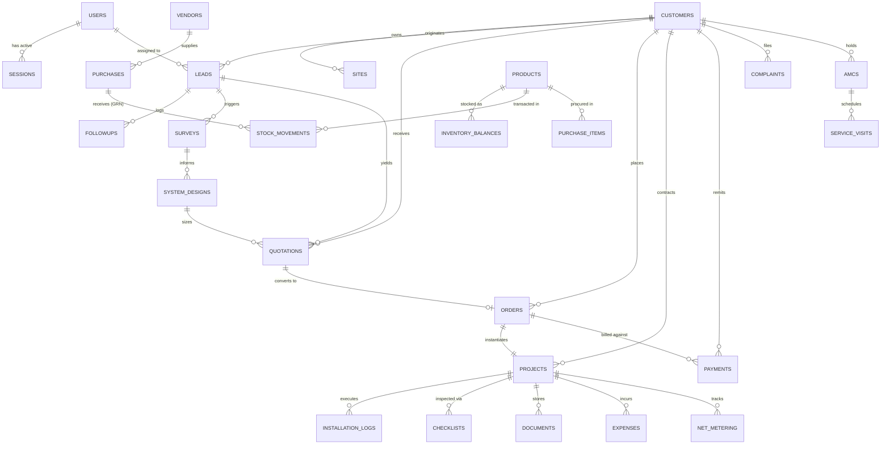

# INS Solar Business Management Software — Database Architecture & Data Design

**Document Reference:** `INS-ARC-DAT-001`  
**Version:** `1.0.0`  
**Status:** Approved Schema Blueprint  
**Primary Database Engine:** MongoDB Atlas (Replica Set, WiredTiger Storage Engine, Snappy Compression)  
**Object-Document Mapper (ODM):** Mongoose 8+ with Strict Schemas and TypeScript Typings  

---

## 1. Data Modeling Philosophy & Integrity Principles

The **INS Solar Business Management Software** data architecture balances the document model's flexibility with strict relational data integrity. It enforces the following core database design principles:

1.  **Reference Over Deep Nesting for Independent Entities:** Entities that possess their own lifecycle, querying patterns, or transactional boundaries (Customers, Quotations, Orders, Projects, Invoices, Inventory Items) are stored in distinct top-level collections and cross-referenced via `ObjectId` references.
2.  **Strategic Embedding for Discrete Snapshots:** Line items, checklist progress checkpoints, and historical discussion logs that never exist independently of their parent document are embedded as subdocument arrays.
3.  **Strict Immutability for Financial & Stock Transactions:** Ledger entries (Stock Movements, Payment Receipts, Invoices, Purchase Orders) are append-only. Corrections require explicit reversing entries or voiding records.
4.  **Zero Floating-Point Financials:** Monetary amounts are stored in base currency units as **Integer Paise** (1 INR = 100 Paise) or using MongoDB `Decimal128` to prevent IEEE 754 floating-point rounding errors.
5.  **Strong Concurrency & Anti-Negative Stock Guards:** Stock balances are updated using atomic conditional operations (`$inc` coupled with `$gte` availability queries) or multi-document ACID transactions.

---

## 2. Entity Relationship Architecture



---

## 3. Core Database Collections & Field Specifications

### 3.1 Security, Users & System Config

#### `users`
Internal staff and administrators.
```typescript
interface IUser {
  _id: ObjectId;
  employeeCode: string;          // e.g. "EMP-0101" (unique, indexed)
  firstName: string;
  lastName: string;
  email: string;                 // unique, lowercase, indexed
  phone: string;                 // unique, E.164 format, indexed
  passwordHash: string;          // Argon2id string
  department: 'ADMIN' | 'SALES' | 'ENGINEERING' | 'OPERATIONS' | 'ACCOUNTS' | 'SERVICE' | 'INVENTORY';
  role: 'SUPERADMIN' | 'ADMIN' | 'DEPARTMENT_HEAD' | 'EXECUTIVE' | 'TECHNICIAN' | 'CUSTOMER';
  permissions: string[];         // Granular permission tokens (e.g. "quote:discount_approve")
  isActive: boolean;             // Default: true
  mfaEnabled: boolean;           // Default: false
  mfaSecretEncrypted?: string;   // AES-256-GCM encrypted TOTP secret
  mfaRecoveryCodesHashed?: string[];
  lastLoginAt?: Date;
  createdAt: Date;
  updatedAt: Date;
}
// Indexes: { email: 1 } (unique), { phone: 1 } (unique), { employeeCode: 1 } (unique), { department: 1, role: 1 }
```

#### `sessions`
Server-managed session state.
```typescript
interface ISession {
  _id: ObjectId;
  sessionId: string;             // Cryptographically random 256-bit token hash (unique, indexed)
  userId: ObjectId;              // Ref -> users._id (indexed)
  role: string;
  ipAddress: string;
  userAgent: string;
  expiresAt: Date;               // TTL index: automatically deleted upon expiration
  createdAt: Date;
}
// Indexes: { sessionId: 1 } (unique), { userId: 1 }, { expiresAt: 1 } (TTL expireAfterSeconds: 0)
```

#### `audit_logs`
Immutable system-wide compliance and security trail.
```typescript
interface IAuditLog {
  _id: ObjectId;
  actorUserId?: ObjectId;        // Ref -> users._id (null for public/system actions)
  action: string;                // e.g. "ORDER_CONFIRMED", "DISCOUNT_APPROVED", "STOCK_VOID"
  entityType: string;            // e.g. "Order", "Quotation", "StockMovement"
  entityId: ObjectId;            // Target document ID
  ipAddress: string;
  userAgent: string;
  correlationId: string;         // Request tracking UUID
  beforeSnapshot?: Record<string, any>;
  afterSnapshot?: Record<string, any>;
  timestamp: Date;
}
// Indexes: { entityType: 1, entityId: 1 }, { actorUserId: 1 }, { timestamp: -1 }, { correlationId: 1 }
```

---

### 3.2 CRM & Solar Engineering Domain

#### `customers`
Master customer directory.
```typescript
interface ICustomer {
  _id: ObjectId;
  customerCode: string;          // e.g. "CUST-2026-00042" (unique, indexed)
  type: 'INDIVIDUAL' | 'COMMERCIAL' | 'INDUSTRIAL' | 'INSTITUTIONAL';
  name: string;                  // Full legal individual or firm name
  primaryPhone: string;          // Indexed
  secondaryPhone?: string;
  email: string;                 // Indexed
  billingAddress: {
    street: string;
    city: string;
    district: string;
    state: string;
    pinCode: string;
  };
  gstin?: string;                // 15-character Indian GSTIN
  pan?: string;                  // 10-character PAN
  portalUserId?: ObjectId;       // Ref -> users._id (optional customer portal login)
  status: 'ACTIVE' | 'INACTIVE' | 'BLACKLISTED';
  createdAt: Date;
  updatedAt: Date;
}
// Indexes: { customerCode: 1 } (unique), { primaryPhone: 1 }, { email: 1 }, { gstin: 1 }
```

#### `sites`
Installation rooftop locations associated with customers.
```typescript
interface ISite {
  _id: ObjectId;
  customerId: ObjectId;          // Ref -> customers._id (indexed)
  siteName: string;              // e.g. "Main Factory Rooftop", "Residence"
  address: {
    street: string;
    city: string;
    state: string;
    pinCode: string;
    geoCoordinates?: { lat: number; lng: number };
  };
  discomName: string;            // e.g. "BESCOM", "MSEDCL"
  consumerNumber: string;        // Utility connection ID
  sanctionedLoadKw: number;
  connectionPhase: 'SINGLE' | 'THREE';
  roofType: 'RCC_FLAT' | 'METAL_SHEET' | 'TILE' | 'ELEVATED' | 'GROUND';
  usableRoofAreaSqFt: number;
  createdAt: Date;
  updatedAt: Date;
}
// Indexes: { customerId: 1 }, { consumerNumber: 1 }
```

#### `leads`
Pre-conversion prospect tracking.
```typescript
interface ILead {
  _id: ObjectId;
  leadCode: string;              // e.g. "LD-2026-00128" (unique, indexed)
  customerId?: ObjectId;         // Ref -> customers._id (if existing customer)
  prospectName: string;
  prospectPhone: string;         // Indexed (checked for duplicates)
  prospectEmail?: string;
  location: {
    city: string;
    state: string;
    pinCode?: string;
  };
  source: 'WEBSITE' | 'REFERRAL' | 'EXPO' | 'COLD_CALL' | 'SOCIAL_MEDIA' | 'OTHER';
  solarRequirement: 'RESIDENTIAL' | 'COMMERCIAL' | 'PUMP' | 'STORAGE_RETROFIT';
  estimatedCapacityKw: number;
  assignedToEmployeeId?: ObjectId; // Ref -> users._id (indexed)
  status: 'NEW' | 'CONTACTED' | 'SURVEY_SCHEDULED' | 'QUOTED' | 'NEGOTIATION' | 'CONVERTED' | 'LOST';
  lostReason?: string;
  createdAt: Date;
  updatedAt: Date;
}
// Indexes: { leadCode: 1 } (unique), { prospectPhone: 1 }, { assignedToEmployeeId: 1 }, { status: 1, createdAt: -1 }
```

#### `quotations`
Commercial project proposals with immutable snapshots.
```typescript
interface IQuotation {
  _id: ObjectId;
  quotationNumber: string;       // e.g. "QT-2026-00055" (base number)
  revisionNumber: number;        // 0 for R0, 1 for R1, etc.
  fullQuotationCode: string;     // "QT-2026-00055-R0" (unique compound index)
  customerId: ObjectId;          // Ref -> customers._id
  siteId: ObjectId;              // Ref -> sites._id
  systemCapacityKw: number;
  systemTopology: 'ON_GRID' | 'OFF_GRID' | 'HYBRID';
  
  // Explicit line items
  lineItems: Array<{
    productId: ObjectId;         // Ref -> products._id
    category: string;
    itemDescription: string;
    hsnCode: string;
    quantity: number;
    unit: string;
    unitPricePaise: number;      // Integer paise
    taxableAmountPaise: number;
    gstRatePercent: number;      // e.g. 12 or 18
    gstAmountPaise: number;
    totalAmountPaise: number;
  }>;

  // Financial Summary (in Paise)
  subtotalPaise: number;
  discountPaise: number;
  discountPercent: number;
  isDiscountApproved: boolean;
  discountApprovedBy?: ObjectId; // Ref -> users._id
  totalGstPaise: number;
  grossTotalPaise: number;

  isGstInvoice: boolean;         // true for GST, false for Non-GST
  validUntil: Date;
  termsAndConditions: string[];
  status: 'DRAFT' | 'PENDING_APPROVAL' | 'APPROVED' | 'SENT' | 'ACCEPTED' | 'REVISED' | 'DECLINED' | 'EXPIRED';
  customerAcceptance?: {
    acceptedAt: Date;
    ipAddress: string;
    signatureUrl?: string;
  };
  createdBy: ObjectId;           // Ref -> users._id
  createdAt: Date;
  updatedAt: Date;
}
// Indexes: { fullQuotationCode: 1 } (unique), { quotationNumber: 1, revisionNumber: -1 }, { customerId: 1 }, { status: 1 }
```

---

### 3.3 Orders & Multi-Location Supply Chain

#### `orders`
Confirmed sales contracts locking prices and BOM.
```typescript
interface IOrder {
  _id: ObjectId;
  orderCode: string;             // e.g. "ORD-2026-00034" (unique, indexed)
  customerId: ObjectId;          // Ref -> customers._id
  quotationId: ObjectId;         // Ref -> quotations._id (accepted revision)
  projectId?: ObjectId;          // Ref -> projects._id (linked project)
  systemCapacityKw: number;
  systemTopology: 'ON_GRID' | 'OFF_GRID' | 'HYBRID';
  totalOrderValuePaise: number;  // Immutable contracted gross amount
  advanceReceivedPaise: number;
  totalCollectedPaise: number;
  outstandingBalancePaise: number;
  paymentStatus: 'ADVANCE_PENDING' | 'PARTIALLY_PAID' | 'FULLY_PAID';
  installationStatus: 'NOT_STARTED' | 'IN_PROGRESS' | 'COMPLETED' | 'ON_HOLD';
  orderDate: Date;
  status: 'CONFIRMED' | 'ACTIVE' | 'COMPLETED' | 'CANCELLED';
  createdAt: Date;
  updatedAt: Date;
}
// Indexes: { orderCode: 1 } (unique), { customerId: 1 }, { quotationId: 1 }, { status: 1 }
```

#### `products`
Hardware component master catalog.
```typescript
interface IProduct {
  _id: ObjectId;
  itemCode: string;              // e.g. "MOD-550-MONO" (unique, indexed)
  name: string;
  category: 'SOLAR_PANEL' | 'INVERTER' | 'BATTERY' | 'STRUCTURE' | 'CABLE' | 'SWITCHGEAR' | 'EARTHING' | 'ACCESSORY';
  brand: string;
  model: string;
  uom: 'NOS' | 'SETS' | 'METERS' | 'KG' | 'PAIRS';
  hsnCode: string;
  defaultGstRate: number;        // e.g. 12
  standardPurchaseRatePaise: number;
  standardSellingRatePaise: number;
  specifications: Record<string, any>; // Polymorphic technical metadata
  minimumStockThreshold: number;
  isActive: boolean;
  createdAt: Date;
  updatedAt: Date;
}
// Indexes: { itemCode: 1 } (unique), { category: 1 }, { brand: 1 }
```

#### `inventory_balances`
Multi-location real-time stock balances.
```typescript
interface IInventoryBalance {
  _id: ObjectId;
  productId: ObjectId;           // Ref -> products._id
  locationType: 'WAREHOUSE' | 'INSTALLATION_SITE' | 'EMPLOYEE_ISSUED';
  locationId: string;            // e.g. "MAIN_DEPOT", ProjectId, or EmployeeId
  physicalQuantity: number;      // Physically on hand
  reservedQuantity: number;      // Locked against confirmed orders
  // Available Quantity is calculated: physicalQuantity - reservedQuantity
  updatedAt: Date;
}
// Compound Unique Index: { productId: 1, locationType: 1, locationId: 1 } (guarantees one balance record per location)
```

#### `stock_movements`
Immutable append-only ledger for every material transaction.
```typescript
interface IStockMovement {
  _id: ObjectId;
  movementCode: string;          // e.g. "STK-2026-00512" (unique, indexed)
  productId: ObjectId;           // Ref -> products._id
  sourceLocationType?: 'WAREHOUSE' | 'INSTALLATION_SITE' | 'EMPLOYEE_ISSUED' | 'VENDOR';
  sourceLocationId?: string;
  destLocationType?: 'WAREHOUSE' | 'INSTALLATION_SITE' | 'EMPLOYEE_ISSUED' | 'CUSTOMER_ROOF';
  destLocationId?: string;
  quantity: number;
  movementType: 'GRN_RECEIPT' | 'SITE_DISPATCH' | 'EMPLOYEE_ISSUE' | 'RETURN_TO_DEPOT' | 'ADJUSTMENT_WRITE_OFF';
  referenceEntityType: 'PURCHASE_ORDER' | 'ORDER' | 'PROJECT' | 'SERVICE_TICKET' | 'MANUAL';
  referenceEntityId?: ObjectId;
  serializedIdentifiers?: string[]; // Array of module barcodes or inverter serials
  performedByUserId: ObjectId;   // Ref -> users._id
  remarks?: string;
  timestamp: Date;
}
// Indexes: { productId: 1, timestamp: -1 }, { movementCode: 1 } (unique), { referenceEntityId: 1 }
```

---

### 3.4 Project Operations & Field Execution

#### `projects`
Operational execution lifecycle for confirmed customer installations.
```typescript
interface IProject {
  _id: ObjectId;
  projectCode: string;           // e.g. "PRJ-2026-00034" (unique, indexed)
  orderId: ObjectId;             // Ref -> orders._id (unique 1:1 binding)
  customerId: ObjectId;          // Ref -> customers._id
  siteId: ObjectId;              // Ref -> sites._id
  systemCapacityKw: number;
  systemTopology: 'ON_GRID' | 'OFF_GRID' | 'HYBRID';
  projectManagerId: ObjectId;    // Ref -> users._id
  allocatedTeamCrewIds: ObjectId[]; // Array of users._id
  
  currentStage: 
    | 'STAGE_1_ENGINEERING_DESIGN'
    | 'STAGE_2_NET_METERING_APPLY'
    | 'STAGE_3_MATERIAL_DISPATCH'
    | 'STAGE_4_CIVIL_STRUCTURE'
    | 'STAGE_5_MODULE_DC_CABLING'
    | 'STAGE_6_INVERTER_ACDB'
    | 'STAGE_7_EARTHING_LIGHTNING'
    | 'STAGE_8_TESTING_PRE_COMMISSION'
    | 'STAGE_9_DISCOM_METER_INSTALL'
    | 'STAGE_10_COMMISSION_HANDOVER';

  stageHistory: Array<{
    stage: string;
    startedAt: Date;
    completedAt?: Date;
    approvedByUserId?: ObjectId;
    remarks?: string;
  }>;

  scheduledStartDate: Date;
  scheduledCompletionDate: Date;
  actualCommissioningDate?: Date;
  overallStatus: 'PLANNING' | 'IN_PROGRESS' | 'ON_HOLD' | 'COMPLETED' | 'CANCELLED';
  createdAt: Date;
  updatedAt: Date;
}
// Indexes: { projectCode: 1 } (unique), { orderId: 1 } (unique), { projectManagerId: 1 }, { overallStatus: 1 }
```

#### `installation_checklists`
Quality gates and photographic evidence per project stage.
```typescript
interface IInstallationChecklist {
  _id: ObjectId;
  projectId: ObjectId;           // Ref -> projects._id
  category: 'SITE_PREPARATION' | 'STRUCTURE_MOUNTING' | 'PANEL_INSTALLATION' | 'INVERTER_ELECTRICAL' | 'EARTHING_SAFETY';
  checklistItems: Array<{
    itemKey: string;             // e.g. "torque_verified", "dc_polarity_checked"
    title: string;
    passed: boolean;
    measuredValue?: string;      // e.g. "1.8 Ohms", "620V Voc"
    remarks?: string;
  }>;
  photos: Array<{
    documentId: ObjectId;        // Ref -> documents._id
    caption: string;
    uploadedAt: Date;
  }>;
  inspectedByUserId: ObjectId;   // Ref -> users._id
  approvedByProjectManagerId?: ObjectId;
  isApproved: boolean;
  approvedAt?: Date;
  createdAt: Date;
  updatedAt: Date;
}
// Indexes: { projectId: 1, category: 1 } (unique compound)
```

---

### 3.5 Financial Ledgers & Commercial Records

#### `payments`
Cash collection vouchers and receipts.
```typescript
interface IPayment {
  _id: ObjectId;
  receiptCode: string;          // e.g. "REC-2026-00089" (unique, indexed)
  customerId: ObjectId;          // Ref -> customers._id
  projectId?: ObjectId;          // Ref -> projects._id
  orderId?: ObjectId;            // Ref -> orders._id
  amountPaise: number;           // Integer paise
  paymentDate: Date;
  paymentMode: 'NEFT_RTGS' | 'UPI_IMPS' | 'CHEQUE' | 'ONLINE_GATEWAY' | 'CASH';
  transactionReference: string;  // Unique bank UTR, cheque number, or gateway ID (indexed)
  idempotencyKey: string;        // UUID from client preventing duplicate submission (unique, indexed)
  receivedByUserId: ObjectId;    // Ref -> users._id
  status: 'PENDING_CLEARANCE' | 'CLEARED' | 'BOUNCED' | 'REFUNDED';
  reversalReason?: string;
  createdAt: Date;
  updatedAt: Date;
}
// Indexes: { receiptCode: 1 } (unique), { idempotencyKey: 1 } (unique), { transactionReference: 1 }, { customerId: 1 }
```

#### `expenses`
Operational expenditures and project-level cost logging.
```typescript
interface IExpense {
  _id: ObjectId;
  expenseCode: string;          // e.g. "EXP-2026-00215" (unique, indexed)
  category: 'TRAVEL_FUEL' | 'FREIGHT' | 'CRANE' | 'CIVIL_MATERIAL' | 'LABOR_SUBCONTRACT' | 'LIAISON_INSPECTION' | 'CONSUMABLES' | 'GENERAL_OVERHEAD';
  projectId?: ObjectId;          // Ref -> projects._id (null for general overhead)
  amountPaise: number;           // Integer paise
  expenseDate: Date;
  paymentMode: 'COMPANY_CARD' | 'BANK_TRANSFER' | 'PETTY_CASH' | 'EMPLOYEE_REIMBURSE';
  claimedByUserId: ObjectId;     // Ref -> users._id
  vendorId?: ObjectId;           // Ref -> vendors._id
  receiptDocumentId?: ObjectId;  // Ref -> documents._id
  description: string;
  isApproved: boolean;
  approvedByUserId?: ObjectId;   // Ref -> users._id
  createdAt: Date;
  updatedAt: Date;
}
// Indexes: { expenseCode: 1 } (unique), { projectId: 1 }, { category: 1 }, { expenseDate: -1 }
```

---

## 4. Concurrency Control & Atomic Transactions

### 4.1 Safe Multi-Location Inventory Allocation
To satisfy the mandatory requirement that **negative stock is strictly blocked** under concurrent conditions, inventory decrement operations never perform read-then-write loops. Instead, they execute atomic conditional writes:

```javascript
// Example: Atomic Stock Decrement with Safe Guard
const result = await InventoryBalance.updateOne(
  {
    productId: targetProductId,
    locationType: 'WAREHOUSE',
    locationId: 'MAIN_DEPOT',
    physicalQuantity: { $gte: requiredQuantity } // Hard guard preventing negative balance
  },
  {
    $inc: { physicalQuantity: -requiredQuantity }
  }
);

if (result.matchedCount === 0) {
  throw new InsufficientStockError(`Insufficient warehouse stock for item ${targetProductId}`);
}
```

### 4.2 Two-Phase Stock Reservation & Issue Lifecycle

```mermaid
stateDiagram-v2
    [*] --> Available: Stock Procured via GRN
    Available --> Reserved: Order Confirmed ($inc reservedQuantity)
    Reserved --> Available: Order Cancelled ($inc reservedQuantity: -qty)
    Reserved --> IssuedToSite: Material Dispatched to Roof ($inc reserved, physical at Depot; $inc at Site)
    IssuedToSite --> Commissioned: Project Handed Over (Stock consumed from site balance)
    Commissioned --> [*]
```


### 4.3 Multi-Document ACID Transactions
Critical multi-entity operations—such as confirming an order (updating order status, creating project record, reserving inventory balances, and logging audit entry)—execute inside a native **MongoDB ClientSession Transaction** with `readConcern: "majority"` and `writeConcern: "majority"`.

---

## 5. Audit Logging, Data Retention & Unresolved Decisions

### 5.1 Append-Only Audit Logging
All state modifications on critical business records (Quotations, Orders, Invoices, Payments, Inventory) emit structured audit records to `audit_logs` storing:
*   Before and after document deltas.
*   Actor user identity and IP address.
*   Trace correlation ID linking HTTP requests to database changes.

### 5.2 Data Retention & Archival
*   **Active Records:** Retained indefinitely in primary collections for the company's operational lifetime.
*   **Audit Logs:** Hot retention in Atlas for 2 years; automated weekly ETL offloads older logs to compressed S3 Glacier parquet files.
*   **Soft Deletes:** Master entities (Users, Customers, Products) use `isActive: false` flags. Hard deletion is forbidden to preserve historical relational integrity.

### 5.3 Documented Architectural Decisions & Tax Engine Alignment
1.  **Multi-Component Date-Effective Tax Engine (DEC-01):** As mandated in [open-decisions-and-risks.md](file:///d:/My%20project/Solar%20Business%20Management%20Software/docs/planning/open-decisions-and-risks.md), no statutory tax formula, split percentage (such as 70:30), or effective tax rate is hardcoded. Quotations compute estimates using date-effective tax profiles, while legally issued Tax Invoices permanently snapshot applied tax components (CGST, SGST, IGST, cess), HSN/SAC codes, and line-item amounts in base integer paise. Applicable GST treatment must be confirmed by the company's chartered accountant before production use.
2.  **Technician Tool Kit Tracking:** Field technician tools (multimeters, torque wrenches, crimping tools, ladder harnesses) are modeled in `products` with category `TOOL_ASSET` to leverage the established multi-location inventory tracking engine across employee custodianship.

