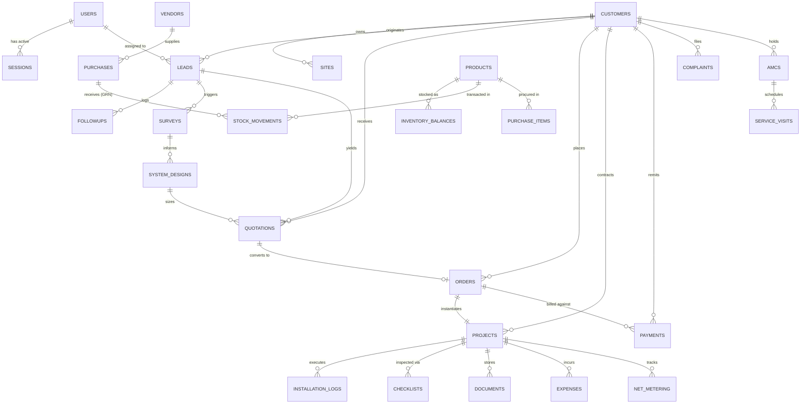

# INS Solar Business Management Software — Database Architecture & Data Design

**Document Reference:** `INS-ARC-DAT-001`  
**Version:** `1.0.0`  
**Status:** Approved Schema Blueprint  
**Primary Database Engine:** MongoDB Atlas (Replica Set, WiredTiger Storage Engine, Snappy Compression)  
**Object-Document Mapper (ODM):** Mongoose 8+ with Strict Schemas and TypeScript Typings  

---

## 1. Data Modeling Philosophy & Integrity Principles

The **INS Solar Business Management Software** data architecture balances the document model's flexibility with strict relational data integrity. It enforces the following core database design principles:

1.  **Reference Over Deep Nesting for Independent Entities:** Entities that possess their own lifecycle, querying patterns, or transactional boundaries (Customers, Quotations, Orders, Projects, Invoices, Inventory Items) are stored in distinct top-level collections and cross-referenced via `ObjectId` references.
2.  **Strategic Embedding for Discrete Snapshots:** Line items, checklist progress checkpoints, and historical discussion logs that never exist independently of their parent document are embedded as subdocument arrays.
3.  **Strict Immutability for Financial & Stock Transactions:** Ledger entries (Stock Movements, Payment Receipts, Invoices, Purchase Orders) are append-only. Corrections require explicit reversing entries or voiding records.
4.  **Zero Floating-Point Financials:** Monetary amounts are stored in base currency units as **Integer Paise** (1 INR = 100 Paise) or using MongoDB `Decimal128` to prevent IEEE 754 floating-point rounding errors.
5.  **Strong Concurrency & Anti-Negative Stock Guards:** Stock balances are updated using atomic conditional operations (`$inc` coupled with `$gte` availability queries) or multi-document ACID transactions.

---

## 2. Entity Relationship Architecture



---

## 3. Core Database Collections & Field Specifications

### 3.1 Security, Users & System Config

#### `users`
Internal staff and administrators.
```typescript
interface IUser {
  _id: ObjectId;
  employeeCode: string;          // e.g. "EMP-0101" (unique, indexed)
  firstName: string;
  lastName: string;
  email: string;                 // unique, lowercase, indexed
  phone: string;                 // unique, E.164 format, indexed
  passwordHash: string;          // Argon2id string
  department: 'ADMIN' | 'SALES' | 'ENGINEERING' | 'OPERATIONS' | 'ACCOUNTS' | 'SERVICE' | 'INVENTORY';
  role: 'SUPERADMIN' | 'ADMIN' | 'DEPARTMENT_HEAD' | 'EXECUTIVE' | 'TECHNICIAN' | 'CUSTOMER';
  permissions: string[];         // Granular permission tokens (e.g. "quote:discount_approve")
  isActive: boolean;             // Default: true
  mfaEnabled: boolean;           // Default: false
  mfaSecretEncrypted?: string;   // AES-256-GCM encrypted TOTP secret
  mfaRecoveryCodesHashed?: string[];
  lastLoginAt?: Date;
  createdAt: Date;
  updatedAt: Date;
}
// Indexes: { email: 1 } (unique), { phone: 1 } (unique), { employeeCode: 1 } (unique), { department: 1, role: 1 }
```

#### `sessions`
Server-managed session state.
```typescript
interface ISession {
  _id: ObjectId;
  sessionId: string;             // Cryptographically random 256-bit token hash (unique, indexed)
  userId: ObjectId;              // Ref -> users._id (indexed)
  role: string;
  ipAddress: string;
  userAgent: string;
  expiresAt: Date;               // TTL index: automatically deleted upon expiration
  createdAt: Date;
}
// Indexes: { sessionId: 1 } (unique), { userId: 1 }, { expiresAt: 1 } (TTL expireAfterSeconds: 0)
```

#### `audit_logs`
Immutable system-wide compliance and security trail.
```typescript
interface IAuditLog {
  _id: ObjectId;
  actorUserId?: ObjectId;        // Ref -> users._id (null for public/system actions)
  action: string;                // e.g. "ORDER_CONFIRMED", "DISCOUNT_APPROVED", "STOCK_VOID"
  entityType: string;            // e.g. "Order", "Quotation", "StockMovement"
  entityId: ObjectId;            // Target document ID
  ipAddress: string;
  userAgent: string;
  correlationId: string;         // Request tracking UUID
  beforeSnapshot?: Record<string, any>;
  afterSnapshot?: Record<string, any>;
  timestamp: Date;
}
// Indexes: { entityType: 1, entityId: 1 }, { actorUserId: 1 }, { timestamp: -1 }, { correlationId: 1 }
```

---

### 3.2 CRM & Solar Engineering Domain

#### `customers`
Master customer directory.
```typescript
interface ICustomer {
  _id: ObjectId;
  customerCode: string;          // e.g. "CUST-2026-00042" (unique, indexed)
  type: 'INDIVIDUAL' | 'COMMERCIAL' | 'INDUSTRIAL' | 'INSTITUTIONAL';
  name: string;                  // Full legal individual or firm name
  primaryPhone: string;          // Indexed
  secondaryPhone?: string;
  email: string;                 // Indexed
  billingAddress: {
    street: string;
    city: string;
    district: string;
    state: string;
    pinCode: string;
  };
  gstin?: string;                // 15-character Indian GSTIN
  pan?: string;                  // 10-character PAN
  portalUserId?: ObjectId;       // Ref -> users._id (optional customer portal login)
  status: 'ACTIVE' | 'INACTIVE' | 'BLACKLISTED';
  createdAt: Date;
  updatedAt: Date;
}
// Indexes: { customerCode: 1 } (unique), { primaryPhone: 1 }, { email: 1 }, { gstin: 1 }
```

#### `sites`
Installation rooftop locations associated with customers.
```typescript
interface ISite {
  _id: ObjectId;
  customerId: ObjectId;          // Ref -> customers._id (indexed)
  siteName: string;              // e.g. "Main Factory Rooftop", "Residence"
  address: {
    street: string;
    city: string;
    state: string;
    pinCode: string;
    geoCoordinates?: { lat: number; lng: number };
  };
  discomName: string;            // e.g. "BESCOM", "MSEDCL"
  consumerNumber: string;        // Utility connection ID
  sanctionedLoadKw: number;
  connectionPhase: 'SINGLE' | 'THREE';
  roofType: 'RCC_FLAT' | 'METAL_SHEET' | 'TILE' | 'ELEVATED' | 'GROUND';
  usableRoofAreaSqFt: number;
  createdAt: Date;
  updatedAt: Date;
}
// Indexes: { customerId: 1 }, { consumerNumber: 1 }
```

#### `leads`
Pre-conversion prospect tracking.
```typescript
interface ILead {
  _id: ObjectId;
  leadCode: string;              // e.g. "LD-2026-00128" (unique, indexed)
  customerId?: ObjectId;         // Ref -> customers._id (if existing customer)
  prospectName: string;
  prospectPhone: string;         // Indexed (checked for duplicates)
  prospectEmail?: string;
  location: {
    street?: string;
    city: string;
    district?: string;
    state: string;
    pinCode?: string;
    geoCoordinates?: { latitude: number; longitude: number };
  };
  source: 'WEBSITE' | 'REFERRAL' | 'EXPO' | 'COLD_CALL' | 'SOCIAL_MEDIA' | 'CHANNEL_PARTNER' | 'OTHER';
  solarRequirement: 'RESIDENTIAL' | 'COMMERCIAL' | 'INDUSTRIAL' | 'PUMP' | 'STORAGE_RETROFIT' | 'OTHER';
  estimatedCapacityKw?: number;
  assignedToEmployeeId?: ObjectId; // Ref -> users._id (indexed)
  status: 'NEW' | 'CONTACTED' | 'SURVEY_SCHEDULED' | 'QUOTED' | 'NEGOTIATION' | 'CONVERTED' | 'LOST';
  lostReason?: string;
  priority: 'LOW' | 'MEDIUM' | 'HIGH' | 'URGENT';
  notes?: string;
  nextFollowUpDate?: Date;
  isActive: boolean;
  convertedCustomerId?: ObjectId;  // Ref -> customers._id (populated upon explicit conversion)
  convertedAt?: Date;
  createdBy?: ObjectId;
  updatedBy?: ObjectId;
  createdAt: Date;
  updatedAt: Date;
}
// Indexes: { leadCode: 1 } (unique), { prospectPhone: 1 }, { assignedToEmployeeId: 1 }, { status: 1, createdAt: -1 }
```

#### `lead_activities`
Chronological interaction timeline and scheduled sales follow-ups.
```typescript
interface ILeadActivity {
  _id: ObjectId;
  leadId: ObjectId;              // Ref -> leads._id (indexed)
  customerId?: ObjectId;         // Ref -> customers._id
  activityType: 'CALL' | 'MEETING' | 'SITE_VISIT' | 'NOTE' | 'FOLLOW_UP' | 'WHATSAPP' | 'EMAIL';
  summary: string;
  remarks?: string;
  activityDate: Date;
  nextFollowUpDate?: Date;       // Indexed for due/overdue queries
  assignedEmployeeId?: ObjectId; // Ref -> users._id
  status: 'SCHEDULED' | 'COMPLETED' | 'RESCHEDULED' | 'CANCELLED';
  sentiment?: 'HOT' | 'WARM' | 'COLD';
  completedAt?: Date;
  createdBy?: ObjectId;          // Ref -> users._id
  createdAt: Date;
  updatedAt: Date;
}
// Indexes: { leadId: 1, createdAt: -1 }, { assignedEmployeeId: 1, nextFollowUpDate: 1, status: 1 }, { status: 1, nextFollowUpDate: 1 }
```

#### `site_surveys`
Physical rooftop feasibility, shadow analysis, electrical parameters, and photographic evidence.
```typescript
interface ISiteSurvey {
  _id: ObjectId;
  surveyNumber: string;          // e.g. "SRV-2026-00001" (unique, indexed)
  leadId: ObjectId;              // Ref -> leads._id (indexed)
  customerId?: ObjectId;         // Ref -> customers._id (indexed)
  siteAddress: IAddressSubdocument;
  roofType: 'RCC_FLAT' | 'METAL_SHEET' | 'TILE' | 'ELEVATED' | 'GROUND';
  usableRoofAreaSqFt: number;    // Non-negative
  grossRoofAreaSqFt?: number;
  monthlyUnitsKwh?: number;
  averageMonthlyBillPaise?: number; // Integer paise (Rs. 1 = 100 paise)
  sanctionedLoadKw: number;      // Strictly positive
  connectionPhase: 'SINGLE' | 'THREE';
  shadowAnalysisNotes?: string;
  orientationAzimuth?: string;
  proposedCapacityKw?: number;
  surveyorEmployeeId?: ObjectId; // Ref -> users._id
  status: 'DRAFT' | 'SCHEDULED' | 'IN_PROGRESS' | 'COMPLETED' | 'REJECTED' | 'CANCELLED';
  scheduledDate?: Date;
  completedDate?: Date;
  observations?: string;
  constraints?: string;
  recommendations?: string;
  photos: Array<{
    storageKey: string;          // Private object reference (no image binary stored in MongoDB)
    fileName: string;
    fileSizeBytes: number;
    mimeType: string;
    category: 'ROOF' | 'DISTRIBUTION_BOARD' | 'METER' | 'EARTHING_PIT' | 'SHADOW_OBSTRUCTION' | 'OTHER';
    caption?: string;
    geoCoordinates?: { latitude: number; longitude: number };
    uploadedBy?: ObjectId;
    uploadedAt: Date;
  }>;
  createdBy?: ObjectId;
  updatedBy?: ObjectId;
  createdAt: Date;
  updatedAt: Date;
}
// Indexes: { surveyNumber: 1 } (unique), { leadId: 1, createdAt: -1 }, { status: 1, createdAt: -1 }, { surveyorEmployeeId: 1, status: 1 }
```

#### `solar_designs`
Technical sizing records and PV plant configurations for On-Grid, Off-Grid, and Hybrid plants.
```typescript
interface ISolarDesign {
  _id: ObjectId;
  designNumber: string;          // e.g. "DES-2026-00001" (unique, indexed)
  customerId: ObjectId;          // Ref -> customers._id (indexed)
  leadId?: ObjectId;             // Ref -> leads._id (indexed)
  surveyId?: ObjectId;           // Ref -> site_surveys._id (indexed)
  designName: string;
  systemTopology: 'ON_GRID' | 'OFF_GRID' | 'HYBRID';
  proposedCapacityKwp: number;   // DC capacity in kWp

  module: {
    productId: ObjectId;         // Ref -> products._id
    name: string;
    sku: string;
    wattageWp: number;
    quantity: number;
    totalDcCapacityKwp: number;
  };
  inverter: {
    productId: ObjectId;         // Ref -> products._id
    name: string;
    sku: string;
    ratedCapacityKw: number;
    quantity: number;
    actualDcAcRatio: number;     // e.g. 1.20
  };
  battery?: {
    productId?: ObjectId;        // Ref -> products._id
    batteryType: string;
    unitVoltageV: number;
    unitCapacityAh: number;
    quantity: number;
    totalStorageKwh: number;
    autonomyDays: number;
  };
  structure: {
    roofType: 'RCC_FLAT' | 'METAL_SHEET' | 'TILE' | 'ELEVATED' | 'GROUND';
    structureType: string;
    tiltAngleDegrees: number;
    azimuthOrientation: string;
  };
  estimatedGeneration: {
    dailyGenerationKwh: number;
    monthlyGenerationKwh: number;
    annualGenerationKwh: number;
    specificYieldKwhPerKwp: number;
  };
  assumptions: {
    peakSunHoursPerDay: number;
    performanceRatioPercent: number;
    assumptionsSource: string;
  };
  warnings: string[];
  disclaimer: string;
  engineeringNotes?: string;
  createdBy: ObjectId;           // Ref -> users._id
  updatedBy?: ObjectId;
  createdAt: Date;
  updatedAt: Date;
}
// Indexes: { designNumber: 1 } (unique), { customerId: 1, createdAt: -1 }, { leadId: 1 }, { surveyId: 1 }, { systemTopology: 1 }
```

#### `quotations`
Commercial proposals with immutable revision snapshots (`QT-YYYY-NNNNN-R0`, `R1`, etc.), integer paise financials, and approval tracking.
```typescript
interface IQuotation {
  _id: ObjectId;
  quotationNumber: string;       // e.g. "QT-2026-00001"
  revisionNumber: number;        // 0 for R0, 1 for R1, etc.
  fullQuotationCode: string;     // e.g. "QT-2026-00001-R0" (unique, indexed)
  parentQuotationId?: ObjectId;  // Ref -> quotations._id
  isLatestRevision: boolean;
  status:
    | 'DRAFT'
    | 'PENDING_APPROVAL'
    | 'APPROVED'
    | 'SENT'
    | 'ACCEPTED'
    | 'REJECTED'
    | 'REVISED'
    | 'EXPIRED'
    | 'CANCELLED';

  customerId: ObjectId;          // Ref -> customers._id
  leadId?: ObjectId;             // Ref -> leads._id
  solarDesignId?: ObjectId;      // Ref -> solar_designs._id

  systemTopology: 'ON_GRID' | 'OFF_GRID' | 'HYBRID';
  systemCapacityKwp: number;

  // Itemized Bill of Materials (all monetary values in Integer Paise)
  lineItems: Array<{
    itemType: 'SOLAR_MODULE' | 'INVERTER' | 'BATTERY' | 'STRUCTURE' | 'BOS_ELECTRICAL' | 'INSTALLATION_LABOUR' | 'OTHER';
    productId?: ObjectId;        // Ref -> products._id
    skuSnapshot?: string;
    description: string;
    quantity: number;
    unit: string;
    unitRatePaise: number;       // Integer paise
    discountPaise: number;
    taxableAmountPaise: number;
    gstRateBasisPoints: number;  // e.g. 1200 for 12%, 1800 for 18%
    taxPaise: number;
    itemTotalPaise: number;
  }>;

  // Commercial Financial Summary (Integer Paise)
  grossSubtotalPaise: number;
  additionalDiscountPaise: number;
  totalDiscountPaise: number;
  discountPercent: number;
  requiresDiscountApproval: boolean;
  discountApprovalStatus: 'PENDING' | 'APPROVED' | 'REJECTED' | 'NOT_REQUIRED';
  discountApprovedBy?: ObjectId; // Ref -> users._id (Anti-self-approval enforced)
  discountApprovedAt?: Date;
  discountRemarks?: string;
  discountRejectionReason?: string;

  taxableAmountPaise: number;
  totalTaxPaise: number;
  taxComponents: Array<{
    componentName: string;       // 'CGST', 'SGST', 'IGST'
    rateBasisPoints: number;
    taxAmountPaise: number;
  }>;
  netTotalPaise: number;

  taxProfile: {
    profileName: string;
    profileCode: string;
    effectiveDate: string;
    isInterState: boolean;
    accountingNotice: string;
  };

  paymentMilestones: Array<{
    name: string;
    percentage: number;
    description: string;
  }>;
  termsAndConditions: string[];
  validUntil: Date;

  // Customer Review & Acceptance
  isAccepted: boolean;
  acceptedAt?: Date;
  decisionIpAddress?: string;
  customerNotes?: string;
  rejectionReason?: string;

  createdBy: ObjectId;           // Ref -> users._id
  updatedBy?: ObjectId;
  createdAt: Date;
  updatedAt: Date;
}
// Indexes: { fullQuotationCode: 1 } (unique), { quotationNumber: 1, revisionNumber: -1 }, { customerId: 1, status: 1 }, { requiresDiscountApproval: 1, discountApprovalStatus: 1 }, { status: 1, validUntil: 1 }
```

---

### 3.3 Orders & Multi-Location Supply Chain

#### `orders`
Confirmed sales contracts locking prices and BOM.
```typescript
interface IOrder {
  _id: ObjectId;
  orderCode: string;             // e.g. "ORD-2026-00034" (unique, indexed)
  customerId: ObjectId;          // Ref -> customers._id
  quotationId: ObjectId;         // Ref -> quotations._id (accepted revision)
  projectId?: ObjectId;          // Ref -> projects._id (linked project)
  systemCapacityKw: number;
  systemTopology: 'ON_GRID' | 'OFF_GRID' | 'HYBRID';
  totalOrderValuePaise: number;  // Immutable contracted gross amount
  advanceReceivedPaise: number;
  totalCollectedPaise: number;
  outstandingBalancePaise: number;
  paymentStatus: 'ADVANCE_PENDING' | 'PARTIALLY_PAID' | 'FULLY_PAID';
  installationStatus: 'NOT_STARTED' | 'IN_PROGRESS' | 'COMPLETED' | 'ON_HOLD';
  orderDate: Date;
  status: 'CONFIRMED' | 'ACTIVE' | 'COMPLETED' | 'CANCELLED';
  createdAt: Date;
  updatedAt: Date;
}
// Indexes: { orderCode: 1 } (unique), { customerId: 1 }, { quotationId: 1 }, { status: 1 }
```

#### `products`
Hardware component master catalog.
```typescript
interface IProduct {
  _id: ObjectId;
  itemCode: string;              // e.g. "MOD-550-MONO" (unique, indexed)
  name: string;
  category: 'SOLAR_PANEL' | 'INVERTER' | 'BATTERY' | 'STRUCTURE' | 'CABLE' | 'SWITCHGEAR' | 'EARTHING' | 'ACCESSORY';
  brand: string;
  model: string;
  uom: 'NOS' | 'SETS' | 'METERS' | 'KG' | 'PAIRS';
  hsnCode: string;
  defaultGstRate: number;        // e.g. 12
  standardPurchaseRatePaise: number;
  standardSellingRatePaise: number;
  specifications: Record<string, any>; // Polymorphic technical metadata
  minimumStockThreshold: number;
  isActive: boolean;
  createdAt: Date;
  updatedAt: Date;
}
// Indexes: { itemCode: 1 } (unique), { category: 1 }, { brand: 1 }
```

#### `inventory_balances`
Multi-location real-time stock balances.
```typescript
interface IInventoryBalance {
  _id: ObjectId;
  productId: ObjectId;           // Ref -> products._id
  locationType: 'WAREHOUSE' | 'INSTALLATION_SITE' | 'EMPLOYEE_ISSUED';
  locationId: string;            // e.g. "MAIN_DEPOT", ProjectId, or EmployeeId
  physicalQuantity: number;      // Physically on hand
  reservedQuantity: number;      // Locked against confirmed orders
  // Available Quantity is calculated: physicalQuantity - reservedQuantity
  updatedAt: Date;
}
// Compound Unique Index: { productId: 1, locationType: 1, locationId: 1 } (guarantees one balance record per location)
```

#### `stock_movements`
Immutable append-only ledger for every material transaction.
```typescript
interface IStockMovement {
  _id: ObjectId;
  movementCode: string;          // e.g. "STK-2026-00512" (unique, indexed)
  productId: ObjectId;           // Ref -> products._id
  sourceLocationType?: 'WAREHOUSE' | 'INSTALLATION_SITE' | 'EMPLOYEE_ISSUED' | 'VENDOR';
  sourceLocationId?: string;
  destLocationType?: 'WAREHOUSE' | 'INSTALLATION_SITE' | 'EMPLOYEE_ISSUED' | 'CUSTOMER_ROOF';
  destLocationId?: string;
  quantity: number;
  movementType: 'GRN_RECEIPT' | 'SITE_DISPATCH' | 'EMPLOYEE_ISSUE' | 'RETURN_TO_DEPOT' | 'ADJUSTMENT_WRITE_OFF';
  referenceEntityType: 'PURCHASE_ORDER' | 'ORDER' | 'PROJECT' | 'SERVICE_TICKET' | 'MANUAL';
  referenceEntityId?: ObjectId;
  serializedIdentifiers?: string[]; // Array of module barcodes or inverter serials
  performedByUserId: ObjectId;   // Ref -> users._id
  remarks?: string;
  timestamp: Date;
}
// Indexes: { productId: 1, timestamp: -1 }, { movementCode: 1 } (unique), { referenceEntityId: 1 }
```

#### `vendors`
Supplier master catalog with commercial, tax, and banking details.
```typescript
interface IVendor {
  _id: ObjectId;
  vendorCode: string;             // e.g. "VEN-2026-00001" (unique, indexed)
  name: string;                   // Legal firm name (indexed)
  contactPerson?: string;
  email?: string;
  phone?: string;
  address?: {
    addressLine1: string;
    addressLine2?: string;
    city: string;
    state: string;
    postalCode: string;
    country: string;
  };
  gstin?: string;                 // 15-char Indian GSTIN (sparse unique index)
  pan?: string;                   // 10-char PAN
  suppliedCategoryIds: ObjectId[];// Ref -> product_categories._id
  suppliedProductIds: ObjectId[]; // Ref -> products._id
  paymentTermsDays: number;       // Default net days (e.g. 30)
  bankDetails?: {
    accountName?: string;
    accountNumber?: string;
    ifscCode?: string;
    bankName?: string;
  };
  leadTimeDays?: number;
  notes?: string;
  isActive: boolean;
  hasPurchaseHistory: boolean;    // Guard flag preventing deletion if purchase records exist
  createdBy: ObjectId;            // Ref -> users._id
  updatedBy?: ObjectId;
  createdAt: Date;
  updatedAt: Date;
}
// Indexes: { vendorCode: 1 } (unique), { name: 1 }, { gstin: 1 } (sparse unique), { isActive: 1 }
```

#### `purchase_orders`
Official procurement commitments with integer paise calculations and approval controls.
```typescript
interface IPurchaseOrder {
  _id: ObjectId;
  poNumber: string;               // e.g. "PO-2026-00001" (unique, indexed)
  vendorId: ObjectId;             // Ref -> vendors._id (indexed)
  destinationWarehouseId: ObjectId; // Ref -> warehouses._id (indexed)
  orderDate: Date;
  expectedDeliveryDate?: Date;
  lineItems: Array<{
    productId: ObjectId;          // Ref -> products._id
    sku: string;
    productName: string;
    description?: string;
    orderedQuantity: number;
    uom: string;
    unitPurchaseRatePaise: number;
    discountAmountPaise: number;
    taxRateBasisPoints: number;   // e.g. 1800 for 18%
    subtotalPaise: number;
    taxAmountPaise: number;
    totalAmountPaise: number;
    receivedQuantity: number;
    rejectedQuantity: number;
    outstandingQuantity: number;
  }>;
  subtotalPaise: number;
  taxAmountPaise: number;
  totalAmountPaise: number;
  status: 'DRAFT' | 'PENDING_APPROVAL' | 'APPROVED' | 'PARTIALLY_RECEIVED' | 'FULLY_RECEIVED' | 'CANCELLED';
  approvalMetadata?: {
    approvedBy: ObjectId;
    approvedAt: Date;
    decisionNotes?: string;
  };
  rejectionReason?: string;
  cancellationReason?: string;
  paymentTerms?: string;
  deliveryTerms?: string;
  notes?: string;
  createdBy: ObjectId;            // Ref -> users._id
  updatedBy?: ObjectId;
  createdAt: Date;
  updatedAt: Date;
}
// Indexes: { poNumber: 1 } (unique), { vendorId: 1, status: 1 }, { destinationWarehouseId: 1 }, { status: 1, orderDate: -1 }
```

#### `goods_receipts`
Official warehouse inbound intake notes recording accepted vs rejected quantities.
```typescript
interface IGoodsReceipt {
  _id: ObjectId;
  grnNumber: string;              // e.g. "GRN-2026-00001" (unique, indexed)
  purchaseOrderId: ObjectId;      // Ref -> purchase_orders._id (indexed)
  vendorId: ObjectId;             // Ref -> vendors._id
  warehouseId: ObjectId;          // Ref -> warehouses._id (destination)
  receiptDate: Date;
  deliveryChallanNumber?: string;
  vehicleNumber?: string;
  lineItems: Array<{
    productId: ObjectId;          // Ref -> products._id
    sku: string;
    productName: string;
    orderedQuantity: number;
    deliveredQuantity: number;
    acceptedQuantity: number;     // Physical stock increment
    rejectedQuantity: number;     // Never increments physical stock
    outstandingQuantityAfter: number;
    rejectionReason?: string;
    serialNumbers?: string[];
    stockMovementId?: ObjectId;   // Ref -> stock_movements._id
  }>;
  status: 'RECEIVED' | 'PARTIALLY_RECEIVED' | 'CANCELLED';
  stockMovementIds: ObjectId[];   // Ref -> stock_movements._id
  receivedBy: ObjectId;           // Ref -> users._id
  notes?: string;
  createdAt: Date;
  updatedAt: Date;
}
// Indexes: { grnNumber: 1 } (unique), { purchaseOrderId: 1 }, { vendorId: 1 }, { warehouseId: 1 }
```

#### `vendor_invoices`
Accounts payable records with automated 3-way match reconciliation.
```typescript
interface IVendorInvoice {
  _id: ObjectId;
  vendorId: ObjectId;             // Ref -> vendors._id (indexed)
  purchaseOrderId?: ObjectId;     // Ref -> purchase_orders._id (indexed)
  vendorInvoiceNumber: string;    // Vendor invoice number
  invoiceDate: Date;
  dueDate?: Date;
  subtotalPaise: number;
  taxAmountPaise: number;
  totalAmountPaise: number;
  paidAmountPaise: number;
  balancePayablePaise: number;
  reconciliationStatus: 'PENDING' | 'RECONCILED' | 'DISPUTED';
  discrepancyReason?: string;
  status: 'RECORDED' | 'PARTIALLY_PAID' | 'PAID' | 'DISPUTED' | 'CANCELLED';
  documentUrl?: string;
  notes?: string;
  createdBy: ObjectId;            // Ref -> users._id
  updatedBy?: ObjectId;
  createdAt: Date;
  updatedAt: Date;
}
// Indexes: { vendorId: 1, vendorInvoiceNumber: 1 } (compound unique), { purchaseOrderId: 1 }, { reconciliationStatus: 1 }, { status: 1 }
```

---

### 3.4 Project Operations & Field Execution

#### `projects`
Operational execution lifecycle for confirmed customer installations.
```typescript
interface IProject {
  _id: ObjectId;
  projectCode: string;           // e.g. "PRJ-2026-00034" (unique, indexed)
  orderId: ObjectId;             // Ref -> orders._id (unique 1:1 binding)
  customerId: ObjectId;          // Ref -> customers._id
  siteId: ObjectId;              // Ref -> sites._id
  systemCapacityKw: number;
  systemTopology: 'ON_GRID' | 'OFF_GRID' | 'HYBRID';
  projectManagerId: ObjectId;    // Ref -> users._id
  allocatedTeamCrewIds: ObjectId[]; // Array of users._id
  
  currentStage: 
    | 'STAGE_1_ENGINEERING_DESIGN'
    | 'STAGE_2_NET_METERING_APPLY'
    | 'STAGE_3_MATERIAL_DISPATCH'
    | 'STAGE_4_CIVIL_STRUCTURE'
    | 'STAGE_5_MODULE_DC_CABLING'
    | 'STAGE_6_INVERTER_ACDB'
    | 'STAGE_7_EARTHING_LIGHTNING'
    | 'STAGE_8_TESTING_PRE_COMMISSION'
    | 'STAGE_9_DISCOM_METER_INSTALL'
    | 'STAGE_10_COMMISSION_HANDOVER';

  stageHistory: Array<{
    stage: string;
    startedAt: Date;
    completedAt?: Date;
    approvedByUserId?: ObjectId;
    remarks?: string;
  }>;

  scheduledStartDate: Date;
  scheduledCompletionDate: Date;
  actualCommissioningDate?: Date;
  overallStatus: 'PLANNING' | 'IN_PROGRESS' | 'ON_HOLD' | 'COMPLETED' | 'CANCELLED';
  createdAt: Date;
  updatedAt: Date;
}
// Indexes: { projectCode: 1 } (unique), { orderId: 1 } (unique), { projectManagerId: 1 }, { overallStatus: 1 }
```

#### `installation_checklists`
Quality gates and photographic evidence per project stage.
```typescript
interface IInstallationChecklist {
  _id: ObjectId;
  projectId: ObjectId;           // Ref -> projects._id
  category: 'SITE_PREPARATION' | 'STRUCTURE_MOUNTING' | 'PANEL_INSTALLATION' | 'INVERTER_ELECTRICAL' | 'EARTHING_SAFETY';
  checklistItems: Array<{
    itemKey: string;             // e.g. "torque_verified", "dc_polarity_checked"
    title: string;
    passed: boolean;
    measuredValue?: string;      // e.g. "1.8 Ohms", "620V Voc"
    remarks?: string;
  }>;
  photos: Array<{
    documentId: ObjectId;        // Ref -> documents._id
    caption: string;
    uploadedAt: Date;
  }>;
  inspectedByUserId: ObjectId;   // Ref -> users._id
  approvedByProjectManagerId?: ObjectId;
  isApproved: boolean;
  approvedAt?: Date;
  createdAt: Date;
  updatedAt: Date;
}
// Indexes: { projectId: 1, category: 1 } (unique compound)
```

---

### 3.5 Financial Ledgers & Commercial Records

#### `payments`
Cash collection vouchers and receipts.
```typescript
interface IPayment {
  _id: ObjectId;
  receiptCode: string;          // e.g. "REC-2026-00089" (unique, indexed)
  customerId: ObjectId;          // Ref -> customers._id
  projectId?: ObjectId;          // Ref -> projects._id
  orderId?: ObjectId;            // Ref -> orders._id
  amountPaise: number;           // Integer paise
  paymentDate: Date;
  paymentMode: 'NEFT_RTGS' | 'UPI_IMPS' | 'CHEQUE' | 'ONLINE_GATEWAY' | 'CASH';
  transactionReference: string;  // Unique bank UTR, cheque number, or gateway ID (indexed)
  idempotencyKey: string;        // UUID from client preventing duplicate submission (unique, indexed)
  receivedByUserId: ObjectId;    // Ref -> users._id
  status: 'PENDING_CLEARANCE' | 'CLEARED' | 'BOUNCED' | 'REFUNDED';
  reversalReason?: string;
  createdAt: Date;
  updatedAt: Date;
}
// Indexes: { receiptCode: 1 } (unique), { idempotencyKey: 1 } (unique), { transactionReference: 1 }, { customerId: 1 }
```

#### `expenses`
Operational expenditures and project-level cost logging.
```typescript
interface IExpense {
  _id: ObjectId;
  expenseCode: string;          // e.g. "EXP-2026-00215" (unique, indexed)
  category: 'TRAVEL_FUEL' | 'FREIGHT' | 'CRANE' | 'CIVIL_MATERIAL' | 'LABOR_SUBCONTRACT' | 'LIAISON_INSPECTION' | 'CONSUMABLES' | 'GENERAL_OVERHEAD';
  projectId?: ObjectId;          // Ref -> projects._id (null for general overhead)
  amountPaise: number;           // Integer paise
  expenseDate: Date;
  paymentMode: 'COMPANY_CARD' | 'BANK_TRANSFER' | 'PETTY_CASH' | 'EMPLOYEE_REIMBURSE';
  claimedByUserId: ObjectId;     // Ref -> users._id
  vendorId?: ObjectId;           // Ref -> vendors._id
  receiptDocumentId?: ObjectId;  // Ref -> documents._id
  description: string;
  isApproved: boolean;
  approvedByUserId?: ObjectId;   // Ref -> users._id
  createdAt: Date;
  updatedAt: Date;
}
// Indexes: { expenseCode: 1 } (unique), { projectId: 1 }, { category: 1 }, { expenseDate: -1 }
```

---

## 4. Concurrency Control & Atomic Transactions

### 4.1 Safe Multi-Location Inventory Allocation
To satisfy the mandatory requirement that **negative stock is strictly blocked** under concurrent conditions, inventory decrement operations never perform read-then-write loops. Instead, they execute atomic conditional writes:

```javascript
// Example: Atomic Stock Decrement with Safe Guard
const result = await InventoryBalance.updateOne(
  {
    productId: targetProductId,
    locationType: 'WAREHOUSE',
    locationId: 'MAIN_DEPOT',
    physicalQuantity: { $gte: requiredQuantity } // Hard guard preventing negative balance
  },
  {
    $inc: { physicalQuantity: -requiredQuantity }
  }
);

if (result.matchedCount === 0) {
  throw new InsufficientStockError(`Insufficient warehouse stock for item ${targetProductId}`);
}
```

### 4.2 Two-Phase Stock Reservation & Issue Lifecycle

```mermaid
stateDiagram-v2
    [*] --> Available: Stock Procured via GRN
    Available --> Reserved: Order Confirmed ($inc reservedQuantity)
    Reserved --> Available: Order Cancelled ($inc reservedQuantity: -qty)
    Reserved --> IssuedToSite: Material Dispatched to Roof ($inc reserved, physical at Depot; $inc at Site)
    IssuedToSite --> Commissioned: Project Handed Over (Stock consumed from site balance)
    Commissioned --> [*]
```


### 4.3 Multi-Document ACID Transactions
Critical multi-entity operations—such as confirming an order (updating order status, creating project record, reserving inventory balances, and logging audit entry)—execute inside a native **MongoDB ClientSession Transaction** with `readConcern: "majority"` and `writeConcern: "majority"`.

### 4.4 Future Inventory Integrity Contract (Phase 3B Baseline)
To ensure absolute accounting and physical traceability across subsequent inventory and supply chain phases, the system establishes the following architectural rules:
1.  **Movement History as Single Source of Truth:** Stock balances are never arbitrarily mutated. Every physical addition, deduction, or relocation must originate from an immutable `StockMovement` ledger entry.
2.  **Location-Scoped Balances:** Balances are strictly scoped by composite key `{ productId, locationType, locationId }`. A product has no monolithic global quantity.
3.  **Serial Number Tracking:** Tier-1 solar hardware (PV modules and solar inverters) requires individual barcode/serial tracking mapped through `SerialNumberTracking` documents to link factory warranties to installation roofs.
4.  **Two-Phase Reservation vs Issue:** Reserving stock for an approved quotation or confirmed order increases `reservedQuantity` without altering `physicalQuantity`. Physical dispatch reduces both depot `physicalQuantity` and `reservedQuantity`, simultaneously creating in-transit or site balance.
5.  **Traceable Transfers:** Inter-warehouse or depot-to-site stock transfers require explicit source and destination locations, tracked through a two-step dispatch and receipt confirmation lifecycle.
6.  **Custody History for Tools & Crews:** Field installation tools and unconsumed materials issued to technicians are maintained in `EMPLOYEE_CUSTODY` warehouse locations, enforcing accountability upon job completion.
7.  **Atomic Negative Stock Prevention:** Stock deductions must use atomic MongoDB conditional updates (`$gte: requiredQuantity`), rejecting requests that would drive physical or available balances below zero.
8.  **Idempotency Protection:** Material transaction requests must include client-supplied or correlation-derived `Idempotency-Key` headers to prevent double-issue or double-receipt upon network retries.
9.  **Immutability of Historical Transactions:** Committed stock movements cannot be updated or deleted. Reconciliation discrepancies require compensating adjustment movements (`ADJUSTMENT_WRITE_OFF` or `COUNT_VARIANCE`).
10. **Non-Destructive Master Lifecycle:** Soft deactivation (`isActive: false`) of products or warehouses preserves historical relational integrity across past quotations, purchase orders, and ledger movements.

#### Proposed Future Inventory Models (Phase 5 Batch)
*   `StockMovement`: Append-only transaction ledger (`movementCode`, `productId`, `sourceLocation`, `destLocation`, `quantity`, `movementType`, `referenceEntityId`, `performedByUserId`, `timestamp`).
*   `StockBalance`: Real-time aggregated location balance (`productId`, `locationType`, `locationId`, `physicalQuantity`, `reservedQuantity`, `updatedAt`).
*   `StockReservation`: Active order allocations (`orderId`, `productId`, `locationId`, `reservedQuantity`, `expiresAt`).
*   `SerialNumberTracking`: Serialized asset lifecycle (`serialNumber`, `productId`, `currentLocationId`, `status: IN_STOCK | ALLOCATED | DISPATCHED | INSTALLED | DEFECTIVE`, `warrantyExpiryDate`).
*   `LocationCustody`: Custodian signoff records for toolkits and materials (`custodianUserId`, `warehouseLocationId`, `issuedAt`, `returnedAt`, `signatureUrl`).

---

## 5. Audit Logging, Data Retention & Unresolved Decisions

### 5.1 Append-Only Audit Logging
All state modifications on critical business records (Quotations, Orders, Invoices, Payments, Inventory) emit structured audit records to `audit_logs` storing:
*   Before and after document deltas.
*   Actor user identity and IP address.
*   Trace correlation ID linking HTTP requests to database changes.

### 5.2 Data Retention & Archival
*   **Active Records:** Retained indefinitely in primary collections for the company's operational lifetime.
*   **Audit Logs:** Hot retention in Atlas for 2 years; automated weekly ETL offloads older logs to compressed S3 Glacier parquet files.
*   **Soft Deletes:** Master entities (Users, Customers, Products, Warehouses) use `isActive: false` flags. Hard deletion is forbidden to preserve historical relational integrity.

### 5.3 Documented Architectural Decisions & Tax Engine Alignment
1.  **Multi-Component Date-Effective Tax Engine (DEC-01):** As mandated in [open-decisions-and-risks.md](file:///d:/My%20project/Solar%20Business%20Management%20Software/docs/planning/open-decisions-and-risks.md), no statutory tax formula, split percentage (such as 70:30), or effective tax rate is hardcoded. Quotations compute estimates using date-effective tax profiles, while legally issued Tax Invoices permanently snapshot applied tax components (CGST, SGST, IGST, cess), HSN/SAC codes, and line-item amounts in base integer paise. Applicable GST treatment must be confirmed by the company's chartered accountant before production use.
2.  **Technician Tool Kit Tracking:** Field technician tools (multimeters, torque wrenches, crimping tools, ladder harnesses) are modeled in `products` with category `TOOL_ASSET` to leverage the established multi-location inventory tracking engine across employee custodianship.

---

## 6. Model Implementation Roadmap & Dependency Plan for All 30 Modules

### 6.1 Status Baseline: Models Implemented in Phase 2, Phase 3A & Phase 3B
*   **`User` (Phase 2):** Internal employee identity, role, department, Argon2id hash, encrypted TOTP MFA secret, session version.
*   **`CustomerIdentity` (Phase 2):** Customer portal passwordless authentication (magic link and OTP hashes).
*   **`PasswordResetToken` (Phase 2):** Single-use employee password reset tokens with MongoDB TTL deletion.
*   **`SecurityAuditLog` (Phase 2):** Append-only security audit events with Mongoose query-level mutation blocking and recursive secret redaction.
*   **`Customer` (Phase 3A):** Business customer record (`customerCode`, name, company, contact details, Indian billing & site addresses, GSTIN/PAN).
*   **`SequenceCounter` (Phase 3A):** Atomic sequence counter store supporting concurrent business number generation (`sequenceKey`, `currentValue`).
*   **`CompanySettings` (Phase 3A):** Organization profile, registered address, fiscal year start month, default numbering prefixes.
*   **`ProductCategory` (Phase 3B):** Hierarchical hardware category model with cycle detection and deactivation constraints.
*   **`Product` (Phase 3B):** Hardware component master catalog with integer paise pricing, normalized case-insensitive SKU uniqueness (`skuNormalized`), and decoupled inventory balance design.
*   **`Warehouse` (Phase 3B):** Multi-location storage model (Central Depot, Transit, Installation Site, Employee Custody) with unique location codes and non-destructive deactivation.

### 6.2 Dependency-Ordered Roadmap for Remaining Modules

| Batch / Phase | Target Module | Proposed Model Name | Main References & Relationships | Critical Indexes | Ownership & Concurrency Rules | Status |
| :--- | :--- | :--- | :--- | :--- | :--- | :--- |
| **Phase 3B** | Mod 9: Products | `Product`, `ProductCategory` | `categoryId -> ProductCategory` | `skuNormalized` (unique), `productCode` (unique) | Optimistic locking (`__v`); rates in paise; decoupled balances | **Verified & Passing (12/12 Tests)** |
| **Phase 3B** | Mod 10: Inventory Locations | `Warehouse` | None (standalone locations) | `code` (unique), `{ type, isActive }` | Central depot vs site transit vs custody; soft deactivation | **Verified & Passing** |
| **Phase 4** | Mod 2: Leads | `Lead`, `LeadActivity` | `assignedTo -> User`, `customer -> Customer` | `leadNumber` (unique), `phone`, `status` | Role-scoped sales visibility | Planned |
| **Phase 4** | Mod 5: Surveys | `SiteSurvey` | `leadId -> Lead`, `surveyorId -> User` | `surveyNumber` (unique), `leadId` | Surveyor ownership; GPS & shadow photo URLs | Planned |
| **Phase 4** | Mod 6: Solar Design | `SolarDesign` | `surveyId -> SiteSurvey`, `engineerId -> User` | `designCode` (unique), `surveyId` | Versioned CAD layout & monthly kWh estimate | Planned |
| **Phase 4** | Mod 7: Quotations | `Quotation`, `QuotationVersion` | `customerId -> Customer`, `designId -> SolarDesign` | `quotationNumber` (unique), `customerId` | Immutable accepted versions; anti-self discount approval | Planned |
| **Phase 5** | Mod 10: Inventory Balances | `StockBalance`, `StockMovement`, `StockReservation` | `productId -> Product`, `warehouseId -> Warehouse` | `{ productId, warehouseId }` (unique), `movementNumber` | Atomic `$inc` with `$gte` balance guard; append-only ledger | Product, Warehouse, Order |
| **Phase 5** | Mod 11: Purchases | `PurchaseOrder`, `PurchaseInvoice` | `vendorId -> Vendor`, `orderId -> Order` | `poNumber` (unique), `vendorId` | PO approval limit guard (>₹25k requires Admin) | Product, SequenceService |
| **Phase 5** | Mod 12: Vendors | `Vendor` | Standalone supplier directory | `vendorCode` (unique), `gstin` | Procurement department scope | Shared Primitives |
| **Phase 6** | Mod 13: Project Governance | `Project`, `ProjectStage` | `orderId -> Order`, `managerId -> User` | `projectCode` (unique), `orderId` | Linear stage gates; supervisor signoff | Order, SequenceService |
| **Phase 6** | Mod 14: Quality & Installation | `InstallationChecklist`, `ElectricalTestRecord` | `projectId -> Project`, `crewLeadId -> User` | `projectId`, `stageId` | Geo-tagged timestamped photo proof | Project |
| **Phase 6** | Mod 15: Net Metering | `NetMeteringApplication` | `projectId -> Project`, `discomId` | `discomApplicationNumber` (sparse unique) | Utility milestone date tracking | Project |
| **Phase 6** | Mod 16: Subsidy (Surya Ghar) | `SubsidyApplication` | `projectId -> Project`, `customerId -> Customer` | `nationalPortalId` (sparse unique) | Direct Benefit Transfer (DBT) status tracking | Project, Customer |
| **Phase 6** | Mod 17: Documents & Storage | `Document` | `entityId`, `entityType`, `uploadedBy -> User` | `storageKey` (unique), `{ entityType, entityId }` | Private S3 key; short-lived signed URLs | User, Customer |
| **Phase 7** | Mod 18: Invoices & Payments | `Invoice`, `PaymentReceipt`, `CustomerLedgerEntry` | `orderId -> Order`, `customerId -> Customer` | `invoiceNumber` (unique), `receiptNumber` (unique) | Integer paise; append-only running ledger with reversals | Order, SequenceService |
| **Phase 7** | Mod 19: Expenses | `Expense` | `projectId -> Project`, `submittedBy -> User` | `expenseNumber` (unique), `projectId` | Anti-self approval; manager threshold check | Project, SequenceService |
| **Phase 7** | Mod 20: Project Costing | `ProjectCostEstimate`, `ActualCostEntry` | `projectId -> Project` | `projectId` (unique) | Estimated vs realized gross margin calculation | Project, Expense, PurchaseOrder |
| **Phase 8** | Mod 21: Service Complaints | `ServiceTicket` | `customerId -> Customer`, `projectId -> Project` | `ticketNumber` (unique), `customerId` | SLA breach alerts; technician assignment | Customer, Project |
| **Phase 8** | Mod 22: Warranty & Serials | `SerialNumber`, `WarrantyRecord`, `WarrantyClaim` | `productId -> Product`, `orderId -> Order` | `serialNumber` (unique), `orderId` | Serial lookup across manufacturer & installation warranties | Product, Order |
| **Phase 8** | Mod 23: AMC Contracts | `AmcContract`, `AmcSchedule` | `customerId -> Customer`, `projectId -> Project` | `contractNumber` (unique), `customerId` | Preventive maintenance schedules & expiry alerts | Customer, Project |
| **Phase 8** | Mod 24: Field Service Visits | `ServiceVisit`, `VisitReport` | `ticketId -> ServiceTicket`, `technicianId -> User` | `visitNumber` (unique), `ticketId` | Digital customer acknowledgment; spare part deduction | ServiceTicket, StockMovement |
| **Phase 8** | Mod 25: Teams & Crews | `Team` | `leaderId -> User`, `members -> [User]` | `name` (unique) | Department assignment | User |
| **Phase 8** | Mod 26: Tasks | `Task` | `assignedTo -> User`, `relatedEntityId` | `taskId` (unique), `assignedTo` | Milestone task dependencies & deadlines | User, Project |
| **Phase 9** | Mod 27: Notifications | `Notification`, `NotificationTemplate` | `recipientId -> User/Customer` | `recipientId`, `isRead` | In-app notification center & dispatch logs | User, CustomerIdentity |
| **Phase 9** | Mod 28: Reminders | `Reminder` | `assignedTo -> User`, `relatedEntityId` | `dueDate`, `isCompleted` | Automated background scheduler triggers | User, SequenceService |
| **Phase 10** | Mod 1: Analytics & KPIs | `MetricSnapshot`, `KpiCache` | Aggregated read model | `metricKey`, `snapshotDate` | Background aggregation; read-only KPI dashboards | All Modules |

