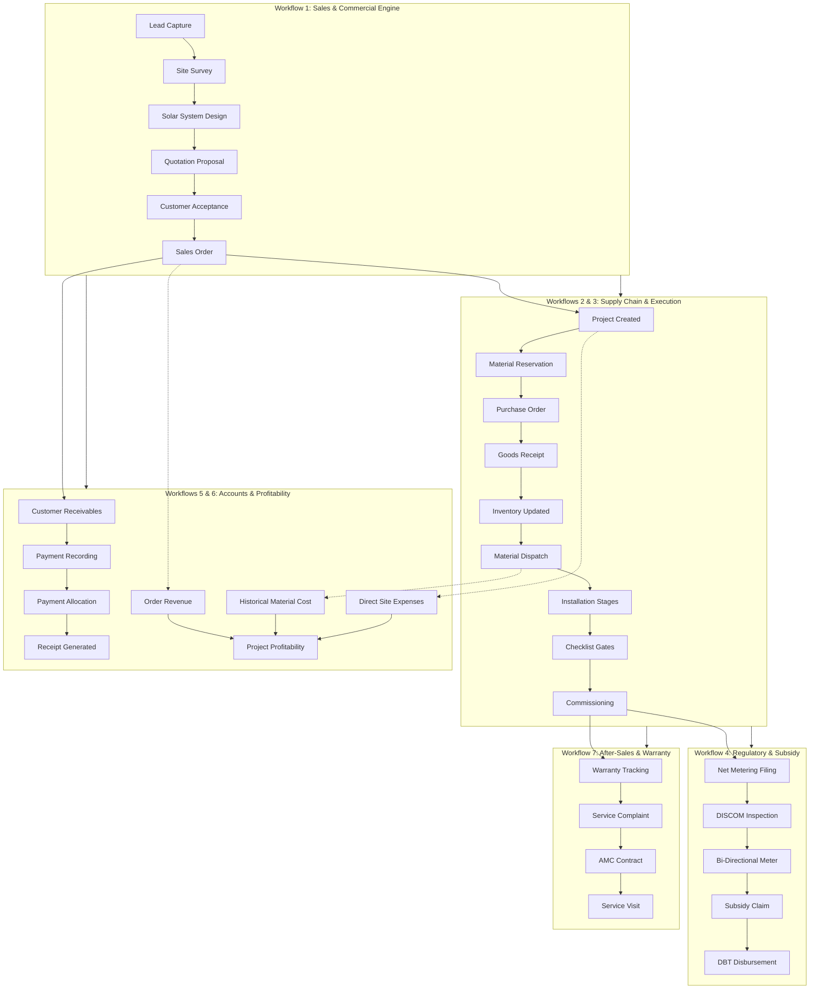

# INS Solar Business Management Software
# Final Logical Module Architecture & Workflow Specification

**Document Version:** `2.0.0`  
**Classification:** Core System Architecture Specification  
**Status:** Approved for Implementation (Stage 1 Deliverable)  
**Target Environment:** Node.js + Express + TypeScript API, React + Vite + Tailwind SPA, MongoDB Atlas  

---

## 1. Executive Summary & Purpose

The INS Solar Business Management Software is an enterprise-grade ERP designed specifically for solar engineering, procurement, and construction (EPC) companies.

Following the initial development of 30 distinct functional capabilities, this document specifies the definitive **24-module logical architecture**. The objective is to eliminate artificial silos, merge complementary features into unified workflows, remove redundant standalone navigation entries, and mirror the genuine operational lifecycle of a solar contracting business—from prospect qualification through technical design, procurement, stage-gated installation, regulatory net metering, financial receivables, and after-sales warranty/AMC servicing.

### Core Architecture Principles
1. **Zero Data Loss:** 100% of existing MongoDB collections, ObjectIds, sequence counters, and historical audit records remain intact and referenced.
2. **Strict Financial Invariants:** Integer paise precision across all quotation revisions, sales orders, customer payments, vendor invoices, and project budgets.
3. **Consolidated Workflows:** Elimination of standalone disjointed pages for follow-ups, quotation sharing, installation, payments, and expenses by embedding them directly into their contextual parent workflows.
4. **Single Source of Truth:** Centralized product catalogue in Inventory, centralized customer timeline in Lead & Customer CRM, centralized execution pipeline in Project Management, and centralized task system.

---

## 2. Complete Module Transformation Matrix (30 Modules → 24 Modules)

| Original Module | Final Module Architecture | Group | Primary Routing | Status & Consolidation Strategy |
| :--- | :--- | :--- | :--- | :--- |
| **1. Dashboard** | **1. Dashboard** | Group A | `/` | Retained as central executive & operational cockpit |
| **2. Leads Management** | **2. Lead & Customer Management** | Group A | `/leads`, `/leads/:id` | Combined Leads, Customers & Follow-up activity timeline |
| **3. Customer Management** | **2. Lead & Customer Management** | Group A | `/leads`, `/customers` | Unified CRM profile, conversion logic & interaction ledger |
| **4. Follow-up Management** | **2. Lead & Customer Management** | Group A | Tab in `/leads/:id` | Standalone navigation removed; embedded in lead/customer record |
| **5. Site Survey Management** | **3. Site Survey Management** | Group A | `/surveys` | Retained; technical handover directly feeds Solar Design |
| **6. Solar System Design** | **4. Solar System Design** | Group A | `/solar-designs` | Retained; pulls equipment directly from Inventory Catalogue |
| **7. Quotations Management** | **5. Quotation Management** | Group A | `/quotations`, `/quotations/:id` | Unified suite: revisions, proposal compiler, discounts |
| **8. Quotation Sharing & PDF** | **5. Quotation Management** | Group A | `/quotations/:id` | Standalone entry removed; secure portal sharing integrated |
| **9. Sales Orders** | **6. Sales Order Management** | Group A | `/orders`, `/orders/:id` | Retained; triggered strictly from accepted quote revision |
| **10. Product & Item Master** | **7. Inventory Management** | Group B | `/inventory` (Catalogue tab) | Standalone entry removed; unified inside Inventory Suite |
| **11. Inventory Management** | **7. Inventory Management** | Group B | `/inventory` | Centralized stock, warehouses, movements, serials, dispatch |
| **12. Purchase Management** | **8. Purchase Management** | Group B | `/purchase-orders`, `/goods-receipts` | POs, approvals, GRNs, and 3-way invoice matching |
| **13. Vendor Management** | **9. Vendor Management** | Group B | `/vendors`, `/vendor-invoices` | Retained; vendor directory, GSTIN, and billing records |
| **14. Project Management** | **10. Project Management** | Group C | `/projects`, `/projects/:id` | Central operational execution hub; 10 stages |
| **15. Installation Management** | **10. Project Management** | Group C | `/projects/:id` (Stages 6–8) | Standalone navigation removed; executed via project stages |
| **16. Installation Checklist** | **11. Installation Checklist & Commissioning** | Group C | `/projects/:id` (Checklist tab) | Versioned checklist templates, mandatory safety gates |
| **17. Net Metering & Subsidy** | **12. Net Metering & Subsidy Management** | Group C | `/net-metering`, `/subsidies` | Regulatory filings, DISCOM inspection, DBT tracking |
| **18. Payment Management** | **14. Accounts & Receivables** | Group D | `/payments` | Standalone entry converted to Accounts & Receivables suite |
| **19. Expense Management** | **15. Project Costing & Profitability** | Group D | `/projects/:id` (Costing tab) | Standalone entry converted into Project Costing suite |
| **20. Project Costing & Profitability** | **15. Project Costing & Profitability** | Group D | `/projects/:id` (Costing tab) | Retained; revenue vs material dispatch vs direct expenses |
| **21. Service & Complaints** | **17. Service & Complaint Management** | Group E | `/complaints` | Retained; ticket triage, escalations, warranty triggers |
| **22. AMC Management** | **19. AMC & Service Visit Management** | Group E | `/amc` | Combined AMC contracts with atomic visit quota ledger |
| **23. Service Visits** | **19. AMC & Service Visit Management** | Group E | `/service-visits`, `/amc` | Combined; technician scheduling, execution checklists |
| **24. Employee & Team** | **20. Employee & Team Management** | Group F | `/employees`, `/teams` | Retained; workforce directory, squads, role assignment |
| **25. Task Management** | **13. Task Management** | Group C | `/tasks` | One unified operational task system across all entities |
| **26. Document Management** | **21. Document Management** | Group F | `/documents` | Central document vault, customer vs internal boundaries |
| **27. Reports & Analytics** | **16. Reports & Analytics** | Group D | `/reports` | Central reporting interface across sales, ops & finance |
| **28. User & Role Management** | **22. User & Role Management** | Group F | `/users`, `/mfa-setup` | RBAC permissions, session revocation, MFA enforcement |
| **29. Notifications & Reminders** | **23. Notifications & Reminders** | Group F | Topbar bell & notification centre | Central persistent notifications, deduplicated dispatch |
| **30. Settings & Masters** | **24. Settings & Masters** | Group F | `/settings` | Central company profile, numbering sequences, tax rules |

---

## 3. Detailed Architecture by Group

### GROUP A — SALES & ENGINEERING

#### 1. Dashboard (`/`)
* **Purpose:** High-level executive and operational visibility.
* **Role-Based Widgets:**
  - Sales: Active leads pipeline, follow-up alerts, unaccepted quotations.
  - Engineering: Pending site surveys, designs in progress.
  - Projects: 10-stage execution pipeline, installation gates, commissioning pending.
  - Procurement: Low-stock alerts, pending PO approvals, expected GRNs.
  - Accounts: Outstanding customer receivables, unallocated receipts.
  - Service: Open customer complaints, scheduled AMC visits.
* **Navigational Integrity:** Every metric card and chart links directly to filtered records in the underlying module. No simulated or artificial stats.

#### 2. Lead & Customer Management (`/leads`, `/leads/:id`)
* **Consolidation:** Merges Leads, Customers, and Follow-ups into a single cohesive CRM record.
* **Key Capabilities:**
  - Lead capture, source tagging, priority classification, and assignment.
  - Duplicate detection by phone number with non-destructive advisory alerts.
  - One-click lead conversion into Customer record preserving history.
  - Customer activity timeline: call notes, follow-up schedules, site visit records.
  - Follow-up is strictly an activity within the lead/customer record, eliminating disconnected follow-up tables.

#### 3. Site Survey Management (`/surveys`)
* **Key Capabilities:**
  - Scheduling and assignment of field surveyors.
  - Capture of structural data: roof dimensions, tilt, azimuth, shading analysis.
  - Electrical data: sanctioned load, service voltage, distribution board distance.
  - Evidence upload: geotagged photos, utility bill copies, structural drawings.
  - Survey completion status directly unlocks Solar System Design.

#### 4. Solar System Design (`/solar-designs`)
* **Key Capabilities:**
  - System architecture: On-grid, Off-grid, or Hybrid sizing.
  - Equipment selection pulled live from Inventory Product Catalogue.
  - Generation simulations: expected monthly generation, PR (performance ratio).
  - Version control: technical iterations tied to survey specifications.

#### 5. Quotation Management (`/quotations`, `/quotations/:id`)
* **Consolidation:** Merges Quotation Management, Revisions, Proposal Generation, and Customer Sharing.
* **Key Capabilities:**
  - BOM compilation from approved Solar Design.
  - Multi-tier pricing: equipment, balance of system (BOS), labour, taxes.
  - Immutable revision tree (`R0`, `R1`, `R2`...) with discount approval gates.
  - Proposal compiler: branded executive solar proposal PDF generation.
  - Customer acceptance/rejection workflow via secure customer portal link.

#### 6. Sales Order Management (`/orders`, `/orders/:id`)
* **Key Capabilities:**
  - Created strictly upon customer acceptance of an immutable quotation revision.
  - Locks contracted commercial value in integer paise.
  - Triggers automated Project creation and inventory reservation demand.
  - Enforces 1:1 integrity to prevent duplicate project instantiation.

---

### GROUP B — PROCUREMENT & INVENTORY

#### 7. Inventory Management (`/inventory`)
* **Consolidation:** Combines Product/Item Master and Multi-Location Stock Management.
* **Internal Tabs & Sub-Sections:**
  1. *Inventory Dashboard:* Stock valuations, movement velocity, low-stock alerts.
  2. *Product & Item Catalogue:* Master catalog, SKU, HSN, specs, base rates.
  3. *Categories:* PV modules, inverters, structures, cables, switchgear.
  4. *Stock Overview:* Real-time available, reserved, and damaged stock by warehouse.
  5. *Warehouses:* Multi-depot configuration and site storage locations.
  6. *Stock Movements:* Immutable audit ledger of all receipts, transfers, and dispatches.
  7. *Stock Reservations:* Project-specific material allocations preventing double-booking.
  8. *Material Dispatch:* Project dispatch slips, transit custody tracking.
  9. *Serial Number Tracking:* Barcode/serial tracking for tier-1 panels and inverters.
  10. *Low Stock Alerts:* Minimum threshold alerts and replenishment triggers.
* **Guarantees:** Negative stock prevention, transactional balance updates, and zero duplicate product collections.

#### 8. Purchase Management (`/purchase-orders`, `/goods-receipts`)
* **Key Capabilities:**
  - Purchase requisition compilation from project material requirements.
  - PO generation with vendor pricing, delivery terms, and GST profiles.
  - Anti-self-approval enforcement for purchase orders exceeding configured thresholds.
  - Goods Receipt Notes (GRN) with inspection, acceptance, and rejection counts.
  - Real-time stock balance updates strictly for accepted quantities.

#### 9. Vendor Management (`/vendors`, `/vendor-invoices`)
* **Key Capabilities:**
  - Centralized vendor directory with GSTIN, bank details, and MSME category.
  - Vendor-to-product catalog mapping and historical purchase prices.
  - Three-way matching: PO vs GRN vs Vendor Invoice.

---

### GROUP C — PROJECT & INSTALLATION

#### 10. Project Management (`/projects`, `/projects/:id`)
* **Consolidation:** Central operational hub absorbing standalone Installation Management.
* **10-Stage Project Lifecycle:**
  1. `PLANNED`
  2. `SITE_SURVEY_COMPLETED`
  3. `DESIGN_FINALIZED`
  4. `MATERIAL_RESERVED`
  5. `MATERIAL_DISPATCHED`
  6. `INSTALLATION_IN_PROGRESS`
  7. `INSTALLATION_COMPLETED`
  8. `TESTING_AND_COMMISSIONING`
  9. `NET_METERING_SUBMITTED`
  10. `HANDOVER_AND_CLOSURE`
* **Key Capabilities:**
  - Team assignment, installation scheduling, and material requirement tracking.
  - Material dispatch verification before physical erection begins.
  - Project milestone tracking, document repository, and customer visibility.

#### 11. Installation Checklist & Commissioning (`/projects/:id` - Checklist Tab)
* **Key Capabilities:**
  - Versioned checklist templates (Electrical, Mechanical, Structural, Safety).
  - Mandatory quality gates: project stage cannot advance to Handover without 100% checklist sign-off.
  - Upload of photographic evidence and commissioning test reports.
  - Digital signature verification by certified site technician.

#### 12. Net Metering & Subsidy Management (`/net-metering`, `/subsidies`)
* **Key Capabilities:**
  - DISCOM application tracking, fee payment receipts, and inspection scheduling.
  - Bidirectional meter installation recording with meter number and initial reading.
  - PM Surya Ghar / National Portal subsidy claim processing.
  - Multi-tranche subsidy disbursement tracking and direct bank transfer verification.

#### 13. Task Management (`/tasks`)
* **Key Capabilities:**
  - Universal operational task engine across all business entities.
  - Assignment to employees or teams with deadlines, priorities, and blockers.
  - Deep linking to related Projects, Leads, Orders, or Service Visits.

---

### GROUP D — ACCOUNTS & BUSINESS PERFORMANCE

#### 14. Accounts & Receivables (`/payments`)
* **Consolidation:** Replaces standalone payment screens with a complete receivables suite.
* **Key Capabilities:**
  - Payment collection recording: NEFT, RTGS, UPI, Cheque, Bank UTR.
  - Multi-order payment allocation: advances, milestone payments, retentions.
  - Automated printable payment receipts with sequence numbering (`REC-YYYY-XXXXX`).
  - Receivables aging (0–30, 31–60, 61–90, 90+ days).
  - Reversal and refund workflows with full audit logging.
  - Absolute integer paise calculations preventing floating-point rounding errors.

#### 15. Project Costing & Profitability (`/projects/:id` - Costing Tab)
* **Consolidation:** Integrates direct expenses into project costing.
* **Key Capabilities:**
  - Project budget setup across material, labour, transport, and statutory fees.
  - Direct site expense logging, receipts upload, and manager approval.
  - Actual material cost evaluated using historical dispatch unit-cost snapshots.
  - Real-time Budget vs Actual variance analysis.
  - Revenue vs Total Realized Cost = Gross Profit and Profit Margin percentage.

#### 16. Reports & Analytics (`/reports`)
* **Key Capabilities:**
  - Sales conversion funnels (Lead → Survey → Quote → Order).
  - Project execution velocity and average stage completion days.
  - Inventory turnover, stock valuation, and procurement lead times.
  - Receivables aging, collection efficiency, and project profitability rankings.
  - Service SLA compliance and warranty claim resolution times.

---

### GROUP E — AFTER-SALES & SERVICE

#### 17. Service & Complaint Management (`/complaints`)
* **Key Capabilities:**
  - Ticket logging from Customer Portal or customer support executive.
  - Fault categorisation: Inverter trip, generation drop, physical damage, grid failure.
  - Priority triage (Critical, High, Medium, Low) and assignment to service engineers.
  - Warranty claim initiation directly from complaint record.

#### 18. Warranty Management (`/warranties`)
* **Key Capabilities:**
  - Serialized asset tracking linking solar panels and inverters to manufacturer warranties.
  - Automatic calculation of active warranty periods based on commissioning date.
  - Vendor warranty claim tracking and replacement unit logistics.

#### 19. AMC & Service Visit Management (`/amc`, `/service-visits`)
* **Consolidation:** Combines Annual Maintenance Contracts and Field Service Visits.
* **Key Capabilities:**
  - AMC contract creation, period validity, and scheduled visit quota (e.g. 4 visits/year).
  - Atomic quota deduction upon completion and sign-off of each service visit.
  - Mobile-ready visit execution checklist: panel cleaning, inverter servicing, torque checks.
  - Customer sign-off and preventive maintenance report generation.

---

### GROUP F — ADMINISTRATION & SUPPORT

#### 20. Employee & Team Management (`/employees`, `/teams`)
* **Key Capabilities:**
  - Employee directory with designation, department, contact details, and status.
  - Team and installation crew configuration with assigned team lead.
  - Safe deactivation preventing data orphanhood while revoking system access.

#### 21. Document Management (`/documents`)
* **Key Capabilities:**
  - Centralized document vault with classification: Identity, Property, Technical, Financial.
  - Strict access boundaries: Customer-accessible vs Confidential Internal.
  - Cryptographic hash verification and signed temporary download URLs.

#### 22. User & Role Management (`/users`, `/mfa-setup`)
* **Key Capabilities:**
  - Role-Based Access Control (RBAC) across 11 system roles.
  - Multi-Factor Authentication (TOTP via Authenticator app) with backup recovery codes.
  - Instant session revocation on password change or role modification.

#### 23. Notifications & Reminders (Topbar Bell & Background Queue)
* **Key Capabilities:**
  - Persistent notification center for operational alerts and approvals.
  - Deduplicated scheduled reminders: follow-up calls, quote expiry, inspection dates.
  - Multi-channel notification dispatch capability (In-App, Email, SMS).

#### 24. Settings & Masters (`/settings`)
* **Key Capabilities:**
  - Company legal profile, branding, and contact details.
  - Tax profiles (GST rates for solar equipment vs installation services).
  - Sequential numbering configuration (`LEAD`, `CUST`, `QT`, `ORD`, `PRJ`, `REC`...).
  - System-wide approval thresholds and default checklist templates.

---

## 4. The 8 Strict Business Workflows

---

## 5. Role-Based Navigation & The 6 Operational Panels

The sidebar is dynamically filtered into six operational panels based on user role:

| Operational Panel | Primary Target Roles | Permitted Modules in Sidebar |
| :--- | :--- | :--- |
| **1. Admin Panel** | `SUPERADMIN`, `ADMIN` | All 24 Modules: Full operational, financial, and configuration authority |
| **2. Sales Panel** | `SALES_EXECUTIVE`, `DEPARTMENT_HEAD` | Dashboard, Leads & Customers, Site Surveys, Solar Design, Quotation Suite, Sales Orders, Document Vault |
| **3. Installation Panel** | `INSTALLATION_CREW`, `TECHNICIAN`, `SURVEYOR` | Dashboard, Site Surveys, Projects (Stages 5–8), Installation Checklists, Field Visits, Document Vault, Tasks |
| **4. Inventory Panel** | `INVENTORY`, `OPERATIONS` | Dashboard, Inventory Suite (Catalogue & Stock), Vendors, Purchase Orders, Goods Receipts, Material Dispatches |
| **5. Accounts Panel** | `ACCOUNTS_OFFICER` | Dashboard, Sales Orders, Accounts & Receivables, Vendor Invoices, Project Costing & Profitability, Reports & Analytics |
| **6. Customer Portal** | `CUSTOMER` | Customer Dashboard, Own Quotations (Accept/Reject), Project Timeline, Payment Receipts, Service Tickets, Document Vault |

---

## 6. Database Safety & Financial Invariants

1. **Integer Arithmetic:** All monetary fields stored strictly in integer paise (`1 INR = 100 paise`). No floating-point inaccuracies.
2. **Zero Schema Deletions:** No MongoDB collections are dropped. The `expenses`, `customer_payments`, and `payment_allocations` collections remain active and linked.
3. **Atomic Sequence Generation:** Every business document receives an atomic sequential identifier (`SequenceCounter`) using `$inc` concurrency controls.
4. **Immutable Audit Trails:** Deactivations are soft (`isActive: false`). Revision histories for quotations and project stages are append-only.

---

## 7. Stage 1 Verification Checklist

- [x] Full existing codebase and route audit completed.
- [x] All 30 original modules mapped to the 24 consolidated modules.
- [x] Six operational panels structured with strict RBAC boundaries.
- [x] 8 strict end-to-end solar business workflows specified.
- [x] Data preservation and financial safety guarantees established.
- [x] Zero code modifications performed in Stage 1.
