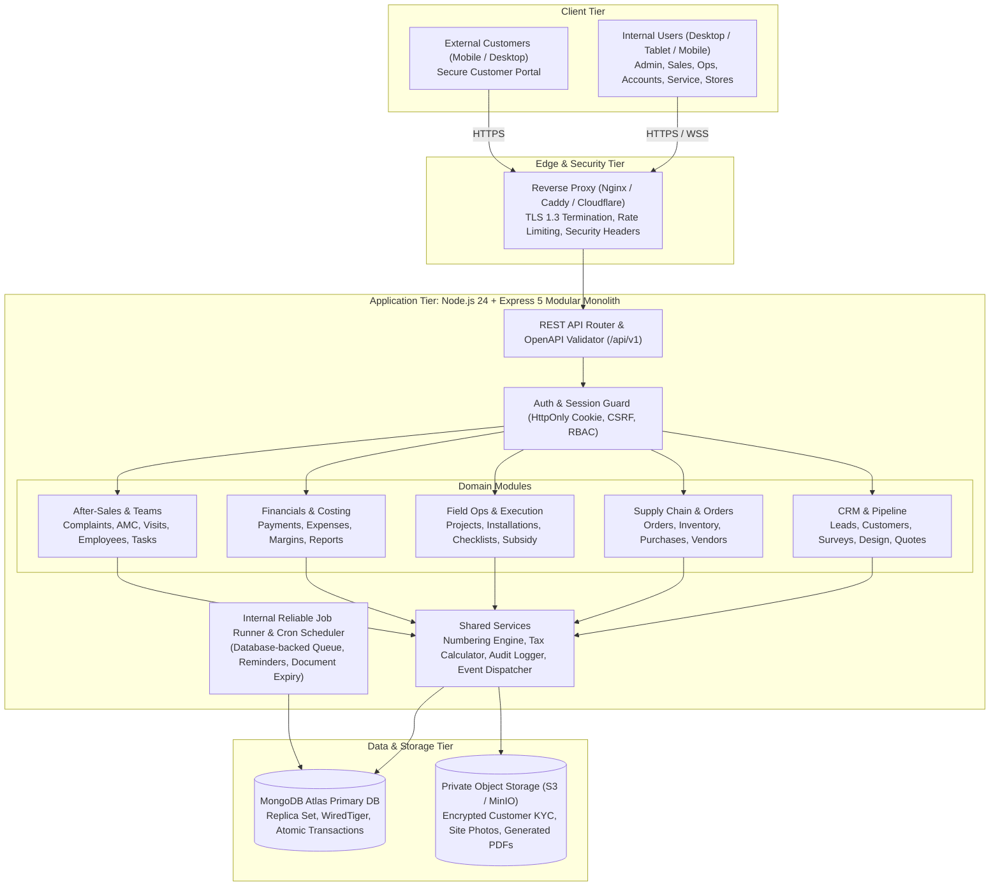
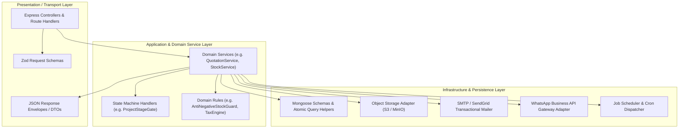
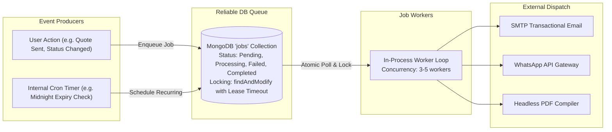

# INS Solar Business Management Software — System Architecture Specification

**Document Reference:** `INS-ARC-SYS-001`  
**Version:** `1.0.0`  
**Status:** Architecture Blueprint Approved  
**System Pattern:** Modular Monolith with Decoupled Frontend and Strict Domain Layering  
**Target Infrastructure:** Low-Cost Managed Hosting / Linux VPS + MongoDB Atlas + Private Object Storage  

---

## 1. Executive Architectural Blueprint

The **INS Solar Business Management Software** is structured as an enterprise-grade **Modular Monolith**. It balances high developer velocity, maintainability, operational simplicity, and low hosting costs for an internal operating team of 11–30 employees and a customer portal.

Distributed microservices, Kubernetes clusters, and independent cache layers (such as Redis) introduce unnecessary deployment overhead, network latency, distributed transaction failure modes, and inflated infrastructure costs. Instead, this system leverages a cohesive, strictly layered modular monolith deployed as a stateless Node.js application paired with MongoDB Atlas and private cloud object storage.



---

## 2. Technology Stack & Component Specifications

The system utilizes modern, supported, long-term support (LTS) technologies adhering strictly to the planned stack:

### 2.1 Frontend Architecture
*   **Core Framework:** React 19 / 18.3 with strict TypeScript (`strict: true`, `noImplicitAny: true`).
*   **Build Tooling:** Vite (ESBuild-powered hot module replacement and optimized production rollup bundling).
*   **Styling Engine:** Tailwind CSS with utility abstractions and CSS custom properties for theming.
*   **Component Primitives:** `shadcn/ui` based on Radix UI unstyled primitives, ensuring full accessibility (WCAG 2.1 AA), keyboard navigation, and consistent design language.
*   **Client Routing:** React Router v6 / v7 with layout nesting, protected route guards, and code-split lazy loading.
*   **Server State & Caching:** TanStack Query (React Query) for declarative data fetching, optimistic UI updates, background cache invalidation, and pagination.
*   **Form Management & Validation:** React Hook Form coupled with Zod schema resolvers for client-side type-safe form validation and inline error rendering.
*   **Icons & Visuals:** Lucide React icons with cohesive stroke weighting.
*   **Testing:** Vitest for component and hook unit testing; React Testing Library for user-centric interaction testing.

### 2.2 Backend Architecture
*   **Runtime Environment:** Node.js 24 LTS (utilizing native high-performance fetch, web streams, and modern V8 optimizations).
*   **Web Framework:** Express 5 (leveraging native async error propagation without monkey-patched wrappers).
*   **Language:** TypeScript with strict type checking compiled via `tsc` or executed via `tsx` in development.
*   **Data Modeling & ORM/ODM:** Mongoose 8+ with explicit schema definitions, validation hooks, discriminators, and typed models.
*   **Runtime Request Validation:** Zod middleware intercepting and sanitizing `params`, `query`, and `body` payloads prior to controller execution.
*   **API Documentation:** OpenAPI 3.1 specification generated and rendered interactively via Swagger UI / Scalar at `/api/docs`.
*   **Logging Engine:** Pino structured JSON logger with ISO timestamps, correlation IDs, child loggers, and redaction of sensitive parameters (passwords, tokens).

---

## 3. Module Boundaries & Domain Layering

To prevent spaghetti code and circular dependencies within the monolith, the codebase enforces a strict **Hexagonal / Clean Domain Layering** pattern:



### 3.1 Domain Decoupling Rules
1.  **Direct Controller-to-Model Access Forbidden:** Route controllers must delegate business logic to Domain Services. Controllers only handle HTTP parsing, parameter extraction, and status code response mapping.
2.  **Cross-Domain Service Invocations:** When one domain requires actions in another (e.g., `OrderConfirmation` triggering `InventoryReservation` and `ProjectCreation`), it must invoke the target domain service method or emit an internal domain event via the in-process `DomainEventEmitter`.
3.  **Encapsulated Transactions:** Transactions spanning multiple collections (e.g., confirming an order and updating stock reservations) are coordinated within application service boundaries using native MongoDB multi-document ACID transactions.

---

## 4. Frontend-to-Backend Communication & Networking

*   **Protocol:** Standard RESTful HTTP/2 over TLS 1.3.
*   **URL Prefixing:** All API endpoints are namespaced under `/api/v1/`.
*   **Transport Format:** JSON (`application/json; charset=utf-8`) for structured data; `multipart/form-data` for binary file uploads (streamed directly to temporary memory buffers and piped to S3).
*   **Client Transport Client:** Centralized Axios / Fetch instance configured with base URL, timeout limits (15 seconds default), automatic CSRF token injection, and unified HTTP 401/403 interception.
*   **Real-time Alerts:** Server-Sent Events (SSE) or lightweight WebSocket gateway at `/api/v1/stream` for live push notifications (e.g., new lead alerts, stockout warnings).

---

## 5. Authentication, Authorization & Security Architecture

### 5.1 Server-Managed Stateful Sessions
Rather than stateless JWTs stored in client-accessible `localStorage` (which are vulnerable to XSS token exfiltration and cannot be instantly revoked), the system implements **Server-Managed Stateful Sessions**:

```mermaid
sequenceDiagram
    autonumber
    actor User as User / Browser
    participant API as Auth Controller
    participant DB as MongoDB (Sessions Collection)
    
    User->>API: POST /api/v1/auth/login (email, password, MFA token)
    API->>DB: Query User & Verify Argon2id Hash
    Note over API: Verify TOTP MFA if Privileged Role
    API->>DB: Insert Session Record (sessionId, userId, role, ip, userAgent, expiresAt)
    API-->>User: HTTP 200 OK + Set-Cookie: sid=<signed-session-id>; HttpOnly; Secure; SameSite=Lax
    
    Note over User,API: Subsequent Authenticated Request
    User->>API: GET /api/v1/projects (Cookie: sid=...)
    API->>DB: Validate Session Expiry & User Active Status
    API-->>User: HTTP 200 OK (Project Data)
    
    Note over User,API: Instant Revocation (Admin terminates session)
    API->>DB: Delete Session Record by sessionId or userId
    User->>API: GET /api/v1/projects (Cookie: sid=...)
    API-->>User: HTTP 401 Unauthorized (Session Invalidated)
```

1.  **Session Storage:** Sessions persist in a dedicated MongoDB `sessions` collection with automatic TTL expiration indexes.
2.  **Session Cookie Flags:**
    *   `HttpOnly: true` (strictly inaccessible to JavaScript, mitigating XSS).
    *   `Secure: true` (only transmitted over encrypted HTTPS connections; relaxed only in localhost development).
    *   `SameSite: 'Lax'` (mitigates Cross-Site Request Forgery while permitting top-level navigation).
    *   `Path: '/'`.
3.  **Password Security:** Password hashing is powered by **Argon2id** (memory cost: 64MB, time cost: 3 iterations, parallelism: 1 thread).
4.  **Cross-Site Request Forgery (CSRF) Protection:** Double-Submit Cookie pattern or signed anti-CSRF token validated on all state-mutating requests (`POST`, `PUT`, `PATCH`, `DELETE`).
5.  **Multi-Factor Authentication (MFA):** Mandatory Time-based One-Time Password (TOTP, RFC 6238) for privileged roles (`Admin`, `Accounts`, `Storekeeper`). Authenticator secret keys are encrypted at rest with AES-256-GCM. Emergency one-time recovery codes are hashed before storage.
6.  **Instant Global Revocation:** Deactivating an employee or clicking "Sign out from all devices" executes an atomic `DELETE` on all active sessions associated with the `userId`.

### 5.2 Server-Side Role-Based & Record-Level Authorization
Access control operates across two distinct layers:
1.  **Role & Permission Middleware:** Evaluates whether the authenticated user possesses the required permission string (e.g., `quotation:discount_approve`).
2.  **Record-Level Ownership Filter:** Ensures non-admin users (e.g., Sales Reps or Customer Portal users) can only query records where `assignedEmployee == req.user.id` or `customerId == req.user.customerId`.

---

## 6. Database & Object Storage Architecture

### 6.1 MongoDB Atlas Primary Database
*   **Clustering:** Managed MongoDB Atlas 3-node Replica Set offering automatic failover and high availability.
*   **Storage Engine:** WiredTiger with Snappy document compression.
*   **Write Concerns:** Critical financial, inventory, and order operations write with `w: "majority"` to guarantee durable commits across nodes.
*   **Indexing Strategy:** Explicit compound indexes covering all filtered, sorted, and paginated query patterns (e.g., `{ status: 1, createdAt: -1 }`, `{ mobile: 1 }`).
*   **Schema Enforcement:** Strict Mongoose schemas with validation rules, preventing schema drift while retaining document flexibility for polymorphic technical specifications (e.g., inverter specs vs battery specs).

### 6.2 Private Cloud Object Storage
Sensitive customer KYC records, property deeds, site survey photos, signed checklists, and generated invoice/quotation PDFs must **never** be stored on the local container/server filesystem.
*   **Storage Provider:** AWS S3, Cloudflare R2, or self-hosted MinIO (S3-compatible API).
*   **Access Tier:** All storage buckets are strictly private (`Block Public Access: ON`).
*   **Asset Ingestion:** Uploads are streamed through backend validation middleware (checking magic bytes, MIME types, and maximum file sizes) and pushed to S3 with cryptographic SHA-256 checksums.
*   **Asset Retrieval:** Files are served exclusively through short-lived **Pre-Signed URLs** with a Time-To-Live (TTL) of 15 minutes, generated only after verifying the requesting user's authorization to access the specific document.

---

## 7. Background Jobs, Cron & Event Scheduling

To maintain low hosting costs and avoid a standalone Redis / BullMQ cluster, the system implements an internal, database-backed reliable job queue:



### 7.1 Queue Characteristics
1.  **Persistence:** Jobs persist in a MongoDB `jobs` collection.
2.  **Concurrency & Locking:** Workers acquire jobs using atomic `findOneAndUpdate` with a lease timeout (e.g., 5 minutes) to ensure that crashed worker processes do not strand jobs indefinitely.
3.  **Automatic Retries & Exponential Backoff:** Failed jobs retry up to 3 times with exponential backoff (1m, 5m, 15m) before moving to a Dead Letter state.
4.  **Scheduled Cron Tasks:**
    *   *Every 15 minutes:* Process scheduled follow-up notifications.
    *   *Daily at 00:01:* Scan and flag expired quotations; scan AMC expiration dates (30d and 15d alerts).
    *   *Daily at 08:00:* Dispatch daily morning task summaries and overdue payment alerts.

---

## 8. Logging, Monitoring, Backups & Disaster Recovery

### 8.1 Structured Observability
*   **Logger:** Pino structured JSON logging outputting machine-parseable lines to `stdout`.
*   **Contextual Correlation:** Every inbound HTTP request is assigned a unique `X-Correlation-ID` header (propagated across all child log entries, database queries, and error responses).
*   **Log Level Management:** Configurable via environment variables (`LOG_LEVEL=info` in production, `debug` in development). Sensitive fields (passwords, card details, authorization cookies) are systematically redacted via Pino redaction paths.

### 8.2 Health Checks & Monitoring
*   **Liveness Probe:** `/api/v1/health/liveness` returns HTTP 200 if the Node process is responsive.
*   **Readiness Probe:** `/api/v1/health/readiness` performs a ping to MongoDB Atlas and verifies S3 bucket reachability.
*   **Error Tracking:** Unhandled exceptions and rejections trigger critical log events and can be piped to Sentry or OpenTelemetry collectors.

### 8.3 Backup Strategy & Restoration Procedures
1.  **Database Automated Backups:** MongoDB Atlas continuous cloud backups with **Point-in-Time Recovery (PITR)** configured for 7-day retention, plus daily scheduled snapshots retained for 30 days.
2.  **Object Storage Backups:** Object storage buckets configured with S3 Versioning and cross-region replication or daily rclone mirroring.
3.  **Disaster Recovery Verification:** Quarterly restoration drill protocol: restore Atlas snapshot into an isolated staging cluster, run automated data integrity test suite, and verify application boot sequence.
