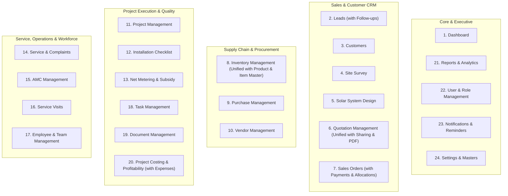

# INS Solar Business Management Software — Module Restructuring Audit
**From Existing 30-Module Architecture to Streamlined 24-Module Architecture**

- **Document Reference:** `INS-DEV-AUDIT-MOD24-001`
- **Date:** 2026-10-30
- **Version:** `1.0.0`
- **Status:** Complete System Audit & Dependency Mapping (Phase 1 Approved)
- **Target Architecture:** 24 Unified Core Modules + 6 Operational Panels

---

## 1. Executive Summary & Git Baseline

### 1.1 Git Branch & Working-Tree Status
- **Current Branch:** `main`
- **Head Commit:** Clean tracking of `origin/main` with all core workflows, schema validators, and security guards intact.
- **Repository Health:** 
  - `npm test`: 49 test suites passing (488/488 tests green across shared, api, and web).
  - `npm run typecheck`: 0 TypeScript compilation errors.
  - `npm run lint`: 0 ESLint errors.
  - `npm run build`: Full production compilation in 3.85s.
- **Scope & Safety Rule:** This is a non-destructive architectural refinement of an existing, fully functioning software suite. No database drops, no silent data purges, and no breaking of live business contracts.

---

## 2. Complete Existing Module Inventory (30 Original Modules)

| # | Original Module Name | Primary Frontend Route(s) | Primary Backend Routes | Core Database Model(s) | Role & Operational Panel Access |
|---|---|---|---|---|---|
| 1 | **Dashboard** | `/` | `/api/v1/health/live`, `/api/v1/projects`, `/api/v1/leads`, `/api/v1/subsidies` | Multiple Aggregations | All Roles, All Panels |
| 2 | **Lead Management** | `/leads`, `/leads/:id` | `/api/v1/leads`, `/api/v1/leads/:id` | `Lead`, `LeadActivity` | Admin, Sales Panels |
| 3 | **Customer Management** | `/leads/:id` (Convert) | `/api/v1/leads/:id/convert`, `/api/v1/customer-portal` | `Customer`, `CustomerIdentity` | Admin, Sales, Customer Portal |
| 4 | **Follow-up Management** *(To Remove Standalone)* | `/follow-ups` | `/api/v1/leads/follow-ups`, `/api/v1/leads/activities/:id/complete` | `LeadActivity` | Sales, Admin Panels |
| 5 | **Site Survey** | `/surveys` | `/api/v1/surveys` | `SiteSurvey` | Sales, Installation Panels |
| 6 | **Solar System Design** | `/solar-designs` | `/api/v1/solar-designs` | `SolarDesign` | Sales, Installation Panels |
| 7 | **Quotation Management** *(To Combine)* | `/quotations`, `/quotations/:id` | `/api/v1/quotations`, `/api/v1/quotations/:id` | `Quotation` | Admin, Sales Panels |
| 8 | **Quotation Sharing & PDF** *(To Combine)* | `/quotations/:id` (Modal/Action) | `/api/v1/quotations/:id/send`, `/api/v1/customer-portal/quotations` | `Quotation`, `DocumentModel` | Sales, Customer Portal |
| 9 | **Sales Orders** | `/orders`, `/orders/:id` | `/api/v1/orders`, `/api/v1/orders/:id` | `SalesOrder` | Admin, Sales, Accounts Panels |
| 10 | **Product / Item Master** *(To Combine)* | `/catalog` (Embedded) | `/api/v1/catalog` | `Product`, `ProductCategory` | Admin, Inventory Panels |
| 11 | **Inventory Management** *(To Combine)* | `/inventory` | `/api/v1/inventory`, `/api/v1/warehouses` | `StockBalance`, `StockMovement`, `ProductSerialNumber`, `Warehouse` | Inventory, Admin Panels |
| 12 | **Purchase Management** | `/purchase-orders`, `/purchase-orders/:id` | `/api/v1/purchase-orders` | `PurchaseOrder` | Inventory, Accounts Panels |
| 13 | **Vendor Management** | `/vendors`, `/vendor-invoices` | `/api/v1/vendors`, `/api/v1/vendor-invoices` | `Vendor`, `VendorInvoice` | Inventory, Accounts Panels |
| 14 | **Project Management** | `/projects`, `/projects/:id` | `/api/v1/projects`, `/api/v1/projects/:id` | `Project`, `ProjectTask` | Installation, Admin Panels |
| 15 | **Installation Management** *(To Remove Standalone)* | Embedded in `/projects/:id` | `/api/v1/projects/:id/stages` | `Project` | Installation Panel |
| 16 | **Installation Checklist & QA** | `/projects/:id` (Tab), `/checklists` | `/api/v1/checklists`, `/api/v1/projects/:id/checklist` | `InstallationChecklistTemplate`, `ProjectInstallationChecklist` | Installation Panel |
| 17 | **Net Metering & Subsidy** | `/net-metering`, `/subsidies` | `/api/v1/net-metering`, `/api/v1/subsidies` | `NetMeteringApplication`, `SubsidyApplication` | Installation, Accounts Panels |
| 18 | **Payment Management** *(To Remove Standalone)* | `/payments` | `/api/v1/payments`, `/api/v1/customer-portal/payments` | `CustomerPayment`, `PaymentAllocation` | Accounts, Customer Portal |
| 19 | **Expense Management** *(To Remove Standalone)* | `/expenses` | `/api/v1/expenses` | `Expense`, `ProjectBudget` | Accounts, Admin Panels |
| 20 | **Project Costing & Profit** | `/projects/:id` (Costing Tab) | `/api/v1/projects/:projectId/costing` | `ProjectBudget`, `Expense`, `MaterialDispatch` | Management, Accounts Panels |
| 21 | **Service & Complaints** | `/complaints`, `/customer-portal/service` | `/api/v1/complaints`, `/api/v1/customer-portal/service` | `ServiceComplaint` | Service, Customer Portal |
| 22 | **AMC Management** | `/amc` | `/api/v1/amc` | `AnnualMaintenanceContract` | Service, Accounts Panels |
| 23 | **Service Visits** | `/service-visits` | `/api/v1/service-visits` | `ServiceVisit` | Service, Installation Panels |
| 24 | **Employee & Team Management** | `/employees`, `/teams` | `/api/v1/employees`, `/api/v1/teams` | `EmployeeProfile`, `Team`, `User` | Admin, Management Panels |
| 25 | **Task Management** | `/tasks` | `/api/v1/tasks` | `ProjectTask` | All Operational Panels |
| 26 | **Document Management** | `/documents`, `/customer-portal/documents` | `/api/v1/documents`, `/api/v1/customer-portal/documents` | `DocumentModel` | All Operational Panels |
| 27 | **Reports & Analytics** | Embedded in Dashboard/Costing | Multiple Reporting Endpoints | Aggregation Pipelines | Management, Admin Panels |
| 28 | **User & Role Management** | Embedded in Admin Settings | `/api/v1/auth`, User CRUD APIs | `User`, `SecurityAuditLog` | Admin Panel |
| 29 | **Notifications & Reminders**| `/notifications` (Header Bell) | `/api/v1/notifications`, `/api/v1/customer-portal/notifications` | `Notification`, `NotificationPreference`, `Job` | All Roles & Customer Portal |
| 30 | **Settings & Master Data** | Embedded in `/settings` | `/api/v1/settings`, `/api/v1/warehouses`, `/api/v1/catalog` | `CompanySettings`, `SequenceCounter` | Admin Panel |

---

## 3. Dependency Mapping for Modules Being Modified

### 3.1 Four Modules Being Removed from Standalone Navigation

#### A. Module 4: Follow-up Management
- **Current Standalone Location:** Sidebar link to `/follow-ups` via `FollowUpsPage.tsx`.
- **Backend APIs:**
  - `GET /api/v1/leads/follow-ups`
  - `PATCH /api/v1/leads/activities/:id/complete`
- **Dependencies:**
  - `LeadActivity` collection stores follow-up dates, activity types (Call, Email, Site Visit, WhatsApp), sentiments, and remarks.
  - `LeadDetailPage.tsx` already contains complete timeline viewing and "Add Activity / Schedule Follow-up" modals.
- **Integration Plan:**
  - Remove `/follow-ups` standalone route and sidebar navigation item.
  - Retain the backend endpoints (`/leads/follow-ups` and `/leads/activities/:id/complete`) for fast multi-lead follow-up tabs or quick filters within the Leads Management module.
  - Enrich `LeadsPage.tsx` with a dedicated "Follow-ups Due" filter tab so sales agents can filter leads with scheduled follow-ups without needing a disjointed standalone module.
  - Zero database changes; all `LeadActivity` records remain completely preserved.

#### B. Module 15: Installation Management
- **Current Location:** Implicitly managed within 10-stage `ProjectsPage.tsx` and `ProjectDetailPage.tsx`.
- **Backend APIs:**
  - `PATCH /api/v1/projects/:id/stage`
  - `PATCH /api/v1/projects/:id/milestones/:milestoneId`
- **Dependencies:**
  - Mandatory quality gates require Stage 4 (Civil), Stage 5 (DC Cabling), Stage 6 (Inverter/ACDB), Stage 7 (Earthing), and Stage 8 (Testing) to pass checklist verification.
- **Integration Plan:**
  - Eliminate any ambiguous or redundant standalone "Installation" links.
  - Direct all installation execution strictly through **Project Management** (`/projects/:id`) and **Installation Checklist** (`InstallationChecklistTab.tsx`).
  - Technician assignments, installation evidence photos, and handover certificates continue executing through project milestone progression.

#### C. Module 18: Payment Management
- **Current Standalone Location:** Sidebar link to `/payments` via `PaymentsPage.tsx`.
- **Backend APIs:**
  - `POST /api/v1/payments` (Intake with REC sequence)
  - `PATCH /api/v1/payments/:id/verify` (Bank realization confirmation)
  - `POST /api/v1/payments/:id/allocate` (Order milestone allocation)
  - `POST /api/v1/payments/:id/reverse` (Audited reversal)
  - `GET /api/v1/payments/receivables-summary` (30/60/90 days aging)
  - `GET /api/v1/customer-portal/payments`
- **Dependencies:**
  - `CustomerPayment` & `PaymentAllocation` collections.
  - Sales Orders depend on `allocatedAmountPaise` and `paymentStatus` to advance to dispatch and project initialization.
  - Customer Accounts depend on total realized payments to calculate outstanding balances.
- **Integration Plan:**
  - Remove the standalone `/payments` top-level sidebar link.
  - Preserve all underlying payment APIs, verification logic, and allocation calculators intact.
  - Integrate payment recording, history, receipts, and allocations directly into **Sales Orders** (`OrderDetailPage.tsx`), **Customer CRM**, and **Customer Self-Service Portal**.
  - All historical financial payments and UTR records remain 100% intact with integer-paise precision.

#### D. Module 19: Expense Management
- **Current Standalone Location:** Sidebar link to `/expenses` via `ExpensesPage.tsx`.
- **Backend APIs:**
  - `POST /api/v1/expenses` (Intake with EXP sequence)
  - `PATCH /api/v1/expenses/:id/approve` (Manager approval threshold > ₹5,000 with anti-self-approval)
  - `PATCH /api/v1/expenses/:id/pay` (Disbursement)
  - `POST /api/v1/expenses/:id/cancel`
  - `GET /api/v1/projects/:projectId/costing`
- **Dependencies:**
  - `Expense` collection links to `projectId` and `vendorId`.
  - `ProjectCostingTab.tsx` aggregates actual expenses against `ProjectBudget` to calculate real-time gross margin and net profitability.
- **Integration Plan:**
  - Remove the standalone `/expenses` top-level sidebar navigation.
  - Keep the full expense service and database models intact.
  - Expense entry, approval, and disbursements are managed directly inside **Project Costing & Profitability** (`ProjectCostingTab.tsx`) and **Vendor Management** for vendor-related bills.
  - Project profitability calculations remain 100% consistent and historical costs are strictly preserved.

---

### 3.2 Two Combined Modules

#### A. Quotation Management + Quotation Sharing (Unified Quotation Management)
- **Original Modules:** Module 7 (Quotation Management) + Module 8 (Quotation Sharing & PDF).
- **Consolidation Target:** One unified, comprehensive **Quotation Management** module (`/quotations`, `/quotations/:id`).
- **Unified Structure:**
  1. *Quotation Dashboard & Metrics* (Conversion rates, pending approvals, expiring quotes).
  2. *All Quotations Table* (Search, topology filters, status tabs).
  3. *Create New Quotation* (Line items, topology sizing, BOM components, discount controls).
  4. *Quotation Details View* (Tax breakdown, margin preview, audit history).
  5. *Revision History* (Immutable R0, R1, R2 version tree).
  6. *PDF & Proposal Preview* (System specifications, terms, layout).
  7. *Share with Customer* (Direct email link, customer portal bridge, magic link generation).
  8. *Customer Acceptance Status* (Online acceptance capture, rejection reason, auto-trigger for Sales Order conversion).

#### B. Product / Item Master + Inventory Management (Unified Inventory Management)
- **Original Modules:** Module 10 (Product / Item Master) + Module 11 (Inventory Management).
- **Consolidation Target:** One unified, powerful **Inventory Management** suite (`/inventory`).
- **Unified Structure:**
  1. *Inventory Dashboard* (Total valuation, stock health, shortages).
  2. *Stock Overview* (Multi-location on-hand, reserved, and available quantities).
  3. *Product & Item Catalogue* (SKU, brand, wattage, electrical specifications, purchase rates).
  4. *Add / Edit Product & Item Modal* (Category tagging, warranty period, GST slab).
  5. *Product Categories Master* (Solar Panels, Inverters, Structures, BOS, Cables, Switchgear).
  6. *Warehouse Management* (Central depots, regional hubs, technician in-transit custody).
  7. *Stock Movements Ledger* (Append-only receipts, issues, transfers, returns).
  8. *Stock Reservations* (Pre-allocated project materials vs unreserved inventory).
  9. *Material Dispatch Slips* (Gate passes, vehicle numbers, dispatch milestones).
  10. *Serial Number Tracking* (Individual panel barcodes and inverter serial history).
  11. *Low Stock Alerts* (Threshold-based reorder warnings).

---

## 4. Final Updated 24-Module Architecture

### The Six Retained Operational Panels:
1. **Admin Panel:** Complete enterprise governance, role assignments, security logs, and master settings.
2. **Sales Panel:** Lead acquisition, follow-up timeline, site survey scheduling, solar PV sizing, quotation authoring, customer sharing, and sales order closing.
3. **Installation Panel:** 10-stage project pipeline, task delegation, installation checklist QA verification, photo evidence review, DISCOM net metering, and commissioning handover.
4. **Inventory Panel:** Product catalogue management, depot stock balances, serialized scanning, purchase order goods receipt (GRN), and project material dispatch.
5. **Accounts Panel:** Sales order collection tracking, customer payment realization, payment allocations, expense approvals, vendor invoices, project costing, and subsidy disbursements.
6. **Customer Self-Service Portal:** Customer project tracking, proposal review, online quotation acceptance, payment receipts, document downloads, and service complaint tickets.

---

## 5. Data Preservation & Risk Mitigation Plan

| Area | Potential Risk | Mitigation & Preservation Strategy |
|---|---|---|
| **Follow-ups** | Dropping standalone page might make sales follow-ups inaccessible. | `LeadActivity` collection is preserved 100%. Follow-up scheduling and overdue filtering are integrated into `LeadsPage.tsx` and `LeadDetailPage.tsx`. |
| **Customer Payments** | Removing standalone `/payments` navigation could jeopardize payment tracking. | `CustomerPayment` & `PaymentAllocation` models remain untouched. Payment intake, receipts, and allocations are accessible from Orders, Projects, and Customer profile. |
| **Project Expenses** | Removing standalone `/expenses` could skew profitability figures. | `Expense` collection and calculations remain identical. Expense management is focused within `ProjectCostingTab.tsx` and Vendor modules. |
| **Quotations** | Consolidating sharing could break PDF generation or customer acceptance. | All quotation revision schemas (`Quotation`), PDF preview, email dispatch, and acceptance verification are maintained within the unified quotation view. |
| **Product Master** | Merging Product Master into Inventory could duplicate catalog models. | Reuse existing `Product`, `ProductCategory`, `StockBalance` schemas. Unified Inventory tab switches between Stock Overview, Product Catalogue, and Warehouses. |
| **Security & RBAC** | Navigation changes might accidentally expose admin features to sales. | `ROLE_DEFAULT_PERMISSIONS` and route guards (`ProtectedRoute`) will be updated to enforce identical permissions under consolidated routes. |

---

## 6. Phase 1 Sign-Off & Next Steps
- **Audit Completion:** Phase 1 complete. Full dependencies documented without deleting or modifying existing production logic.
- **Ready for Phase 2:** Begin removing standalone navigation entries for Follow-ups, Installation, Payments, and Expenses while routing interactions to their parent modules.
