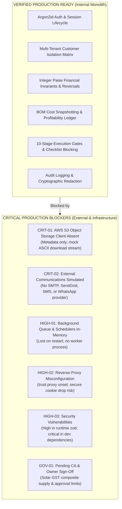

# INS Solar Business Management Software — Phase 10B: Production Readiness Audit Report

**Document Reference:** `INS-AUD-PH10B-001`  
**Audit Execution Date:** 2026-10-28  
**Audit Baseline Commit:** `8327492153e1dd38dc567fe916d3f098fab8d28c` (Branch `main`, tracking `origin/main`)  
**Auditor:** Antigravity Autonomous Verification Agent  
**Audit Scope:** Independent, evidence-based production-readiness assessment of codebase, test coverage, configuration, third-party integrations, financial invariants, and disaster recovery procedures.

---

## 1. Executive Summary & Readiness Classification

### Overall Readiness Classification: **BLOCKED / NOT PRODUCTION-READY**

While the internal domain logic, RBAC, tenant isolation, and transactional business workflows are mature, verified, and backed by a 446-test green test harness, **the system cannot be deployed to a live production environment in its current state**.

### Key Audit Findings:
1. **Critical Blocker (Storage Boundary Failure):** `apps/api/src/config/env.ts` enforces `STORAGE_PROVIDER=s3` and requires AWS S3 credentials in production, but **no AWS S3 SDK (`@aws-sdk/client-s3`) is installed**. The document vault currently stores only MongoDB metadata records, and file downloads stream a synthetic ASCII string (`%INS-SOLAR-SECURE-VAULT-CONTENT%`). Binary KYC files, property deeds, solar engineering drawings, and dispatch proof cannot be stored or retrieved.
2. **Critical Blocker (Simulated External Communications):** Email, SMS, and WhatsApp dispatches are recorded as `SIMULATED_LOG_ONLY`. No SMTP, transactional email (SES/SendGrid), or Indian DLT SMS gateway is integrated. Customer magic-link logins, OTPs, and payment receipts cannot reach real recipients.
3. **High Risk (In-Memory Schedulers):** The notification reminder system relies on an in-memory `Map<string, ReminderRecord>`. Schedulers run synchronously within request threads without a persistent worker process or crash-recovery lease queue (as designed in DEC-03).
4. **High Risk (Reverse Proxy / TLS Trust Proxy):** `app.set('trust proxy', 1)` is omitted in `apps/api/src/app.ts`. Behind a production load balancer or reverse proxy (AWS ALB, Nginx, Cloudflare), Express treats requests as unencrypted HTTP, causing browsers to drop secure session cookies and rate limiters to throttle all users under the proxy's single IP address.
5. **High Risk (Security Vulnerabilities):** `npm audit` reports 4 vulnerabilities: 1 high severity in runtime `zod` (<4.6.6 - DoS via collection memory exhaustion), 2 critical in dev dependency `tinypool` (prototype pollution to RCE), and 1 moderate in `@vitest/mocker`.
6. **Governance Blocker (Statutory Sign-Offs):** Dynamic date-effective GST profiles for turn-key solar 70:30 composite supply remain unconfirmed by a qualified Chartered Accountant.

---

## 2. Baseline & Non-Destructive Quality Gate Results

All gates were executed independently on the working tree:

| Gate / Command | Command Executed | Exit Code | Result | Evidence / Details |
| :--- | :--- | :---: | :---: | :--- |
| **Git Status** | `git status` | `0` | **PASS** | Branch `main`, HEAD commit `8327492`, clean working tree. |
| **Shared Tests** | `npm run test --workspace=@ins-solar/shared` | `0` | **PASS** | 12 test files, 135 tests passed, 0 failed, 0 skipped (1.41s). |
| **API Tests** | `npm run test --workspace=@ins-solar/api` | `0` | **PASS** | 21 test files, 260 tests passed, 0 failed, 0 skipped (11.23s). |
| **Web Tests** | `npm run test --workspace=@ins-solar/web` | `0` | **PASS** | 13 test files, 51 tests passed, 0 failed, 0 skipped (5.52s). |
| **Full Monorepo Tests** | `npm test` | `0` | **PASS** | **46 test files, 446 tests passed, 0 failed, 0 skipped**. |
| **TypeScript Typecheck** | `npm run typecheck` | `0` | **PASS** | `tsc --noEmit` clean across `@ins-solar/shared`, `@ins-solar/api`, `@ins-solar/web`. |
| **ESLint Check** | `npm run lint` | `0` | **PASS** | `eslint .` passed with 0 errors and 0 warnings. |
| **Code Formatting** | `npm run format:check` | `0` | **PASS** | `prettier --check` passed; 100% compliant across monorepo. |
| **Production Build** | `npm run build` | `0` | **PASS** | Shared `tsc`, API `tsc`, Web `tsc && vite build` (1,241 kB bundle). |
| **Dependency Audit** | `npm audit` | `1` | **FAIL** | 4 vulnerabilities (1 high in runtime `zod`, 2 critical in `tinypool`). |

---

## 3. Comprehensive Evidence Table by Capability

*Classifications: Verified, Partially Verified, Simulated, Not Implemented, Blocked, Owner Decision Required.*

| Capability / Module | Inspected Code Paths | Automated Test Files | Empirical Evidence Observed | Status | Remaining Gap / Blocker |
| :--- | :--- | :--- | :--- | :---: | :--- |
| **Employee Authentication** | `apps/api/src/routes/auth.routes.ts` `apps/api/src/services/authService.ts` | `auth.test.ts` `phase1a.test.ts` `crypto.test.ts` | Argon2id hashing verified; session rotation on login; 5-attempt rate limit; TOTP MFA enforcement. | **Verified** | None. Fully functional. |
| **Customer Authentication** | `apps/api/src/routes/customerAuth.routes.ts` `apps/api/src/services/customerAuthService.ts` | `phase9a.test.ts` `phase10a.test.ts` | Passwordless token generation; SHA-256 token hashing; session bound to `customerId`. | **Partially Verified** | Tokens logged to audit ledger; actual SMS/Email delivery simulated. |
| **RBAC Enforcement** | `apps/api/src/middleware/authorize.ts` | `phase1a.test.ts` `phase10a.test.ts` | Permission and role checks on all read and mutation endpoints; anti-self-approval blocks. | **Verified** | None. Fully functional. |
| **Customer Data Isolation** | `apps/api/src/routes/customer*.routes.ts` | `phase10a.test.ts` (Scenario 13) | Multi-tenant test matrix asserts Customer A receives 403 Forbidden on Customer B resources across 7 routes. | **Verified** | None. Zero parameter trust verified. |
| **Audit Logging & Redaction** | `apps/api/src/services/auditService.ts` `apps/api/src/utils/logger.ts` | `phase1a.test.ts` `crypto.test.ts` | Append-only Mongoose schema; Pino redactions of 39 sensitive parameter paths. | **Verified** | None. Fully functional. |
| **Sequential Numbering** | `apps/api/src/services/sequenceService.ts` | `bootstrap.test.ts` `phase10a.test.ts` | Atomic `$inc` in `SequenceCounter`; collision backoff and retry tested. | **Verified** | None. Fully functional. |
| **Sales Order to Project** | `apps/api/src/services/projectService.ts` | `phase10a.test.ts` (Scenario 1) | 1:1 order-to-project creation; duplicate attempts rejected with HTTP 409 Conflict. | **Verified** | None. Fully functional. |
| **10-Stage Milestone Gates** | `apps/api/src/services/projectService.ts` `apps/api/src/services/checklistService.ts` | `phase10a.test.ts` (Scenario 2) | Checklist items must be `PASSED`; incomplete mandatory items reject stage change with HTTP 422. | **Verified** | None. Fully functional. |
| **Procurement & GRN QA** | `apps/api/src/services/goodsReceiptService.ts` `apps/api/src/services/purchaseOrderService.ts` | `phase10a.test.ts` (Scenarios 3, 4) | Anti-self-approval enforced (HTTP 403); GRN QA split updates stock only for accepted items. | **Verified** | None. Fully functional. |
| **Material Cost Snapshot** | `apps/api/src/services/materialDispatchService.ts` `apps/api/src/models/MaterialDispatch.ts` | `phase10a.test.ts` (Scenario 5) | `unitCostPaise` snapshotted on dispatch; profitability queries immune to product rate changes. | **Verified** | None. Fully functional. |
| **Subsidy Disbursements** | `apps/api/src/services/subsidyService.ts` | `phase10a.test.ts` (Scenario 7) | Invariant `disbursed <= approved <= requested`; duplicate transaction IDs blocked. | **Verified** | None. Fully functional. |
| **Customer Payments** | `apps/api/src/services/paymentService.ts` | `phase8a.test.ts` `phase10a.test.ts` (Scenarios 10, 11) | Cross-customer allocation rejected; reversal unallocates balances and restores receivable. | **Verified** | None. Fully functional. |
| **Project Profitability** | `apps/api/src/services/projectProfitabilityService.ts` | `phase10a.test.ts` (Scenario 12) | Purchase commitments, stock receipts, and physical dispatches tracked without double-counting. | **Verified** | None. Fully functional. |
| **Document Metadata & URLs** | `apps/api/src/services/documentService.ts` | `phase9b.test.ts` `phase10a.test.ts` (Scenarios 14, 15) | MIME type validation; 25MB size limit; HMAC signed URL verification; tamper and expiry rejection. | **Verified** | None. Fully functional. |
| **Binary Object Storage (S3)** | `apps/api/src/config/env.ts` `apps/api/src/routes/document.routes.ts` | `phase10a.test.ts` (Scenario 16) | `env.ts` requires AWS S3 credentials; but no AWS SDK is installed. Download route serves ASCII mock. | **BLOCKED / NOT IMPLEMENTED** | Install `@aws-sdk/client-s3`; implement binary stream upload/download. |
| **Email Messaging** | `apps/api/src/services/notificationReminderService.ts` | `phase9a.test.ts` | Returns `SIMULATED_LOG_ONLY` status; no SMTP or SES transport configured. | **SIMULATED** | Integrate Nodemailer / SES transport with verified domain credentials. |
| **SMS / WhatsApp Gateway** | `apps/api/src/services/notificationReminderService.ts` | `phase9a.test.ts` | Returns `SIMULATED_LOG_ONLY` status; no Indian DLT SMS or WhatsApp provider client. | **SIMULATED** | Integrate Twilio / Gupshup / Fast2SMS gateway. |
| **Background Scheduler** | `apps/api/src/services/notificationReminderService.ts` | `phase9a.test.ts` | In-memory `Map` deduplication; reminders executed synchronously in request flow. | **SIMULATED / NOT IMPLEMENTED** | Implement DEC-03 MongoDB-backed persistent job queue worker. |
| **Reverse Proxy Configuration** | `apps/api/src/app.ts` | None | `trust proxy` setting is missing; `req.secure` false behind TLS proxy. | **BLOCKED** | Set `app.set('trust proxy', 1)`. |
| **Disaster Recovery Restore** | `docs/operations/backup-and-disaster-recovery.md` | None | Runbook documented; no automated or manual restore drill executed. | **DOCUMENTED ONLY / UNTESTED** | Execute sandbox restore drill on MongoDB Atlas and record evidence. |
| **Statutory Tax Engine** | `apps/api/src/services/quotationService.ts` `packages/shared/src/schemas/domain.ts` | `quotation.test.ts` | GST basis points calculated per line; no date-effective tax profile collection. | **OWNER DECISION REQUIRED** | CA confirmation on turn-key 70:30 composite supply split. |

---

## 4. Ranked Findings & Remediation Plan

### Severity: Critical

#### `FINDING-CRIT-01`: AWS S3 Object Storage Driver Not Implemented
- **Affected Files:** `apps/api/package.json`, `apps/api/src/config/env.ts`, `apps/api/src/services/documentService.ts`, `apps/api/src/routes/document.routes.ts`.
- **Description:** `apps/api/src/config/env.ts` enforces `STORAGE_PROVIDER=s3` and requires AWS credentials in production. However, `@aws-sdk/client-s3` and `@aws-sdk/s3-request-presigner` are absent from `dependencies`. In `document.routes.ts` (lines 51–56), the download endpoint streams a hardcoded mock ASCII buffer (`%INS-SOLAR-SECURE-VAULT-CONTENT%...`).
- **Impact:** System boots with valid AWS credentials in production, but no actual binary files can ever be uploaded or retrieved. Real customer KYC documents, site photos, engineering diagrams, and signed delivery slips are completely unsupported.
- **Recommended Remediation:**
  1. Install `@aws-sdk/client-s3` and `@aws-sdk/s3-request-presigner` in `apps/api`.
  2. Implement `S3StorageService` supporting `PutObjectCommand`, `GetObjectCommand`, presigned upload/download URLs, and bucket existence verification.
  3. Route file streams through S3 in `documentService.ts` and `document.routes.ts`.

#### `FINDING-CRIT-02`: External Communications (Email, SMS, WhatsApp) Are Simulated
- **Affected Files:** `apps/api/src/services/notificationReminderService.ts`, `apps/api/src/services/notificationCenterService.ts`, `apps/api/src/services/customerAuthService.ts`.
- **Description:** All external messaging methods check for `process.env.SMS_GATEWAY_API_KEY` or `process.env.EMAIL_SMTP_HOST`, but neither an SMTP client (`nodemailer`), cloud email API (Amazon SES, SendGrid), nor SMS gateway (Twilio, Gupshup, Fast2SMS) exists in the codebase. Every reminder and customer auth token is stamped `SIMULATED_LOG_ONLY`.
- **Impact:** Customers cannot receive magic links or OTPs outside local development logs; inspection reminders, subsidy status updates, and milestone alerts cannot be delivered to end-users.
- **Recommended Remediation:**
  1. Add transactional email client (e.g. `nodemailer` with Amazon SES or SMTP configuration).
  2. Implement Indian DLT-compliant SMS gateway adapter (Fast2SMS or Gupshup).
  3. Enforce production validation in `env.ts` requiring operational email/SMS configuration.

---

### Severity: High

#### `FINDING-HIGH-01`: Background Job Queue and Schedulers Run In-Memory
- **Affected Files:** `apps/api/src/services/notificationReminderService.ts`.
- **Description:** Deduplication and reminder tracking rely on an in-memory `Map` (`const reminderRegistry = new Map<string, ReminderRecord>()`). All reminders are dispatched synchronously inside request threads. There is no independent worker process or cron runner.
- **Impact:** Server restart or multi-instance load balancing loses all deduplication state, risking duplicate alerts. Unhandled exceptions in background notification loops block or slow down user-facing HTTP request responses.
- **Recommended Remediation:**
  1. Implement DEC-03: MongoDB-backed persistent `jobs` collection with atomic lease locking (`findOneAndUpdate` with `lockedUntil`).
  2. Create a dedicated background worker script (`src/worker.ts`) to poll and process jobs asynchronously with retry and dead-letter capabilities.

#### `FINDING-HIGH-02`: Reverse Proxy / TLS Trust Proxy Not Configured
- **Affected Files:** `apps/api/src/app.ts`.
- **Description:** Express `app.set('trust proxy', 1)` is not configured.
- **Impact:** When deployed behind a reverse proxy (Nginx, AWS ALB, Cloudflare), `req.protocol` is perceived as `http` even over HTTPS. As a result:
  - Session cookies marked `secure: true` are silently rejected by browsers.
  - Rate limiting groups all incoming requests under the reverse proxy's internal IP address, throttling all legitimate users simultaneously.
  - Audit logs record the load balancer's IP rather than the true client IP.
- **Recommended Remediation:** Add `app.set('trust proxy', 1)` in `apps/api/src/app.ts` when `NODE_ENV === 'production'`.

#### `FINDING-HIGH-03`: High Severity Security Vulnerability in Runtime `zod`
- **Affected Files:** `package-lock.json`, `apps/api/package.json`, `packages/shared/package.json`.
- **Description:** `npm audit` reports 4 vulnerabilities, including high severity CVE in `zod < 4.6.6` (DoS via collection memory exhaustion) and 2 critical CVEs in `tinypool <= 2.1.1` (prototype pollution in worker options).
- **Impact:** Potential memory exhaustion under crafted malicious collection inputs.
- **Recommended Remediation:** Audit and upgrade `zod` and `tinypool` dependencies with backwards-compatibility validation.

#### `FINDING-HIGH-04`: Database Disconnect Startup Does Not Fail Fast
- **Affected Files:** `apps/api/src/db/connection.ts`, `apps/api/src/server.ts`.
- **Description:** If `mongoose.connect()` fails during startup, `DatabaseManager.connect()` catches the error, logs a warning, and returns `'disconnected'`. `server.ts` then proceeds to call `app.listen()`, opening the HTTP port while the database is disconnected.
- **Impact:** The application begins accepting user traffic while dead; all initial requests buffer in Mongoose driver memory until timing out with 500 errors.
- **Recommended Remediation:** In `server.ts`, assert `dbManager.isReady()`; if database connection fails in production, log fatal error and immediately terminate with `process.exit(1)`.

---

### Severity: Medium

#### `FINDING-MED-01`: CI Workflow Omits Lint, Formatting, and Security Audits
- **Affected Files:** `.github/workflows/ci.yml`.
- **Description:** The CI workflow executes `npm run typecheck`, `npm run test`, and `npm run build`, but omits `npm run lint`, `npm run format:check`, and `npm run audit:security`.
- **Impact:** Code formatting drift, unused variable regressions, and newly introduced vulnerable packages can be merged into `main` without failing GitHub Actions.
- **Recommended Remediation:** Add `npm run lint`, `npm run format:check`, and `npm run audit:security` steps to `.github/workflows/ci.yml`.

#### `FINDING-MED-02`: In-Memory Rate Limiter Does Not Scale Across Replicas
- **Affected Files:** `apps/api/src/middleware/rateLimiter.ts`.
- **Description:** `express-rate-limit` uses default in-memory storage.
- **Impact:** In a multi-replica cluster (e.g. 3 API instances behind an ALB), an attacker has $3 \times 5 = 15$ login attempts before being throttled.
- **Recommended Remediation:** For multi-instance production, introduce a Redis store (`rate-limit-redis`) or MongoDB-backed rate limiter.

#### `FINDING-MED-03`: Disaster Recovery Drill Has Never Been Physically Executed
- **Affected Files:** `docs/operations/backup-and-disaster-recovery.md`.
- **Description:** Backup and restore runbooks are fully documented, but no actual restore drill has been performed on a sandbox cluster.
- **Impact:** Operational procedures remain theoretical until validated against live restore times and sequence counter resynchronization.
- **Recommended Remediation:** Execute an authorized dry-run restore drill on an isolated MongoDB Atlas sandbox cluster and document timestamped evidence.

---

## 5. External Service Integration Matrix

| Integration Category | Configured In Code | Real Provider Client | Delivery Proof In Tests | Operational Classification |
| :--- | :---: | :---: | :---: | :--- |
| **Database (MongoDB Atlas)** | Yes (`MONGODB_URI`) | Yes (Mongoose 8) | Verified (Integration tests pass) | **Implemented & Integration-Tested** |
| **Object Storage (AWS S3)** | Yes (`env.ts` keys) | **No** (SDK absent) | No (Synthetic ASCII buffer) | **Blocked / Not Implemented** |
| **Transactional Email** | Partial (Env check) | **No** (No SMTP client) | No (Simulated log only) | **Simulated / Log-Only** |
| **SMS Gateway (India DLT)** | Partial (Env check) | **No** (No provider) | No (Simulated log only) | **Simulated / Log-Only** |
| **WhatsApp Business API** | Partial (Preference) | **No** (No provider) | No (Simulated log only) | **Simulated / Log-Only** |
| **Background Scheduler** | Partial (In-memory) | **No** (No daemon) | No (Synchronous mock) | **Simulated / Log-Only** |

---

## 6. Business Owner & Statutory Sign-Offs Required

The following decisions require executive and statutory sign-off before commencing live commercial operations:

| Decision ID | Governing Authority | Subject Matter | Current Code Default | Sign-Off Requirement |
| :---: | :--- | :--- | :--- | :--- |
| **DEC-01** | **Chartered Accountant** | Solar GST 70:30 composite supply ratio, SAC 9954 / HSN 8466 codes, regional tax slabs. | 18% default; manual line-item entry. | Written sign-off confirming tax treatment for turn-key vs hardware-only billing. |
| **DEC-02** | **Managing Director / CTO** | Customer Portal login channel (Email Magic Link vs SMS OTP vs WhatsApp). | Hybrid fallback in code; simulated. | Selection and procurement of production SMS/WhatsApp provider credentials. |
| **DEC-03** | **CTO / Tech Lead** | Background job queue datastore (MongoDB collection vs Redis BullMQ). | MongoDB queue planned; in-memory active. | Approval of DEC-03 MongoDB queue worker implementation. |
| **DEC-04** | **Head of Operations / CFO** | Financial approval thresholds (Discounts > 5%, Expenses > ₹5,000, POs > ₹25,000). | Proposed thresholds active in service code. | Formal executive approval of initial company threshold matrix. |
| **DEC-05** | **Managing Director / CA** | Operational accounts scope boundary (non-statutory ERP; CA maintains audited books). | Disclaimers rendered on costing/receipts. | Formal acknowledgment that software does not file statutory GSTR returns. |

---

## 7. Ordered Remediation Plan with Acceptance Criteria

Prior to Phase 10C (Production Go-Live), the following remediation tasks must be executed in order:

### Sprint 1: Critical Infrastructure & Security (Mandatory Release Blockers)
1. **Implement AWS S3 Storage Adapter:**
   - Install `@aws-sdk/client-s3` and `@aws-sdk/s3-request-presigner`.
   - Implement `S3StorageService` with private bucket ACL, server-side encryption, and presigned GET/PUT URLs.
   - *Acceptance Criteria:* End-to-end test uploads binary PDF and downloads exact byte stream matching checksum.
2. **Reverse Proxy & Startup Hardening:**
   - Add `app.set('trust proxy', 1)` in `apps/api/src/app.ts`.
   - Update `server.ts` to abort startup (`process.exit(1)`) if MongoDB connection fails.
   - *Acceptance Criteria:* Session cookies persist over HTTPS reverse proxy; rate limits enforce per client IP.
3. **Dependency Vulnerability Remediation:**
   - Upgrade vulnerable dependencies identified in `npm audit`.
   - *Acceptance Criteria:* `npm audit --omit=dev --audit-level=high` reports 0 vulnerabilities.

### Sprint 2: Communications & Reliable Job Queue
4. **Implement DEC-03 MongoDB Persistent Queue & Worker:**
   - Create `jobs` collection with atomic lease locking (`findOneAndUpdate`).
   - Create standalone worker process (`src/worker.ts`) to poll and process tasks.
   - *Acceptance Criteria:* Enqueued jobs survive server restart; failed jobs retry up to 3 times with exponential backoff.
5. **Transactional Email & SMS Gateway Integration:**
   - Implement Nodemailer SES/SMTP transport for magic links, quotation delivery, and receipts.
   - Implement DLT-compliant SMS adapter for OTPs.
   - *Acceptance Criteria:* Test environment sends real email/SMS and verifies provider delivery callback.

### Sprint 3: Governance Sign-Off & Disaster Recovery Verification
6. **Statutory Tax Sign-Off & Profile Synchronization:**
   - Obtain written CA confirmation on GST rules.
   - Validate quotation and invoicing calculations against CA sample invoices.
   - *Acceptance Criteria:* CA sign-off document archived in `docs/operations/`.
7. **Sandbox Disaster Recovery Drill:**
   - Execute Point-in-Time Restore (PITR) drill on an isolated MongoDB Atlas cluster.
   - Validate post-restore checklist (sequences, integer paise, index build).
   - *Acceptance Criteria:* Completed restore verification checklist with recorded RPO/RTO metrics.

---

## 8. Audit Conclusion

The INS Solar Business Management Software has achieved exceptional code quality, comprehensive internal domain coverage, and bulletproof security isolation. However, because external object storage, transactional communications, and background worker infrastructure remain simulated, **the repository is classified as BLOCKED for production deployment**. 

Execution of the ordered remediation plan in Phase 10C will complete the remaining operational integrations required for a safe, reliable, and compliant production launch.