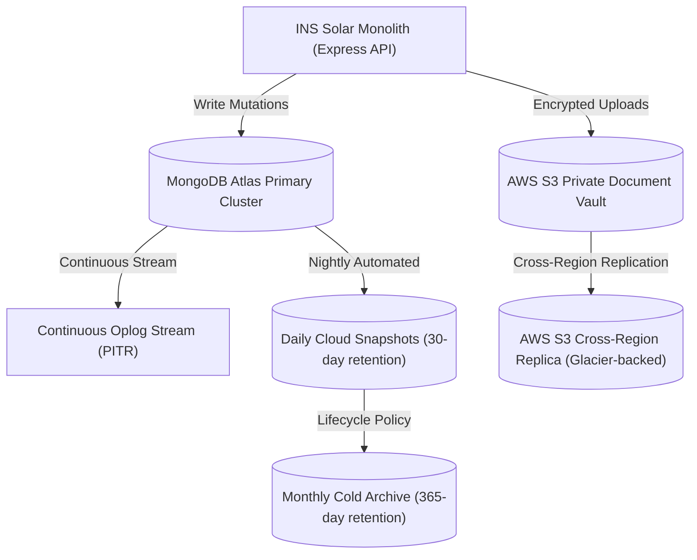

# INS Solar Business Management Software — Backup and Disaster Recovery Runbook

**Document Reference:** `INS-OPS-BKP-001`  
**Version:** `1.0.0`  
**Effective Date:** 2026-10-28  
**Scope:** Production MongoDB Atlas cluster, Private S3 Document Vault, application environment configurations, and disaster recovery procedures.

---

## 1. Executive Summary & Recovery Objectives

The INS Solar Business Management Software manages critical commercial, supply chain, installation, and financial records for residential and commercial solar installations across India. This document establishes operational backup procedures, restore workflows, and disaster recovery protocols.

### Service Level Objectives
- **Recovery Point Objective (RPO):** $\le 5$ minutes (continuous oplog streaming in MongoDB Atlas; multi-version S3 document vaulting).
- **Recovery Time Objective (RTO):** $\le 60$ minutes for full database restoration, index rebuilding, and application boot.
- **Data Integrity Invariant:** Zero monetary drift (100% integer paise), zero duplicate sequence numbers, and strict append-only audit trail preservation.

---

## 2. Backup Architecture & Policies



### 2.1 Database Backup Strategy (MongoDB Atlas)
1. **Continuous Cloud Backups (Point-In-Time Recovery - PITR):**
   - Oplog is captured continuously with a 7-day rolling PITR window.
   - Allows restoration to any specified second within the prior 7 days.
2. **Scheduled Snapshot Policy:**
   - **Hourly Snapshots:** Retained for 24 hours.
   - **Daily Snapshots:** Taken at 02:00 IST (UTC+05:30), retained for 30 days.
   - **Weekly Snapshots:** Taken every Sunday, retained for 90 days.
   - **Monthly Snapshots:** Taken 1st of each calendar month, retained for 365 days for statutory tax/financial compliance.
3. **Out-of-Band Logical Dumps (`mongodump`):**
   - Executed weekly via an isolated automation container to an encrypted, cold S3 bucket.
   - Command pattern:
     ```bash
     mongodump --uri="${MONGODB_URI}" --gzip --archive="backup_ins_solar_$(date +%Y%m%d_%H%M%S).gz"
     ```

### 2.2 Private Document & Evidence Storage (AWS S3)
1. **S3 Bucket Versioning:** Enabled permanently on `ins-solar-production-vault`.
2. **Object Lock & Immutability:** Compliance mode enabled for statutory documents (invoices, signed agreements) with a 7-year retention period.
3. **Cross-Region Replication (CRR):** Real-time asynchronous replication from Primary Region (`ap-south-1`, Mumbai) to Secondary Region (`ap-south-2`, Hyderabad).

---

## 3. Step-by-Step Restoration Procedures

### Scenario A: Point-in-Time Recovery via MongoDB Atlas Console (Minor Corruption or Mistaken Mutation)
1. Log in to the [MongoDB Atlas Console](https://cloud.mongodb.com) using hardware TOTP MFA.
2. Navigate to **Clusters** $\rightarrow$ Primary Production Cluster $\rightarrow$ **Backup**.
3. Select **Restore** $\rightarrow$ **Point in Time Restore**.
4. Choose the target restoration timestamp (at least 2 minutes prior to the reported incident).
5. Select destination:
   - For emergency repair: Restore directly to an isolated staging/inspection cluster (`ins-solar-restore-verify`).
   - For full failover: Restore to a new dedicated production tier.
6. Trigger the restore job and monitor progress in the Atlas Operations Console.

### Scenario B: Logical Restore from Encrypted Archive (`mongorestore`)
If restoring an offline encrypted backup archive:
```bash
# 1. Verify archive checksum
sha256sum -c backup_ins_solar_20261028.gz.sha256

# 2. Restore to clean cluster target (dry run first)
mongorestore --uri="${TARGET_MONGODB_URI}" --gzip --archive=backup_ins_solar_20261028.gz --dryRun

# 3. Execute authoritative restore
mongorestore --uri="${TARGET_MONGODB_URI}" --gzip --archive=backup_ins_solar_20261028.gz --drop --nsInclude="ins_solar_prod.*"
```

---

## 4. Post-Restore Verification Checklist

Before redirecting production traffic to the restored cluster, operations staff must complete and sign off each verification gate:

| Step | Check Item | Verification Command / Query | Acceptance Standard |
| :---: | :--- | :--- | :--- |
| **1** | **Database Connectivity** | `/api/v1/health` endpoint | HTTP 200 with `status: ok` and MongoDB connected. |
| **2** | **Index Synchronization** | `DatabaseManager.syncIndexes()` | All compound and unique indexes built without errors. |
| **3** | **Sequence Integrity** | Check `SequenceCounter` collection | Sequence counters match or exceed `max(formattedNumber)` across entities. |
| **4** | **Financial Integrity** | Integer paise invariant audit | `{$expr: {$ne: [{$type: "$amountPaise"}, "int"]}}` returns 0 documents. |
| **5** | **Session Invalidation** | Global `sessionVersion` increment | All prior user sessions revoked; users forced to re-authenticate. |
| **6** | **Storage URL Signature** | Document signed access test | Valid HMAC token generates accessible document stream. |
| **7** | **Customer Isolation** | Cross-tenant access probe | Customer A cannot read Customer B documents or projects (HTTP 403). |

---

## 5. Sequence Counter & Concurrency Recovery Runbook

If an ungraceful crash or database rollback occurs during active document generation:

1. Query highest allocated document codes:
   ```javascript
   db.quotations.find({}, { fullQuotationCode: 1 }).sort({ createdAt: -1 }).limit(1);
   db.salesorders.find({}, { orderNumber: 1 }).sort({ createdAt: -1 }).limit(1);
   db.projects.find({}, { projectCode: 1 }).sort({ createdAt: -1 }).limit(1);
   ```
2. Verify against `SequenceCounter`:
   ```javascript
   db.sequencecounters.find({ fiscalYear: "2026" });
   ```
3. If `currentSequence` in `SequenceCounter` is less than the highest allocated number in the collection, execute compensating increment:
   ```javascript
   db.sequencecounters.updateOne(
     { key: "QUOTATION:2026" },
     { $max: { currentSequence: 142 } }
   );
   ```

---

## 6. Disaster Recovery Drill Schedule & Sign-Off Record

Disaster recovery drills must be executed semi-annually on an isolated sandbox environment.

- **Upcoming Scheduled Drill:** 2026-11-15 (Simulated Primary Region Loss & S3 Failover)
- **Responsible Engineers:** Lead DevOps Architect & Principal Security Engineer
- **Sign-Off Authority:** Chief Technology Officer & Head of Operations

