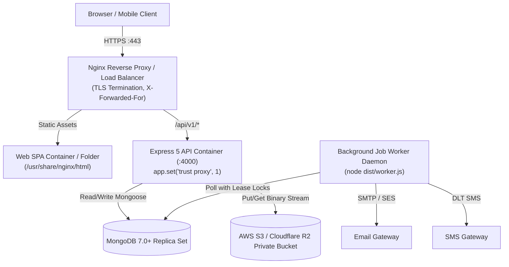

# INS Solar Business Management Software — Production Deployment Guide

**Document Reference:** `INS-OPS-DEP-001`  
**Version:** `1.0.0`  
**Target Environment:** Linux VPS (Ubuntu 22.04 LTS / Debian 12), Docker / Docker Compose, or Kubernetes  
**Status:** Approved Operational Guide  

---

## 1. Architecture Overview

The INS Solar Business Management Software is structured as a modular monorepo:
1. **Frontend (`apps/web`):** React 18, Vite, Tailwind CSS SPA served via Nginx with gzip compression, asset hashing, and client-side routing fallback.
2. **Backend API (`apps/api`):** Express 5, TypeScript modular monolith running behind an HTTPS reverse proxy with `trust proxy: 1`.
3. **Background Worker (`apps/api/dist/worker.js`):** Standalone asynchronous daemon executing persistent MongoDB-backed queue jobs (DEC-03) with atomic lease locks.
4. **Primary Database:** MongoDB 7.0+ (Atlas Replica Set or self-hosted replica set with WiredTiger engine).
5. **Object Storage:** AWS S3 or Cloudflare R2 (100% private bucket, AES-256 encryption, presigned URL access).



---

## 2. Infrastructure & Sizing Requirements

| Component | Minimum Sizing | Recommended Production Sizing |
| :--- | :--- | :--- |
| **Server Host** | 2 vCPU, 4 GB RAM, 40 GB NVMe | 4 vCPU, 8 GB RAM, 80 GB NVMe |
| **Operating System** | Ubuntu 22.04 LTS / Debian 12 | Ubuntu 22.04 LTS |
| **Node.js Runtime** | Node.js v20.x LTS | Node.js v20.18+ LTS |
| **MongoDB Database** | MongoDB Atlas M0 (Dev only) | MongoDB Atlas M10 Replica Set (Prod) |
| **Object Storage** | MinIO (Self-hosted) | AWS S3 or Cloudflare R2 (10 GB free egress) |

---

## 3. Environment Variables Configuration

Copy `.env.example` to `.env` in the production environment:
```bash
cp .env.example .env
chmod 600 .env
```

### Critical Security Secrets Generation
Generate cryptographic secrets prior to booting the production environment:
```bash
# Generate 32-character Session Secret
openssl rand -hex 32

# Generate 32-byte (64 hex characters) MFA Encryption Key
openssl rand -hex 32

# Generate 32-character CSRF Secret
openssl rand -hex 32
```

### Production `.env` Required Parameters:
*   `NODE_ENV=production`
*   `PORT=4000`
*   `CORS_ORIGIN=https://app.inssolar.com`
*   `TRUST_PROXY=1` (Strictly avoids wildcard `true` to block IP spoofing)
*   `MONGODB_URI=mongodb+srv://<user>:<pass>@cluster0.mongodb.net/ins_solar_prod?retryWrites=true&w=majority`
*   `STORAGE_PROVIDER=s3` (Simulated storage is strictly rejected in production)
*   `AWS_REGION=ap-south-1`
*   `AWS_S3_BUCKET=ins-solar-documents-private`
*   `AWS_ACCESS_KEY_ID=AKIA...`
*   `AWS_SECRET_ACCESS_KEY=...`

---

## 4. Deployment Methods

### Option A: Containerized Deployment (Docker Compose — Recommended)

1. **Verify Docker and Docker Compose Installation:**
   ```bash
   docker --version
   docker compose version
   ```

2. **Build and Launch All Services:**
   ```bash
   docker compose build
   docker compose up -d
   ```

3. **Verify Container Health:**
   ```bash
   docker compose ps
   ```
   All containers (`inssolar-mongodb`, `inssolar-api`, `inssolar-worker`, `inssolar-web`) must report `healthy` or `running`.

4. **Initialize Superadmin Account:**
   ```bash
   docker compose exec api node apps/api/dist/scripts/bootstrap-admin.js
   ```

---

### Option B: Bare-Metal Systemd Deployment

#### 1. Build the Monorepo:
```bash
npm ci
npm run build
```

#### 2. Configure Systemd Services:

**API Service (`/etc/systemd/system/inssolar-api.service`):**
```ini
[Unit]
Description=INS Solar Express API Server
After=network.target mongodb.service

[Service]
Type=simple
User=inssolar
WorkingDirectory=/opt/inssolar
EnvironmentFile=/opt/inssolar/.env
ExecStart=/usr/bin/node apps/api/dist/server.js
Restart=always
RestartSec=5
StandardOutput=journal
StandardError=journal

[Install]
WantedBy=multi-user.target
```

**Worker Daemon (`/etc/systemd/system/inssolar-worker.service`):**
```ini
[Unit]
Description=INS Solar Background Job Worker Daemon
After=network.target inssolar-api.service

[Service]
Type=simple
User=inssolar
WorkingDirectory=/opt/inssolar
EnvironmentFile=/opt/inssolar/.env
ExecStart=/usr/bin/node apps/api/dist/worker.js
Restart=always
RestartSec=10
StandardOutput=journal
StandardError=journal

[Install]
WantedBy=multi-user.target
```

#### 3. Enable and Start Services:
```bash
sudo systemctl daemon-reload
sudo systemctl enable --now inssolar-api
sudo systemctl enable --now inssolar-worker
sudo systemctl status inssolar-api
```

---

## 5. Reverse Proxy Configuration (Nginx & SSL/TLS)

Install Nginx and configure Let's Encrypt Certbot:
```bash
sudo apt update && sudo apt install -y nginx certbot python3-certbot-nginx
```

Create `/etc/nginx/sites-available/inssolar.conf`:
```nginx
# HTTP to HTTPS redirect
server {
    listen 80;
    server_name app.inssolar.com api.inssolar.com;
    return 301 https://$host$request_uri;
}

# Web SPA Frontend
server {
    listen 443 ssl http2;
    server_name app.inssolar.com;

    ssl_certificate /etc/letsencrypt/live/app.inssolar.com/fullchain.pem;
    ssl_certificate_key /etc/letsencrypt/live/app.inssolar.com/privkey.pem;
    ssl_protocols TLSv1.2 TLSv1.3;
    ssl_ciphers HIGH:!aNULL:!MD5;

    root /opt/inssolar/apps/web/dist;
    index index.html;

    location / {
        try_files $uri $uri/ /index.html;
    }

    location ~* \.(?:css|js|woff2?|svg|png|jpg|ico|webp)$ {
        expires 1y;
        add_header Cache-Control "public, max-age=31536000, immutable";
    }
}

# Backend API
server {
    listen 443 ssl http2;
    server_name api.inssolar.com;

    ssl_certificate /etc/letsencrypt/live/api.inssolar.com/fullchain.pem;
    ssl_certificate_key /etc/letsencrypt/live/api.inssolar.com/privkey.pem;

    client_max_body_size 30M;

    location / {
        proxy_pass http://127.0.0.1:4000;
        proxy_http_version 1.1;
        proxy_set_header Upgrade $http_upgrade;
        proxy_set_header Connection 'upgrade';
        proxy_set_header Host $host;
        proxy_set_header X-Real-IP $remote_addr;
        proxy_set_header X-Forwarded-For $proxy_add_x_forwarded_for;
        proxy_set_header X-Forwarded-Proto $scheme;
        proxy_cache_bypass $http_upgrade;
    }
}
```

Enable site and restart Nginx:
```bash
sudo ln -s /etc/nginx/sites-available/inssolar.conf /etc/nginx/sites-enabled/
sudo nginx -t
sudo systemctl restart nginx
```

---

## 6. Verification & Health Monitoring

1. **API Readiness Probe:**
   ```bash
   curl -i https://api.inssolar.com/api/v1/health
   # Returns HTTP 200: {"success":true,"data":{"status":"HEALTHY","database":"connected"}}
   ```

2. **Storage Health Verification:**
   Ensure S3 bucket is created with **Block All Public Access = ON**.

3. **Log Monitoring:**
   ```bash
   # Systemd
   journalctl -u inssolar-api -f
   journalctl -u inssolar-worker -f

   # Docker
   docker compose logs -f api
   docker compose logs -f worker
   ```

---

## 7. Zero-Downtime Rolling Updates

To perform a zero-downtime update:
```bash
git pull origin main
npm ci
npm run build

# Restart worker daemon first
sudo systemctl restart inssolar-worker

# Restart API process
sudo systemctl restart inssolar-api
```
