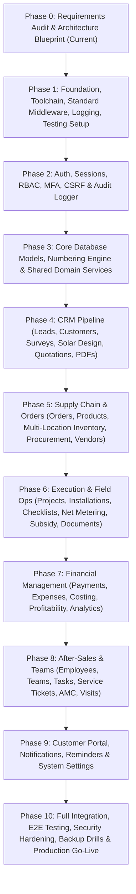

# INS Solar Business Management Software — Implementation Roadmap

**Document Reference:** `INS-PLN-ROA-001`  
**Version:** `1.0.0`  
**Status:** Approved Phase Plan  
**Total Planned Phases:** 11 Phases (Phase 0 through Phase 10)  
**Methodology:** Incremental, Dependency-Gated, Test-Driven Modular Delivery  

---

## 1. Roadmap Overview & Dependency Flow

---

## 2. Phase-by-Phase Execution Plan

### Phase 0: Requirements Audit & Master Blueprint (Current)
*   **Focus:** Workspace inspection, complete requirements inventory (all 30 modules, 6 panels, 30 business decisions), technical architecture, data design, API conventions, implementation roadmap, and risk register.
*   **Entry Criteria:** Clean workspace initialization.
*   **Deliverables:**
    1.  `docs/requirements/requirements-catalog.md`
    2.  `docs/requirements/feature-traceability-matrix.md`
    3.  `docs/architecture/system-architecture.md`
    4.  `docs/architecture/database-design.md`
    5.  `docs/architecture/api-conventions.md`
    6.  `docs/planning/implementation-roadmap.md`
    7.  `docs/planning/open-decisions-and-risks.md`
    8.  `docs/planning/phase-0-review-report.md`
*   **Acceptance Criteria:** 100% of required modules, panels, and business rules documented and mapped to testable criteria.
*   **Test Gate:** Independent architectural audit and verification sign-off.
*   **Deployment Gate:** No code written in this phase; ready for user review.

---

### Phase 1: Repository Foundation, Configuration, Quality & Toolchain
*   **Focus:** Monorepo or clean modular structure, Node.js 24 LTS, Vite, TypeScript strict configuration, Tailwind CSS, shadcn/ui foundation, ESLint, Prettier, Pino logger, unified Express error handler, and Vitest test runner.
*   **Entry Criteria:** Approval of Phase 0 Blueprint.
*   **Deliverables:**
    *   Package manifests (`package.json`, lockfiles) with verified, non-deprecated stable packages.
    *   Strict `tsconfig.json` for both server and client workspaces.
    *   Express 5 application shell with correlation ID middleware, Pino logging, and standard response helpers.
    *   Client shell with Vite, Tailwind CSS tokens, and initial `shadcn/ui` components.
    *   Automated test harness (Vitest, Supertest, Testing Library).
*   **Acceptance Criteria:** `npm run build`, `npm run lint`, and `npm run test` pass with 0 errors and 0 warnings.
*   **Test Gate:** Baseline health check endpoint (`/api/v1/health`) verified with automated integration tests.
*   **Deployment Gate:** CI pipeline passing on local and git runner.

---

### Phase 2: Authentication, Sessions, Roles, Permissions & Security
*   **Focus:** Server-managed stateful sessions, HttpOnly cookies, Argon2id password hashing, TOTP MFA for privileged roles, CSRF protection, RBAC permission middleware, customer isolation guard, and audit log emitter.
*   **Entry Criteria:** Phase 1 Foundation passing all tests.
*   **Deliverables:**
    *   `User`, `Session`, and `AuditLog` Mongoose schemas.
    *   Auth endpoints (`/api/v1/auth/login`, `/logout`, `/me`, `/mfa/setup`, `/mfa/verify`).
    *   Express auth middleware (`requireAuth`, `requireRole`, `requirePermission`).
    *   Client auth context, login interface, session persistence, and protected route wrappers.
*   **Acceptance Criteria:** Secure session lifecycle; instant session revocation on logout/deactivation; passwords hashed with Argon2id; MFA enforced for Admin/Accounts roles.
*   **Test Gate:** Comprehensive Supertest suite covering brute-force protection, invalid passwords, expired sessions, CSRF rejections, and unauthorized route access.

---

### Phase 3: Database Models, Numbering Engine & Shared Domain Services
*   **Focus:** Core database connections (MongoDB Atlas), Mongoose schema definitions, compound indexes, sequential document numbering engine (`SequenceService`), centralized tax calculator (`TaxCalculationService`), and atomic transaction helpers.
*   **Entry Criteria:** Phase 2 Auth passing all tests.
*   **Deliverables:**
    *   MongoDB connection manager with retry logic, replica set support, and graceful shutdown.
    *   Atomic `SequenceService` guaranteeing sequential, non-colliding IDs (`QT-YYYY-XXXXX`, `ORD-YYYY-XXXXX`, etc.).
    *   `TaxCalculationService` supporting standard GST, solar 70:30 split, and non-GST regimes with integer paise precision.
    *   Shared validation schemas and common domain utilities.
*   **Acceptance Criteria:** Atomic sequence generator tested under high concurrent load with zero duplicate keys.
*   **Test Gate:** Unit tests asserting 100% precision on financial and tax calculations; sequence generation concurrency tests.

---

### Phase 4: CRM Pipeline (Leads, Customers, Surveys, Solar Design, Quotations & PDFs)
*   **Focus:** Lead management, customer directory, site profiles, feasibility surveys, tri-topology solar design (On-Grid, Off-Grid, Hybrid), quotation generator, discount approval gates, and server-side PDF proposal compiler.
*   **Entry Criteria:** Phase 3 Core Data & Services verified.
*   **Deliverables:**
    *   Modules 2, 3, 4, 5, 6, 7, 8 implemented end-to-end.
    *   Duplicate lead phone check and assignment workflow.
    *   Solar sizing engine calculating panel counts, inverters, and battery capacities.
    *   Quotation management with multi-revision tracking (`R0`, `R1`) and PDF generation.
    *   Sales Panel views for Leads, Surveys, and Quotations.
*   **Acceptance Criteria:** Complete sales flow from lead capture to accepted quotation PDF; discounts > threshold blocked without Admin sign-off.
*   **Test Gate:** Integration tests for lead state transitions, sizing calculation accuracy, and PDF compilation.

---

### Phase 5: Supply Chain & Orders (Orders, Products, Multi-Location Inventory, Procurement & Vendors)
*   **Focus:** Order confirmation locking accepted quotation terms, product master catalog, multi-location inventory (Warehouse, Site, Employee Issued), atomic stock reservations, material dispatch slips, shortage blocking, purchase orders, and vendor ledgers.
*   **Entry Criteria:** Phase 4 CRM Pipeline verified.
*   **Deliverables:**
    *   Modules 9, 10, 11, 12, 13 implemented end-to-end.
    *   Order confirmation auto-creating project and placing stock reservations.
    *   Multi-location inventory tracking with atomic anti-negative stock guards.
    *   PO generation, GRN stock-in flow, and vendor accounts payable ledger.
    *   Inventory Panel interface for storekeepers.
*   **Acceptance Criteria:** Stock cannot fall below zero; physical issue is hard-blocked on shortages; order locks prices permanently against catalog changes.
*   **Test Gate:** Concurrent stock reservation tests; negative balance rejection tests; PO to GRN stock-in integration tests.

---

### Phase 6: Field Execution & Operations (Projects, Installations, Checklists, Net Metering & Documents)
*   **Focus:** Project management (10 linear stages), daily installation tracking, mandatory 5-category installation checklists with geotagged photos, pre-commissioning electrical testing, DISCOM net metering tracking, subsidy tracking, and secure object storage document management.
*   **Entry Criteria:** Phase 5 Supply Chain verified.
*   **Deliverables:**
    *   Modules 14, 15, 16, 17, 26 implemented end-to-end.
    *   Project stage-gate progression engine.
    *   Installation checklist submission requiring photos for each category before approval.
    *   Private S3 document storage with short-lived pre-signed URLs.
    *   Installation Panel interface for field crews and project managers.
*   **Acceptance Criteria:** Projects advance strictly through valid stage gates; checklist approval requires verified photos; documents secured behind authenticated signed URLs.
*   **Test Gate:** Stage transition validation tests; checklist rejection on missing photos; S3 upload/download authorization tests.

---

### Phase 7: Financial Management (Payments, Expenses, Costing, Profitability & Reports)
*   **Focus:** Cash collections (advances, partial payments), duplicate payment submission prevention, payment receipt PDF vouchers, project-level expense logging with tiered approvals, real-time project costing and gross margin analytics, and exportable business reports.
*   **Entry Criteria:** Phase 6 Operations verified.
*   **Deliverables:**
    *   Modules 1, 18, 19, 20, 27 implemented end-to-end.
    *   Payment ledger with idempotency safeguards and running balance tracking.
    *   Project costing engine computing actual landed hardware + labor + expense costs.
    *   Cost variance analysis (Estimated BOM vs Actual Cost).
    *   Executive Dashboard and Reports & Analytics module with CSV/Excel exports.
    *   Accounts Panel interface for finance staff.
*   **Acceptance Criteria:** Duplicate payments prevented via idempotency keys; project profit and margin percentages accurately calculated; reports export valid CSV/Excel.
*   **Test Gate:** Financial ledger reconciliation unit tests; idempotency concurrency tests; report calculation accuracy tests.

---

### Phase 8: After-Sales & Team Management (Employees, Teams, Tasks, Break-Fix, Warranty, AMC & Visits)
*   **Focus:** Employee directory, team composition, task Kanban board, break-fix service tickets, warranty tracking (panel barcodes, inverter serials), recurring AMC contracts, and scheduled preventive maintenance visit logging.
*   **Entry Criteria:** Phase 7 Financials verified.
*   **Deliverables:**
    *   Modules 21, 22, 23, 24, 25 implemented end-to-end.
    *   Service complaint ticketing with SLA tracking and spare parts logging.
    *   AMC schedule generator batch-creating quarterly/periodic visit records.
    *   Field service visit report with customer signature capture.
    *   Service Panel interface for maintenance technicians.
*   **Acceptance Criteria:** AMC batch generator correctly provisions future service visits; spare parts consumed update inventory balances.
*   **Test Gate:** Service ticket lifecycle tests; AMC visit batch scheduling unit test; warranty claim linkage test.

---

### Phase 9: Customer Portal, Notifications, Reminders & System Settings
*   **Focus:** External Customer Portal (isolated project tracker, quotation acceptance, bill upload, invoices), in-app notification center, transactional emails, configurable WhatsApp templates, automated chron-based reminder engine, and global settings/masters console.
*   **Entry Criteria:** Phase 8 After-Sales verified.
*   **Deliverables:**
    *   Modules 28, 29, 30 and Customer Portal (`REQ-PNL-07`) implemented end-to-end.
    *   Customer portal interface with magic link or credential authentication.
    *   In-app notification center and database-backed job runner for reminders.
    *   Global settings console for brands, pricing slabs, tax rules, and approval limits.
*   **Acceptance Criteria:** Customers can only view their own projects/quotations; customer quotation acceptance triggers operational order alert; background reminders trigger reliably.
*   **Test Gate:** Customer isolation security tests; notification event dispatch tests; reminder cron execution tests.

---

### Phase 10: Full Integration, End-to-End Verification, Hardening & Production Go-Live
*   **Focus:** Complete panel integration (Admin, Sales, Installation, Accounts, Service, Inventory), end-to-end Playwright tests, performance testing, security vulnerability scans, backup/restore disaster recovery drills, staging deployment, and production release.
*   **Entry Criteria:** All Modules 1–30 and Panels implemented.
*   **Deliverables:**
    *   Automated Playwright E2E suite covering critical user journeys (Lead $\rightarrow$ Quote $\rightarrow$ Order $\rightarrow$ Project $\rightarrow$ Install $\rightarrow$ Payment $\rightarrow$ Commissioning).
    *   Security audit report (OWASP Top 10 check, dependency vulnerability audit).
    *   Documented disaster recovery drill log (Atlas restore + application boot).
    *   Production deployment configuration (Docker / systemd, Nginx reverse proxy, TLS, backup cron).
*   **Acceptance Criteria:** 100% of traceability matrix requirements verified; zero high/critical vulnerabilities; 100% of test suites passing.
*   **Release Gate:** Executive sign-off for production deployment.
