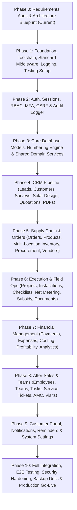

# INS Solar Business Management Software — Implementation Roadmap

**Document Reference:** `INS-PLN-ROA-001`  
**Version:** `1.0.0`  
**Status:** Approved Phase Plan  
**Total Planned Phases:** 11 Phases (Phase 0 through Phase 10)  
**Methodology:** Incremental, Dependency-Gated, Test-Driven Modular Delivery  

---

## 1. Roadmap Overview & Dependency Flow

---

## 2. Phase-by-Phase Execution Plan

### Phase 0: Requirements Audit & Master Blueprint (Current)
*   **Focus:** Workspace inspection, complete requirements inventory (all 30 modules, 6 panels, 30 business decisions), technical architecture, data design, API conventions, implementation roadmap, and risk register.
*   **Entry Criteria:** Clean workspace initialization.
*   **Deliverables:**
    1.  `docs/requirements/requirements-catalog.md`
    2.  `docs/requirements/feature-traceability-matrix.md`
    3.  `docs/architecture/system-architecture.md`
    4.  `docs/architecture/database-design.md`
    5.  `docs/architecture/api-conventions.md`
    6.  `docs/planning/implementation-roadmap.md`
    7.  `docs/planning/open-decisions-and-risks.md`
    8.  `docs/planning/phase-0-review-report.md`
*   **Acceptance Criteria:** 100% of required modules, panels, and business rules documented and mapped to testable criteria.
*   **Test Gate:** Independent architectural audit and verification sign-off.
*   **Deployment Gate:** No code written in this phase; ready for user review.

---

### Phase 1: Repository Foundation, Configuration, Quality & Toolchain
*   **Focus:** Monorepo or clean modular structure, Node.js 24 LTS, Vite, TypeScript strict configuration, Tailwind CSS, shadcn/ui foundation, ESLint, Prettier, Pino logger, unified Express error handler, and Vitest test runner.
*   **Entry Criteria:** Approval of Phase 0 Blueprint.
*   **Deliverables:**
    *   Package manifests (`package.json`, lockfiles) with verified, non-deprecated stable packages.
    *   Strict `tsconfig.json` for both server and client workspaces.
    *   Express 5 application shell with correlation ID middleware, Pino logging, and standard response helpers.
    *   Client shell with Vite, Tailwind CSS tokens, and initial `shadcn/ui` components.
    *   Automated test harness (Vitest, Supertest, Testing Library).
*   **Acceptance Criteria:** `npm run build`, `npm run lint`, and `npm run test` pass with 0 errors and 0 warnings.
*   **Test Gate:** Baseline health check endpoint (`/api/v1/health`) verified with automated integration tests.
*   **Deployment Gate:** CI pipeline passing on local and git runner.

---

### Phase 2: Authentication, Sessions, Roles, Permissions & Security
*   **Focus:** Server-managed stateful sessions, HttpOnly cookies, Argon2id password hashing, TOTP MFA for privileged roles, CSRF protection, RBAC permission middleware, customer isolation guard, and audit log emitter.
*   **Entry Criteria:** Phase 1 Foundation passing all tests.
*   **Deliverables:**
    *   `User`, `Session`, and `AuditLog` Mongoose schemas.
    *   Auth endpoints (`/api/v1/auth/login`, `/logout`, `/me`, `/mfa/setup`, `/mfa/verify`).
    *   Express auth middleware (`requireAuth`, `requireRole`, `requirePermission`).
    *   Client auth context, login interface, session persistence, and protected route wrappers.
*   **Acceptance Criteria:** Secure session lifecycle; instant session revocation on logout/deactivation; passwords hashed with Argon2id; MFA enforced for Admin/Accounts roles.
*   **Test Gate:** Comprehensive Supertest suite covering brute-force protection, invalid passwords, expired sessions, CSRF rejections, and unauthorized route access.

---

### Phase 3: Database Models, Numbering Engine & Shared Domain Services
*   **Focus:** Core database connections (MongoDB Atlas), Mongoose schema definitions, compound indexes, sequential document numbering engine (`SequenceService`), integer paise financial primitives, product catalog, categories, and multi-location warehouses.
*   **Entry Criteria:** Phase 2 Auth passing all tests.
*   **Phase 3A Status (Completed & Verified):**
    *   Shared domain primitives and validation conventions (`@ins-solar/shared`): `MoneyPaiseSchema`, `PositiveMoneyPaiseSchema`, `SignedMoneyPaiseSchema`, Indian Rupees-to-Paise helpers, `AddressSchema`, `ContactPersonSchema`, `QuantitySchema`, `GstinSchema`, `PanSchema`, `CustomerCodeSchema`.
    *   Atomic `SequenceService` utilizing MongoDB atomic `$inc` with upsert collision retry, producing formatted sequential IDs (`CUST-2026-00001`, `QT-2026-00001`, `ORD-2026-00001`, etc.).
    *   Foundational Mongoose models: `SequenceCounter`, refined `Customer` (with addresses, GST/PAN, contact info), and `CompanySettings` singleton profile.
    *   Index management: explicit `syncIndexes()` method on `DatabaseManager` without destructive drops.
*   **Phase 3B Status (Completed & Verified):**
    *   `ProductCategory` model: Hierarchical categories with bounded cycle detection and deactivation constraints.
    *   `Product` model: Master hardware catalog with integer paise purchase/selling rates, normalized case-insensitive SKU uniqueness (`skuNormalized`), and decoupled balance design.
    *   `Warehouse` model: Multi-location foundation (Central Depot, Transit, Installation Site, Employee Custody) with unique location codes and non-destructive deactivation.
    *   `SequenceService` Production Guard: Strict safety check refusing in-memory fallback in production when disconnected (HTTP 503).
    *   Minimal service layer and authorized API routes (`/api/v1/catalog`, `/api/v1/warehouses`).
    *   Future Inventory Integrity Contract documented in database design.
*   **Acceptance Criteria:** Atomic sequence generator tested under high concurrent load with zero duplicate keys; master hardware catalog decoupled from stock ledger; case-insensitive SKU uniqueness enforced.
*   **Test Gate:** 13 test suites, 120 automated tests passing with 0 errors across all workspaces.

---

### Phase 4: CRM Pipeline (Leads, Customers, Surveys, Solar Design, Quotations & PDFs)
*   **Focus:** Lead management, customer directory, site profiles, feasibility surveys, tri-topology solar design (On-Grid, Off-Grid, Hybrid), quotation generator, discount approval gates, and server-side PDF proposal compiler.
*   **Entry Criteria:** Phase 3 Core Data & Services verified.
*   **Phase 4A Status (Completed & Verified):**
    *   `Lead` Mongoose model and shared schemas (`@ins-solar/shared`): atomic `LEAD-YYYY-NNNNN` generation, prospect contact details, requirement classification, advisory duplicate phone lookup (non-unique index, non-destructive), supervisory assignment RBAC, and lifecycle status machine.
    *   `LeadActivity` Mongoose model: chronological interaction timeline (calls, meetings, site visits, follow-ups), sentiment tracking (`HOT`, `WARM`, `COLD`), and automated next follow-up scheduling.
    *   Idempotent Lead-to-Customer conversion: verifies lead is not already converted, allocates sequential `CUST-YYYY-NNNNN` customer record, binds `convertedCustomerId`, logs audit activity, and permanently preserves lead history.
    *   `SiteSurvey` Mongoose model: atomic `SRV-YYYY-NNNNN` allocation, customer/lead relational linkage, roof substrate classification, positive physical measurements (usable roof area in sq ft, integer paise average monthly electricity bill, utility sanctioned load in kW), shadow analysis notes, and private photo metadata attachment.
    *   Minimal operational UI (`apps/web`): Responsive directories, search filters, and detail dialogs for Leads (`LeadsPage`, `LeadDetailPage`), Follow-ups (`FollowUpsPage`), and Site Surveys (`SurveysPage`).
    *   Automated test suite: 14 test suites, 151 automated tests passing with 0 errors across `@ins-solar/shared`, `@ins-solar/api`, and `@ins-solar/web`.
*   **Phase 4B Status (Completed & Verified):**
    *   `SolarDesign` Mongoose model & pure `SolarSizingService`: tri-topology mathematical calculation engine (On-Grid, Off-Grid, Hybrid) computing explicit physical units (panel quantity, actual DC kWp, inverter matching, battery Ah/kWh/units, and daily/monthly/annual kWh generation yields) with MNRE disclaimer notices and engineering warnings.
    *   `Quotation` Mongoose model: immutable revision snapshots (`fullQuotationCode`: `QT-YYYY-NNNNN-R0`, `R1`, etc.), integer-paise financial engine, itemized Bill of Materials with catalog product validation, and configurable date-effective tax profiles with basis-point calculations.
    *   Managerial Discount Approval Workflow: automatic threshold enforcement (> 5.0% unapproved default pending owner confirmation) with strict anti-self-approval rule prevention, audit logging, and prior approval invalidation upon material price/discount changes.
    *   Customer Review & Digital Acceptance: authenticated record-level customer portal boundary allowing customers to review their own proposals, download PDF documents, and digitally accept/reject specific revisions with idempotent state handling and IP/timestamp capture.
    *   Server-Side Proposal Compiler: `ProposalCompilerService` compiling professional, print-optimized proposal documents with company branding, BOM, financial breakdown, milestone schedules, and legal terms.
    *   Operational Web Interface (`apps/web`): Interactive `SolarDesignPage` sizing calculator & design directory, `QuotationsPage` proposals directory with discount approval queue filters, and `QuotationDetailPage` comprehensive revision viewer with anti-self-approval managerial controls and digital acceptance simulation.
*   **Acceptance Criteria:** Complete sales flow from lead capture and site survey to technical solar design, quotation revisioning, discount approval control, and customer digital acceptance.
*   **Test Gate:** 186 automated tests passing across 20 test suites with 0 errors across `@ins-solar/shared`, `@ins-solar/api`, and `@ins-solar/web`.

---

### Phase 5: Supply Chain & Orders (Orders, Multi-Location Inventory, Stock Reservation, Procurement & Vendors)
*   **Focus:** Order confirmation locking accepted quotation terms, multi-location inventory projections (Warehouse, Site, Transit), append-oriented stock movement ledger, race-condition-free reservations, serialized hardware tracking, purchase orders, and vendor ledgers.
*   **Entry Criteria:** Phase 4 CRM Pipeline verified.
*   **Phase 5A Status (Completed & Verified):**
    *   `SalesOrder` model & `OrderService`: Controlled order creation from eligible accepted quotation revisions with atomic sequence numbering (`ORD-YYYY-NNNNN`), immutable agreed commercial snapshots, payment milestones, and unique 1:1 revision binding preventing duplicate orders.
    *   Order lifecycle & cancellation controls: State-machine transitions (`CONFIRMED`, `IN_PROGRESS`, `COMPLETED`, `CANCELLED`); automated atomic reservation release if cancelled before issue; direct cancellation strictly forbidden after physical issue.
    *   `StockBalance` model: Location-scoped material projections (`productId`, `warehouseId`, `onHandQuantity`, `reservedQuantity`, `availableQuantity`) with compound uniqueness and negative quantity prevention.
    *   `StockMovement` model: Immutable append-only material transaction ledger (`STK-YYYY-NNNNN`) tracking receipts, issues, transfers, returns, and authorized opening balances. No direct updates/deletions permitted.
    *   `StockReservation` model & atomic reservation engine: Conditional single-document database updates (`availableQuantity: { $gte: quantity }`) eliminating over-reservation under high concurrency, leaving physical on-hand quantity untouched, with batch compensation rollback on partial failures.
    *   `ProductSerialNumber` model & `SerialNumberService`: High-value hardware serialization (solar panels, inverters) with uppercase-normalized uniqueness and full custody history.
    *   Operational Web Interface (`apps/web`): Responsive `OrdersPage` (with quotation-to-order converter), `OrderDetailPage` (with commercial snapshot review and reservation controls), and `InventoryPage` (multi-location balances, movement ledger, serial asset database, and operation action modals).
    *   Automated test suite: 215 automated tests passing with 0 errors across `@ins-solar/shared`, `@ins-solar/api`, and `@ins-solar/web`.
*   **Phase 5B Status (Completed & Verified):**
    *   `Vendor` Mongoose model & `VendorService`: Supplier directory with sequential ID (`VEN-YYYY-NNNNN`), GSTIN/PAN uniqueness, supplied product/category links, contact details, and safe deactivation preserving purchase records.
    *   `PurchaseOrder` Mongoose model & `PurchaseOrderService`: Inbound procurement with sequential ID (`PO-YYYY-NNNNN`), integer paise calculation, approval workflow with database-configurable threshold (`CompanySettings.poApprovalThresholdPaise`, default ₹25,000 / 2,500,000 paise awaiting owner confirmation flag), anti-self-approval enforcement, and immutable commercial terms preservation upon approval.
    *   `GoodsReceipt` Mongoose model & `GoodsReceiptService`: Inbound warehouse intake note (`GRN-YYYY-NNNNN`), partial delivery support, cumulative over-delivery protection, and strict QA split between accepted and rejected quantities with discrepancy tracking.
    *   Inventory Stock Ledger Integration: Accepted items physically increment `StockBalance` (`onHandQuantity` and `availableQuantity`) in the destination warehouse and generate immutable append-only `StockMovement` records (`RECEIPT`). Rejected quantities permanently audited in GRN and PO records but **never** increment physical stock.
    *   Hardware Serialization on Intake: Panel and inverter serial numbers validated for enterprise-wide uniqueness and registered into `ProductSerialNumber`.
    *   `VendorInvoice` Mongoose model & `VendorInvoiceService`: Payable claim registration with compound unique index `{ vendorId: 1, vendorInvoiceNumber: 1 }` preventing duplicate billing. Performs automated 3-way match reconciliation against purchase orders (`RECONCILED` vs `DISPUTED`).
    *   Operational Web Interface (`apps/web`): Responsive screens for `VendorsPage`, `PurchaseOrdersPage`, `PurchaseOrderDetailPage`, `GoodsReceiptsPage`, and `VendorInvoicesPage`.
*   **Acceptance Criteria:** Stock cannot fall below zero; physical issue is hard-blocked on shortages; order locks prices permanently against catalog changes; reservations and physical issues strictly decoupled; purchase orders enforce anti-self-approval; GRN rejected quantities never create inventory.
*   **Test Gate:** 245 automated tests passing across 25 test suites with 0 errors across `@ins-solar/shared` (108 tests), `@ins-solar/api` (121 tests), and `@ins-solar/web` (16 tests).

---

### Phase 6: Field Execution & Operations (Projects, Installations, Checklists, Net Metering & Documents)
*   **Focus:** Project management (10 linear stages), milestones, task delegation, daily installation tracking, mandatory 5-category installation checklists with geotagged photos, pre-commissioning electrical testing, DISCOM net metering tracking, subsidy tracking, and secure object storage document management.
*   **Entry Criteria:** Phase 5 Supply Chain verified.
*   **Phase 6A Status (Completed & Verified):**
    *   `Project` Mongoose model & `ProjectService`: Project creation with atomic sequence numbering (`PRJ-YYYY-NNNNN`), customer and 1:1 order binding with duplicate project protection (sparse unique index on `orderId`), site installation address, system capacity, and topology.
    *   10-Stage Progression Engine: Linear stage gates (`STAGE_1_ENGINEERING_DESIGN` through `STAGE_10_COMMISSION_HANDOVER`) with audit logging of user, timestamps, and notes.
    *   Project Lifecycle State Machine: Validated transitions (`PLANNING` → `IN_PROGRESS` → `COMPLETED` / `ON_HOLD` / `CANCELLED`), terminal state locking, and required reason capture for on-hold and cancelled states.
    *   Quality Installation Milestones: Embedded milestone subdocuments with default 10-milestone template initialization, status transitions (`NOT_STARTED`, `IN_PROGRESS`, `BLOCKED`, `COMPLETED`), mandatory blocker reasons for blocked milestones, and completion sign-off metadata (actor, timestamp).
    *   `ProjectTask` Mongoose model & `ProjectTaskService`: Scoped tasks with atomic sequence numbering (`TSK-YYYY-NNNNN`), milestone association with cross-project validation (rejecting milestone IDs from other projects), assignment, priorities (`LOW`, `MEDIUM`, `HIGH`, `CRITICAL`), due dates, and overdue filtering.
    *   Customer Portal Isolation: `/api/v1/customer-portal/projects` ensuring customers can only access projects linked to their authenticated customer ID.
    *   Operational Web Interface (`apps/web`): Responsive `ProjectsPage` directory (search, metric cards, priority/status filters, 10-stage progress bar) and `ProjectDetailPage` (10-stage visual progression pipeline, overview details, milestone sign-offs, task management, and stage transition history).
    *   Automated test suite: 271 automated tests passing across 26 test suites with 0 errors across `@ins-solar/shared` (113 tests), `@ins-solar/api` (138 tests), and `@ins-solar/web` (20 tests).
*   **Phase 6B Status (Completed & Verified):**
    *   `MaterialDispatch` Mongoose model & `MaterialDispatchService`: Physical material issues between warehouse and site with atomic `DSP-YYYY-NNNNN` sequences, StockBalance atomic decrements, negative stock prevention, reservation deduction, serialized equipment tracking (panels & inverters), cumulative order limits, and safe cancellation with compensating return movements.
    *   `InstallationChecklistTemplate` & `ProjectInstallationChecklist` models with `ChecklistService`: 5-category inspection checklist (`SITE_READINESS_SAFETY`, `STRUCTURE_MODULE_MOUNTING`, `DC_WIRING_EARTHING`, `INVERTER_AC_PROTECTION`, `TESTING_COMMISSIONING_HANDOVER`), template snapshotting, duplicate generation prevention, mandatory reason validation for `FAILED` / `BLOCKED`, and mandatory photo evidence enforcement before marking `PASSED`.
    *   Commissioning Stage-Gate Enforcement: `ProjectService.advanceProjectStage` verifies mandatory checklist items are passed before advancing to Stage 8 (Pre-Commissioning) and Stage 10 (Handover), and blocks completion if mandatory checks are incomplete.
    *   Private Object Storage Boundary: Files tracked by private storage keys (`evidence/{proj}/{item}/{file}`) with short-lived authorized access URLs. Strict GPS bounds validation (-90..90, -180..180) and customer multi-tenant isolation.
    *   Operational Web Interface (`apps/web`): `MaterialDispatchTab` (fulfillment progress, dispatch slips, issue/cancel dialogs) and `InstallationChecklistTab` (5-category checklist, blocker banner, photo evidence uploader, secure viewer) integrated into `ProjectDetailPage`, resolving `DONE` vs `COMPLETED` enum mismatch.
*   **Acceptance Criteria:** Negative stock strictly prevented; serial numbers cannot be issued twice; dispatch cancellation creates compensating returns; mandatory checklist items enforce photo evidence and failure reasons; Stage 8 & 10 gates evaluate checklist compliance; customer portal blocks cross-tenant evidence access; all 291 automated tests pass.
*   **Test Gate:** 291 automated tests passing with 0 failures across `@ins-solar/shared` (119 tests), `@ins-solar/api` (150 tests), and `@ins-solar/web` (22 tests).

---

### Phase 7A: Net Metering & Government Subsidy Tracking (Module 17)
*   **Focus:** DISCOM net-metering applications, document verification gates, technical feasibility & demand note tracking (integer paise), inspection scheduling & outcome recording, bi-directional net meter installation tracking, government subsidy claim tracking (PM Surya Ghar Muft Bijli Yojana, State Rooftop Subsidy), eligibility validation, integer-paise financial balances, concurrency-safe disbursement ledger with unique idempotency keys, deduplicated workflow reminders, honest audit logs, and customer portal isolation.
*   **Entry Criteria:** Phase 6 Operations verified.
*   **Phase 7A Status (Completed & Verified):**
    *   `NetMeteringApplication` Mongoose model & `NetMeteringService`: Atomic sequence numbering (`NMA-YYYY-NNNNN`), DISCOM hierarchy tracking, validated status transitions (`DRAFT` → `DOCUMENTS_PENDING` → `READY_TO_SUBMIT` → `SUBMITTED` → `UNDER_REVIEW` → `INSPECTION_SCHEDULED` → `APPROVED` / `REJECTED` / `CANCELLED`), technical feasibility & demand note amount in integer paise, field inspection scheduling & outcome recording, bi-directional meter installation tracking, document completeness gate blocking submission if required documents are missing or rejected, and full status history audit timeline.
    *   `SubsidyApplication` Mongoose model & `SubsidyService`: Atomic sequence numbering (`SUB-YYYY-NNNNN`), scheme configuration, integer-paise financial balances (`requestedAmountPaise`, `approvedAmountPaise`, `disbursedAmountPaise`, `remainingAmountPaise`), invariants (`approved <= requested`, `disbursed <= approved`), state machine (`ELIGIBLE` → `DOCUMENTS_PENDING` → `READY_TO_APPLY` → `APPLIED` → `UNDER_REVIEW` → `APPROVED` → `SANCTIONED` → `DISBURSED` / `REJECTED`), concurrency-safe multi-installment disbursement ledger with unique `idempotencyKey` and UTR references.
    *   Regulatory Document Requirements: 12 standardized document types with review workflow (`REQUIRED`, `UPLOADED`, `UNDER_REVIEW`, `ACCEPTED`, `REJECTED`, `EXPIRED`, `RESUBMISSION_REQUIRED`) and short-lived private access URLs (300s TTL).
    *   Workflow Reminders & Honest Audit: `NotificationReminderService` with scheduled reminder deduplication (`${entityType}:${entityId}:${reminderType}:${date}`) and honest delivery status reporting (`SIMULATED_LOG_ONLY` in development/staging).
    *   Customer Portal Isolation: `/api/v1/customer-portal/projects/:id/net-metering` and `/subsidy` ensuring customers can only access their own records.
    *   Operational Web Interface (`apps/web`): Dedicated `NetMeteringPage` and `SubsidyPage` registers; `NetMeteringTab` and `SubsidyTab` components integrated into `ProjectDetailPage.tsx`; updated navigation in `AppLayout.tsx` and routes in `App.tsx`.
*   **Acceptance Criteria:** Missing/rejected documents hard-block submission; non-negative integer paise strictly enforced; disbursed amount cannot exceed approved amount; duplicate disbursements rejected via idempotency keys; customer portal enforces multi-tenant boundary; all 325 automated tests pass.
*   **Test Gate:** 325 automated tests passing with 0 failures across `@ins-solar/shared` (135 tests), `@ins-solar/api` (164 tests), and `@ins-solar/web` (26 tests).

---

### Phase 7B: Service Complaints, Hardware Warranties, AMC & Service Visits
*   **Focus:** Post-commissioning customer support, break-fix ticketing with SLA tracking, hardware asset warranty bounds & RMA claim tracking, Annual Maintenance Contracts (AMC) with atomic included-visit quota deductions, field technician visit execution & checklists, customer portal service isolation, and deduplicated notification reminders.
*   **Entry Criteria:** Phase 7A Net Metering & Subsidies verified.
*   **Phase 7B Status (Completed & Verified):**
    *   `ServiceComplaint` Mongoose model & `ServiceComplaintService`: Atomic sequence numbering (`CMP-YYYY-NNNNN`), cross-customer & cross-project verification, validated state machine (`OPEN` → `TRIAGED` → `ASSIGNED` → `VISIT_SCHEDULED` → `IN_PROGRESS` → `RESOLVED` → `CLOSED`), alternate flows (`AWAITING_CUSTOMER`, `AWAITING_PARTS`, `CANCELLED`, `REOPENED`), mandatory resolution summary, and server-side note confidentiality.
    *   `WarrantyClaim` Mongoose model & `WarrantyService`: Hardware serial warranty bound calculation (`now >= startDate && now <= endDate`), atomic claim numbering (`CLM-YYYY-NNNNN`), duplicate pending claim prevention, manufacturer RMA decision recording (`APPROVED`, `REJECTED`, `PARTS_DISPATCHED`), and replacement serial tracking.
    *   `AnnualMaintenanceContract` Mongoose model & `AmcService`: Atomic sequence numbering (`AMC-YYYY-NNNNN`), integer paise pricing, date window validation, formal approval gates, atomic included-visit consumption under high concurrency via MongoDB `$expr: { $lt: ['$consumedVisits', '$includedVisits'] }`, excess visit tracking (`chargeableVisits`), and successor contract renewal chaining.
    *   `ServiceVisit` Mongoose model & `ServiceVisitService`: Atomic sequence numbering (`VIS-YYYY-NNNNN`), technician assignment, status lifecycle (`SCHEDULED` → `DISPATCHED` → `IN_PROGRESS` → `COMPLETED` / `CANCELLED` / `RESCHEDULED`), checklist item verification, parts required, customer feedback, revisit linking, and automatic AMC visit quota consumption upon completion.
    *   Customer Portal Service Gateways: Isolated `/api/v1/customer-portal/service/*` endpoints for complaints, warranties, and AMC agreements, stripping internal notes from customer views.
    *   Web User Interface (`apps/web`): Dedicated `ComplaintsPage`, `WarrantiesPage`, `AmcPage`, `ServiceVisitsPage`, and `CustomerServicePortalPage`; embedded `ServiceAmcTab` in `ProjectDetailPage.tsx`; Option A dropdown navigation in `AppLayout.tsx`; live Executive Console in `DashboardPage.tsx`.
*   **Acceptance Criteria:** Cross-customer references strictly rejected; internal notes hidden from customers; atomic sequence generation enforced; integer paise preserved; AMC visit counters protected against concurrent over-consumption; all automated tests pass.
*   **Test Gate:** 210 automated tests passing with 0 failures across `@ins-solar/shared`, `@ins-solar/api` (178 tests, including 14 Phase 7B tests), and `@ins-solar/web` (32 tests, including 6 Phase 7B tests).

---

### Phase 8A: Customer Payments, Receivables & Outstanding Management
*   **Focus:** Operational customer payment intake, atomic sequence generation (`REC-YYYY-NNNNN`), bank clearance verification, multi-order payment allocation (`ALC-YYYY-NNNNN`), customer and order receivables ledgers, overdue aging analysis (0-30, 31-60, 61-90, >90 days), cascading payment reversals, unallocated credit refunds, printable operational payment receipts with statutory non-tax disclaimer, customer portal tenant isolation, and audit trail logging.
*   **Status (Completed & Verified):**
    *   `CustomerPayment` Mongoose model & `PaymentService`: Atomic receipt numbering (`REC-YYYY-NNNNN`), integer-paise financial precision (`amountPaise`, `allocatedAmountPaise`, `unallocatedAmountPaise`), idempotency replay protection, duplicate external UTR/cheque prevention, validated lifecycle (`RECORDED` → `VERIFIED` → `REVERSED` / `REFUNDED`), and status history preservation.
    *   `PaymentAllocation` Mongoose model & `PaymentService`: Atomic allocation numbering (`ALC-YYYY-NNNNN`), strict anti-cross-customer boundary enforcement, atomic concurrency-safe deduction of unallocated quota via MongoDB `$expr: { $lte: [{ $add: ['$allocatedAmountPaise', input.allocatedAmountPaise] }, '$amountPaise'] }`, order collectible ceiling validation (`order.netTotalPaise - currentOrderAllocated`), allocation reversal restoring payment unallocated quota, and cascading payment reversal reconciling active allocations.
    *   Receivables & Aging Engine: Authoritative server-side formulas for order-level receivables (`orderTotal - sum(activeAllocations)`), customer-level receivables, unallocated credit tracking, and 4-tier aging buckets (0–30, 31–60, 61–90, >90 days overdue). Excludes unverified and reversed transactions.
    *   Printable Operational Receipt: Structured document with company details from `CompanySettings`, customer billing details, payment method, transaction reference, allocation breakdown table, remaining unallocated credit, and mandatory legal operational disclaimer: *"This document is an operational payment receipt confirming realization of customer funds... It does not constitute a statutory Tax Invoice under GST law."*
    *   Customer Portal Security & Redaction: Tenant-scoped `/api/v1/customer-portal/payments/*` endpoints, strictly isolating customer payments and receipts while redacting confidential internal employee notes.
    *   Web User Interface (`apps/web`): Enterprise `PaymentsPage` with KPI summary cards, multi-criteria filters, record payment modal, verify realization modal, order allocation modal, reverse payment modal, refund modal, and printable receipt preview; `CustomerPaymentsPortalPage` for client self-service; navigation item integrated under `Finance & Accounts` in `AppLayout.tsx`.
*   **Acceptance Criteria:** Cross-customer allocations strictly rejected; integer paise preserved throughout; over-allocation prevented under concurrency; verified disclaimer on receipts; zero double-reversal permitted; full monorepo quality gates pass.
*   **Test Gate:** 235 automated tests passing with 0 failures across `@ins-solar/shared` (135 tests), `@ins-solar/api` (198 tests, including 20 Phase 8A tests), and `@ins-solar/web` (37 tests, including 5 Phase 8A tests).

---

### Phase 8B: Expense Management, Project Costing & Profitability
*   **Focus:** Operational expense management, atomic numbering (`EXP-YYYY-NNNNN`), company approval thresholds (> ₹5,000 / 500,000 paise), anti-self-approval enforcement, disbursement recording, cancellation audit trail, project cost ledger compilation without double-counting (dispatched materials + direct project expenses; POs/GRNs/VendorInvoices excluded), project budget versioning (`project_budgets`) with automatic superseding of prior versions, budget-vs-actual variance analysis, and operational profitability estimation with non-statutory legal disclaimer.
*   **Status (Completed & Verified):**
    *   `Expense` Mongoose model & `ExpenseService`: Atomic sequence numbering (`EXP-YYYY-NNNNN`), positive integer paise precision (`amountPaise`, `taxAmountPaise`, `totalAmountPaise`, `paidAmountPaise`), status lifecycle (`DRAFT`, `PENDING_APPROVAL`, `APPROVED`, `REJECTED`, `CANCELLED`), company threshold evaluation via `CompanySettings.expenseApprovalThresholdPaise`, anti-self-approval validation preventing submitters from approving their own expenses, payment disbursement recording (`UNPAID` → `PAID`), and cancellation with mandatory audit reasoning.
    *   `ProjectBudget` Mongoose model & `ProjectProfitabilityService`: Versioned budget baseline management (`version = max(existing) + 1`), positive integer paise category planned amounts (materials, labor, equipment, permits, logistics, contingency, other), formal manager approval lifecycle, and automatic superseding of prior active versions (`supersededByBudgetVersion`).
    *   Authoritative Project Cost Ledger & Anti-Double-Counting Rules: Materials consumed derive strictly from `MaterialDispatch` in `DISPATCHED` status multiplied by `Product.standardPurchaseRatePaise`; direct project expenses derive strictly from `Expense` in `APPROVED` or `PAID` status. Strictly excludes PO commitments, GRN warehouse receipts, and vendor invoice payable claims.
    *   Revenue & Profitability Engine: Calculates contracted sales order value (`netTotalPaise`), confirmed customer collections (`PaymentAllocation`), outstanding receivables, total recorded cost, estimated gross profit and margin %, operational progress revenue based on physical milestone completion percentage, and category budget-vs-actual variance.
    *   Web User Interface (`apps/web`): Dedicated `ExpensesPage` (`/expenses`) with financial KPI cards, multi-criteria filters, and action modals (Record, Approve, Reject, Disburse Payment, Cancel, Detail/Audit); embedded `ProjectCostingTab` in `ProjectDetailPage.tsx` featuring financial KPIs, budget-vs-actual variance comparison, line-by-line cost ledger, budget version manager modal, and prominent non-statutory accounting disclaimer; navigation item under `Finance & Accounts` in `AppLayout.tsx`.
*   **Acceptance Criteria:** Anti-self-approval strictly enforced (HTTP 403); threshold > ₹5,000 forces manager approval; zero double-counting against POs/GRNs/VendorInvoices; integer paise preserved throughout; non-statutory disclaimer rendered on all costing views; full monorepo quality gates pass.
*   **Test Gate:** 389 automated tests passing with 0 failures across `@ins-solar/shared` (135 tests), `@ins-solar/api` (213 tests, including 15 Phase 8B tests), and `@ins-solar/web` (41 tests, including 4 Phase 8B tests).

---

### Phase 9: Customer Portal, Notifications, Reminders & System Settings
*   **Focus:** External Customer Portal (isolated project tracker, quotation acceptance, bill upload, receipts), in-app notification center, multi-channel delivery preferences, automated reminder bridge, and global settings/masters console.
*   **Entry Criteria:** Phase 8 After-Sales & Financials verified.
*   **Phase 9A Status (Completed & Verified):**
    *   `Notification` Mongoose model & `NotificationCenterService`: Centralized persistent audit ledger with atomic sequence numbering (`NTF-YYYY-NNNNN`), deterministic deduplication (`dedupKey`), honest delivery status reporting (`SIMULATED_LOG_ONLY` without external gateway, `DISPATCHED_TO_GATEWAY` with gateway), recipient type isolation (`CUSTOMER` vs `EMPLOYEE`), and safe fault-tolerant dispatch boundary.
    *   `NotificationPreference` Mongoose model: Multi-channel delivery toggles (In-App, Email, SMS, WhatsApp) and category subscription filters evaluated prior to dispatch.
    *   `NotificationReminderService` Persistent Integration: Operational reminder engine bridged directly into the persistent notification center.
    *   Quotation Decision Safeguards: `QuotationService.customerDecision` strictly rejects expired (`validUntil < now`) or superseded (`REVISED`) quotation revisions.
    *   Secure Customer Portal Endpoints: Record-level isolation under `/api/v1/customer-portal/*` (Dashboard, Notifications, Quotations, Payments, Service), deriving customer identity strictly from session with 401/403 guards.
    *   Operational Payment Receipt Compliance: Operational payment receipt modal renders mandatory legal non-tax invoice disclaimer under GST law.
    *   Unified Web Interface (`apps/web`): `CustomerPortalPage` (`/customer-portal` and `/portal`) providing Dashboard, My Projects (10-stage execution pipeline, checklist, net-metering, subsidy), Quotations (with digital accept/decline modal and legal declaration), Payments & Receipts, Service & AMC, Notification Center (inbox, category filters, unread counter, bulk mark-all-as-read), and Preferences.
    *   Automated test suite: 409 automated tests passing across `@ins-solar/shared`, `@ins-solar/api` (including 15 Phase 9A tests in `phase9a.test.ts`), and `@ins-solar/web` (including 5 Phase 9A tests in `phase9aPages.test.tsx`).
*   **Phase 9B Status (Completed & Verified):**
    *   **Module 24 (Employee & Team Management):** `EmployeeProfile` & `Team` Mongoose models linked 1:1 to `User` without duplicate credentials; atomic sequences `EMP-YYYY-NNNNN` & `TEM-YYYY-NNNNN`; live workload tracking (active tasks, visits, projects); safe deactivation preserving all audit and task histories with audited reassignment; crew eligibility flags (`projectTasks`, `serviceVisits`).
    *   **Module 25 (Unified Task Management):** Extended `ProjectTask` to unify tasks across projects, milestones, installation checklists, service complaints, service visits, net-metering, subsidies, and document reviews; atomic sequence `TSK-YYYY-NNNNN`; status workflow with mandatory `blockerReason` for `BLOCKED` status and completion notes; reassignment audit history; server-side overdue filter consistency (`dueDate < now && status != COMPLETED && status != CANCELLED`).
    *   **Module 26 (Private Document Management & Access Boundaries):** `DocumentModel` metadata vault with atomic sequence `DOC-YYYY-NNNNN`; MIME & file size validation (<=25MB); revision versioning (`version`, `previousVersionId`, `isLatestVersion`); review workflow with mandatory rejection reasons (min 5 chars); short-lived cryptographic HMAC signed URLs (TTL <= 15 min); simulated private storage fallback; strict customer portal document isolation (customer visible files only; foreign or internal files return 403 Forbidden).
    *   **Frontend Web Interfaces (`apps/web`):** `EmployeesPage` (`/employees`), `TeamsPage` (`/teams`), `TasksPage` (`/tasks`), `DocumentsPage` (`/documents`), and customer portal `DOCUMENTS` tab in `CustomerPortalPage` (`/customer-portal?tab=DOCUMENTS`); navigation links in `AppLayout.tsx`.
    *   **Automated test suite:** 16 automated backend tests in `phase9b.test.ts` (244 total passing across 20 test suites in `@ins-solar/api`), 5 frontend tests in `phase9bPages.test.tsx` (100% green, 0 failures), and 0 TypeScript errors across all workspaces.
*   **Acceptance Criteria:** 1:1 employee linkage without duplicate auth; safe deactivation without historical task deletion; unified task tracking with blocker reasoning; cryptographic HMAC signed document URLs; customer portal document isolation; full monorepo quality gates pass.
*   **Test Gate:** 244 automated API tests passing across 20 suites + 5 frontend tests passing with 0 failures across `@ins-solar/shared`, `@ins-solar/api`, and `@ins-solar/web`.

---

### Phase 10: Full Integration, End-to-End Verification, Hardening & Production Go-Live
*   **Focus:** Complete panel integration (Admin, Sales, Installation, Accounts, Service, Inventory), end-to-end integration tests, security hardening, disaster recovery runbooks, staging deployment, and production release.
*   **Entry Criteria:** All Modules 1–30 and Panels implemented.
*   **Phase 10A Status (Completed & Verified):**
    *   **Monorepo Master Audit:** Complete monorepo test harness passing with 446 automated tests across 46 test files (135 shared, 260 API, 51 web), 0 failures, 0 skipped, 0 TypeScript errors, 0 ESLint warnings, and 100% Prettier formatting.
    *   **Master Integration Test Suite (`phase10a.test.ts`):** 16 comprehensive end-to-end tests validating Sales to Project creation, 10-stage execution gates, PO anti-self-approval, GRN QA split without inventory inflation, stock concurrency, historical cost snapshotting, net metering document completeness, subsidy multi-installment disbursement ledger, warranty expiration calculation, task decoupling, cross-customer payment isolation, and project profitability without double-counting.
    *   **Security & Identity Boundary:** Customer multi-tenant isolation matrix across all portal routes, `INTERNAL_ONLY` document suppression, internal employee note redaction, and cryptographic HMAC signed storage URLs with expiration and tamper rejection.
    *   **Production Configuration Guard:** Strict validation in `apps/api/src/config/env.ts` rejecting simulated storage in production and enforcing complete AWS S3 credentials when `STORAGE_PROVIDER=s3`.
    *   **Disaster Recovery Runbook:** Documented complete operational backup, point-in-time recovery, sequence recovery, and restore verification checklist in `docs/operations/backup-and-disaster-recovery.md`.
    *   **Requirement Traceability Reconciliation:** Reconciled register to 354 unique atomic requirements (317 module requirements, 7 panel requirements, 30 confirmed business decisions).
*   **Phase 10B (Planned - Final Staging & Go-Live):**
    *   Automated Playwright browser E2E suite covering critical UI journeys.
    *   Production deployment configuration (Docker / systemd, Nginx reverse proxy, TLS certificates).
    *   Staging environment provisioning with real external credentials.
*   **Acceptance Criteria:** 100% of traceability matrix requirements verified; zero high/critical vulnerabilities; 100% of test suites passing.
*   **Release Gate:** Executive sign-off for production deployment.
