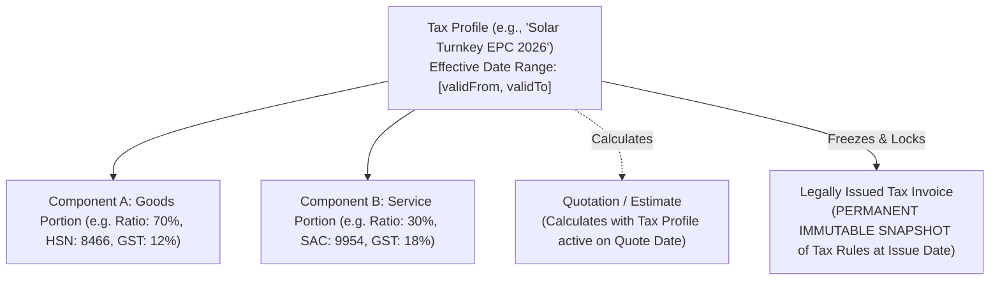

# INS Solar Business Management Software — Open Decisions, Assumptions & Risk Management

**Document Reference:** `INS-PLN-RSK-001`  
**Version:** `1.1.0` (Updated following Independent Phase 0 Review)  
**Status:** Active Governance Document  
**Target Environment:** INS Solar Enterprise ERP / CRM System  

---

## 1. Executive Summary & Governance Mandate

This document establishes the official decision log, regulatory risk assessment, and technical trade-off evaluation for the **INS Solar Business Management Software**. In strict compliance with architectural governance standards, **no financial, legal, tax, or operational assumptions are silently adopted or hardcoded into the system**.

Every critical decision is audited with:
1.  **The Core Architecture / Business Question:** What must be decided.
2.  **Practical Options:** Real-world alternatives evaluated against operational reality.
3.  **Recommended Default:** Pragmatic engineering and workflow recommendation.
4.  **Statutory / Accounting Limitations:** Clear boundaries between software functionality and legal/financial liability.
5.  **Implementation Timing Gate:** The specific phase milestone requiring formal confirmation before execution.

---

## 2. Critical Architectural Decisions (DEC-01 through DEC-05)

### DEC-01: Indian Solar GST & Tax Engine Architecture

#### Context & Mandate
Under Indian Goods and Services Tax (GST) regulations, turn-key solar engineering, procurement, and construction (EPC) contracts have historically been governed by specific notifications (e.g., deemed 70% goods at applicable rates and 30% services at 18%). However, statutory classifications, GST Council notifications, state advance rulings, and composite supply definitions evolve frequently. 

> [!IMPORTANT]
> **Zero Hardcoding Rule:** The software system must **NOT** hardcode a presumed 70:30 goods/services tax split, a fixed 13.8% effective tax rate, or any presumed statutory tax formula into application code or database constraints.
>
> **Statutory Disclaimer:** Configurable tax fields, calculation profiles, and invoice formatting in the software do **NOT** constitute tax or legal compliance. Applicable GST treatments, split percentages, HSN/SAC classifications, and tax rates must be formally reviewed and confirmed against authoritative current CBIC / GST Council guidance and INS Solar's qualified chartered accountant prior to production billing.

#### Technical Tax Engine Design
To support compliant, auditable, and maintainable taxation without code modifications when tax laws change, the system implements a **Date-Effective Multi-Component Tax Configuration Model**:



1.  **Date-Effective Tax Profiles:** Tax rules are stored in a dedicated `tax_profiles` configuration collection with `validFrom` and optional `validTo` date boundaries. When a quotation or invoice is prepared, the system resolves the tax profile active on that specific date.
2.  **Multi-Component Ratio Modeling:** Rather than hardcoding 70:30, profiles define an array of `taxComponents` each specifying:
    *   `componentName`: (e.g., "Solar Generating System Equipment", "Civil & Installation Works").
    *   `ratioPercentage`: (e.g., 70, 30; or 100 for pure goods/services).
    *   `hsnSacCode`: Statutory HSN (e.g., 8466/8541) or SAC code (e.g., 9954).
    *   `cgstRate`, `sgstRate`, `igstRate`: Specific regional tax slab percentages.
    *   `cessRate`: Optional compensation cess if applicable.
3.  **Strict Distinction Between Quotations and Tax Invoices:**
    *   *Quotations / Commercial Estimates:* Commercial proposals subject to validity expiry. They calculate anticipated taxes using the currently active tax profile.
    *   *Legally Issued Tax Invoices:* Formal statutory accounting documents. When an invoice is legally issued, the system takes a **complete, permanent immutable snapshot** of the applied tax profile, component ratios, HSN/SAC codes, supplier GSTIN, recipient GSTIN, place of supply, and exact CGST/SGST/IGST paise amounts. Future modifications to tax settings will never alter or recompute historical issued tax invoices.
4.  **Centrally Tested Precision & Rounding:** All tax math executes through a centralized `TaxCalculationService` using integer paise arithmetic. Component rounding complies with Rule 54 of CGST Rules (rounding to nearest whole rupee at the invoice total level, with fractional paise tracked at line items).
5.  **Decision Gate:** Phase 4 (Quotation Engine) and Phase 7 (Invoicing).

---

### DEC-02: Customer Portal Authentication & Access Isolation

#### Context & Security Assessment
External customer portal users present distinct security and behavioral characteristics compared to internal employees:
*   *Low Frequency of Access:* Customers typically access the portal during initial proposal review, project execution milestones, and quarterly AMC maintenance visits.
*   *Support Overhead of Passwords:* Infrequent users disproportionately forget passwords, triggering frequent reset requests and support desk friction.
*   *Security Risks:* Public-facing authentication endpoints are vulnerable to credential stuffing, brute-force attacks, mobile phone enumeration, and unauthorized access to sensitive property KYC documents.

#### Evaluation of Authentication Strategies

| Criterion | Option A: Traditional Password | Option B: Passwordless Email Magic Link | Option C: Mobile SMS / WhatsApp OTP | Option D: Hybrid Passwordless (Recommended) |
| :--- | :--- | :--- | :--- | :--- |
| **User Convenience** | Low (forgotten passwords) | High (one-click access from email) | High (familiar mobile UX) | **Highest (Customer choice of Email or WhatsApp OTP)** |
| **Provider Cost** | $0 (in-database auth) | Negligible (uses transactional email) | Moderate (SMS ₹0.15–₹0.30/msg; WA ₹0.40–₹0.80) | **Low (Email primary; WhatsApp secondary)** |
| **Provider Reliability** | 100% internal uptime | High (SendGrid/SES >99.9% delivery) | Variable (Telecom DLT gateway delays) | **High (Redundant delivery channels)** |
| **Token Lifetime & Replay** | N/A (standard session) | Strict single-use token (TTL: 15 min) | Strict single-use 6-digit OTP (TTL: 5 min) | **Single-use cryptographically signed tokens** |
| **Abuse & Enumeration** | Vulnerable to timing attacks | High protection (constant-time response) | High risk of SMS flooding if unthrottled | **Protected via strict rate limits & anti-enumeration** |
| **Session Isolation** | Standard session | Server-managed HttpOnly cookie | Server-managed HttpOnly cookie | **Server-managed session bound to `customerId`** |

#### Recommended Architectural Design: Option D (Hybrid Passwordless Engine)
1.  **Authentication Flow:**
    *   Customer initiates login by entering their registered mobile number or email at `/portal/login`.
    *   **Anti-Enumeration Protection:** Regardless of whether the customer exists in the database, the server returns an identical HTTP 200 response: *"If an account matches those details, a secure access link has been dispatched."* Response timing is normalized using constant-time dummy hashing to defeat side-channel timing attacks.
    *   **Primary Channel (Email Magic Link):** Generates a 256-bit cryptographically secure random token hashed with SHA-256 before database storage. Token has a 15-minute TTL and is marked single-use (invalidated immediately upon first consumption).
    *   **Secondary Channel (WhatsApp / SMS OTP):** For mobile-first customers, generates a secure 6-digit numeric OTP (valid for 5 minutes, maximum 3 attempts before lockout).
2.  **Rate Limiting & Abuse Prevention:**
    *   IP-level rate limit: Maximum 5 login requests per 15-minute window per IP.
    *   Target-level rate limit: Maximum 3 OTP/Magic Link dispatches per phone/email per hour to prevent SMS gateway flooding and toll fraud.
3.  **Strict Customer Tenant Isolation:**
    *   Upon successful token consumption, the server sets a secure, server-managed session cookie (`ins_cust_session`) marked `HttpOnly`, `Secure`, and `SameSite=Lax`.
    *   The session payload binds permanently to `session.customerId`.
    *   **Zero Client Parameter Trust:** Portal API endpoints never accept `customerId` in query params or request bodies. All database queries unconditionally inject `{ customerId: req.session.customerId }`.
4.  **Decision Gate:** Phase 9 (Customer Portal Implementation).

---

### DEC-03: Background Job Queue & Asynchronous Processing Engine

#### Context & Evaluation
The software requires reliable asynchronous background processing for:
*   Transactional email dispatch (quotations, receipts, milestone alerts).
*   WhatsApp template message notifications.
*   Server-side headless PDF generation.
*   Scheduled chronological reminders (overdue payments, AMC contract expiries, follow-ups).
*   Daily maintenance scans (flagging expired quotations at midnight).

#### Architecture Comparison

| Capability | Option 1: Managed Queue (AWS SQS / Cloud Tasks) | Option 2: Redis-backed Queue (BullMQ) | Option 3: MongoDB-backed Queue (Recommended) |
| :--- | :--- | :--- | :--- |
| **Infrastructure Overhead** | High (Cloud provider lock-in, IAM setup) | Medium (Requires dedicated Redis instance) | **Zero (Uses existing MongoDB Atlas cluster)** |
| **Operating Cost** | ~$5–$15/mo + bandwidth | ~$15–$30/mo for managed Redis instance | **$0 additional monthly hosting cost** |
| **Durable Persistence** | High (Multi-AZ cloud storage) | Medium (In-memory; requires AOF/RDB tuning) | **High (WiredTiger replica set majority write)** |
| **Atomic Claiming** | Supported via API | High-throughput Redis Lua scripts | **Native atomic `findOneAndUpdate` with lease locks** |
| **Lease Expiry & Crash Recovery** | Built-in visibility timeout | Built-in lock renewal | **Supported via `lockedUntil` timestamp queries** |
| **Retry & Exponential Backoff** | Configurable redrive policy | Configurable backoff options | **Built-in `retryCount` with exponential math** |
| **Idempotency Safeguards** | Message deduplication ID | Job ID deduplication | **Unique `jobKey` compound index in collection** |
| **Operational Complexity** | High (external vendor configuration) | Medium (extra service monitoring & memory management) | **Lowest (Single datastore to backup, monitor, restore)** |

#### Recommended Decision: Option 3 (MongoDB-Backed Reliable Job Queue)
For an operating scale of 11–30 internal employees and several hundred active customers (generating an estimated 200–2,000 background jobs daily), introducing a standalone Redis instance or cloud message broker adds operational fragility, maintenance overhead, and hosting expense without measurable benefit.

**Technical Queue Specification (`jobs` collection):**
```typescript
interface IJob {
  _id: ObjectId;
  jobKey: string;                // e.g. "REMIND_PAYMENT_PRJ01_2026-10-23" (Unique sparse index for deduplication)
  queueName: 'CRITICAL_MAIL' | 'WHATSAPP' | 'PDF_COMPILE' | 'CRON_MAINTENANCE';
  payload: Record<string, any>;
  status: 'PENDING' | 'PROCESSING' | 'COMPLETED' | 'FAILED';
  retryCount: number;            // Default: 0
  maxRetries: number;            // Default: 3
  lockedUntil?: Date;            // Worker lease expiry timestamp
  lockedByWorkerId?: string;     // Unique identifier of worker instance
  lastError?: string;
  scheduledFor: Date;            // For future/delayed execution
  completedAt?: Date;
  createdAt: Date;
}
// Indexes: { status: 1, scheduledFor: 1, lockedUntil: 1 }, { jobKey: 1 } (unique)
```
1.  **Atomic Polling & Lease Locking:** Workers poll jobs using atomic `findOneAndUpdate`:
    ```javascript
    const job = await Job.findOneAndUpdate(
      {
        status: 'PENDING',
        scheduledFor: { $lte: new Date() },
        $or: [{ lockedUntil: { $exists: false } }, { lockedUntil: { $lt: new Date() } }]
      },
      {
        $set: {
          status: 'PROCESSING',
          lockedUntil: new Date(Date.now() + 5 * 60 * 1000), // 5-minute lease
          lockedByWorkerId: workerInstanceId
        }
      },
      { sort: { scheduledFor: 1 }, returnDocument: 'after' }
    );
    ```
2.  **Crash Recovery:** If a worker process restarts or crashes mid-execution, the lease expires (`lockedUntil < now`), allowing another worker thread to automatically reclaim the job.
3.  **Dead-Letter & Manual Retries:** Jobs exceeding `maxRetries` transition to `FAILED` with full error stack traces. The Admin Panel provides a visual job inspection dashboard with a one-click manual retry button.
4.  **Decision Gate:** Phase 1 (Queue Foundation) and Phase 9 (Scheduler).

---

### DEC-04: Approval Hierarchy, Thresholds & Anti-Self-Approval Governance

#### Context & Business Rules
Confirmed business decision #8 mandates controlled approvals for discounts, purchases, expenses, stock adjustments, and cancellations. These must be governed by dynamic settings, rigorous state machines, and fraud prevention controls.

#### Configurable Initial Defaults (Subject to Company Sign-off)
The following initial thresholds are proposed for company approval in Module 30 (Settings Master):

| Controlled Action | Proposed Initial Default Threshold | Governing Approver Role | Rejection / Cancellation Impact |
| :--- | :--- | :--- | :--- |
| **Sales Discount Approval** | > 5% discount on standard rate card | Admin / Sales Director | Quotation remains locked in `PENDING_APPROVAL`; cannot be sent or printed. |
| **Operational Expense Approval** | > ₹5,000 single expense voucher | Accounts Manager / Admin | Expense flagged `PENDING_APPROVAL`; payment reimbursement hard-blocked. |
| **Purchase Order (PO) Approval** | > ₹25,000 PO value | Admin / Procurement Head | PO cannot be issued to vendor; GRN cannot be generated. |
| **Stock Balance Adjustment** | Any quantity write-off or loss adjustment | Storekeeper Head / Admin | Physical balance remains unchanged until approval posted. |
| **Payment Refund / Reversal** | Any customer refund or receipt void | Admin / CFO | Reversal voucher held pending approval; balances unaffected. |

#### Approval State Machine & Audit Schema
Every approval-gated entity tracks an embedded approval subdocument:
```typescript
interface IApprovalMetadata {
  approvalStatus: 'NOT_REQUIRED' | 'PENDING_APPROVAL' | 'APPROVED' | 'REJECTED' | 'CANCELLED';
  requestedByUserId: ObjectId;   // Person who initiated the request
  requestedAt: Date;
  requestNotes?: string;
  approverUserId?: ObjectId;     // Formal authorizer
  approvedAt?: Date;
  decisionReason?: string;       // Mandatory justification if rejected
  thresholdAppliedPaise?: number; // Snapshot of the threshold active at request time
}
```

#### Safeguards Against Self-Approval
1.  **Anti-Self-Approval Enforcement:** An approver cannot approve their own submitted request (e.g., if a Sales Director creates a quotation with a 10% discount, the system forbids them from acting as the approver; the approval escalates to Managing Director / Superadmin).
2.  **State Transition Guards:**
    *   `PENDING_APPROVAL` $\rightarrow$ `APPROVED`: Unlocks normal workflow.
    *   `PENDING_APPROVAL` $\rightarrow$ `REJECTED`: Reverts entity to draft status with mandatory feedback remarks.
    *   `PENDING_APPROVAL` $\rightarrow$ `CANCELLED`: Initiator withdraws request before review.
3.  **Decision Gate:** Phase 2 (RBAC Framework) and Phase 9 (Settings Console).

---

### DEC-05: Accounting Scope Boundaries & Statutory Limitations

#### Context & Clear Boundaries
Confirmed business decision #20 specifies that the finance scope for INS Solar currently centers on operational commercial workflows rather than a full double-entry accounting engine.

#### Operational Accounting Scope (Confirmed In-Scope)
The software fully manages and traces operational cash flows and project profitability:
*   **Customer Collections:** Advance receipts, installment milestone payments, multiple receipts per order, running receivables ledgers, and aging schedules (0–15, 16–30, 31–60, >60 days).
*   **Authorized Adjustments:** Controlled refunds, debit notes, credit notes, and reversing vouchers (append-only ledger).
*   **Procurement Payables:** Purchase order liabilities, vendor payment disbursements, bank transfer UTR tracking, and accounts payable aging.
*   **Project Costing:** Real-time landed hardware costs (BOM consumption), subcontractor labor, freight, crane hire, civil materials, and site expenses.
*   **Project Profitability Analytics:** Accurate gross profit and margin percentage calculations, including side-by-side estimated BOM cost vs actual execution cost variance.
*   **Accounting Data Exports:** Standardized financial ledger streaming export to Excel (.xlsx) and CSV formatted with standard Chart of Accounts mapping codes (e.g. Tally / QuickBooks compatible columns).

#### Statutory Accounting Limitations (Explicitly Out-of-Scope)
To avoid legal, tax, or operational misunderstandings:
1.  **No General Ledger / Balance Sheet:** The software does **NOT** maintain a complete double-entry general ledger with automatic trial balances, balance sheets, profit & loss (P&L) statements, capital accounts, or asset depreciation schedules.
2.  **No Direct Statutory Tax Filing:** The software does **NOT** directly connect to the GSTN Portal to generate or file GSTR-1, GSTR-3B, GSTR-9, or e-Invoicing / e-Way bills.
3.  **Statutory Book of Record:** The operational ledgers in this software serve as the primary engineering and operational record of cash inflows and outflows. Formal audited books of account and tax filings remain the statutory responsibility of INS Solar's external chartered accountant utilizing professional accounting software (e.g. TallyPrime / Zoho Books).

---

## 3. Architecture & Operational Risk Matrix

| Risk ID | Risk Category | Risk Description | Probability | Impact | Mitigation Strategy |
| :--- | :--- | :--- | :---: | :---: | :--- |
| **`RSK-01`** | **Data Concurrency** | Race conditions during concurrent order bookings causing negative inventory or overselling. | Medium | Critical | Enforce atomic conditional MongoDB writes (`$inc` with `$gte` availability check) and wrap multi-entity stock movements in multi-document ACID transactions. |
| **`RSK-02`** | **Asset Security** | Sensitive customer KYC records (Aadhaar, property deeds) exposed via public URLs. | Low | Critical | Store files in private S3 buckets with public access completely blocked. Files accessed exclusively via pre-signed URLs with short 15-minute TTL issued only to authorized sessions. |
| **`RSK-03`** | **Financial Integrity** | Floating point rounding discrepancies between line-item taxes, quotation totals, and payment receipts. | Medium | High | Enforce base currency storage in **Integer Paise** across all database fields. Centralize all rounding logic in a single tested `TaxCalculationService`. |
| **`RSK-04`** | **Duplicate Payments** | Network retries or rapid double-clicks causing duplicate payment receipts to be logged against an order. | Medium | High | Require client-side `Idempotency-Key` headers on payment endpoints and enforce unique database index on bank transaction reference numbers (UTR). |
| **`RSK-05`** | **Regulatory Compliance** | False expectation of direct API automation with state electricity utilities (DISCOMs) or government subsidy portals. | High | Medium | Explicitly document that net metering and subsidy tracking is an internal milestone and document workflow. No automated government scraping without verified authorized APIs. |
| **`RSK-06`** | **Provider Dependency** | WhatsApp Business API provider downtime or credential suspension blocking customer communications. | Medium | Low | Decouple WhatsApp into an optional, asynchronous notification channel. Primary transaction notifications always dispatch via in-app alerts and reliable transactional email (SMTP). |
| **`RSK-07`** | **Host / Infrastructure** | Server crash or unhandled exception during PDF compilation stranding active requests. | Low | Medium | Isolate PDF generation into an asynchronous worker task or streaming process with memory limits; run Node.js behind a process supervisor (`systemd` or Docker restart policy). |
| **`RSK-08`** | **Data Loss** | Accidental catastrophic database corruption or ransomware on managed VPS. | Low | Critical | Automated continuous cloud backups on MongoDB Atlas with Point-in-Time Recovery (PITR); daily automated backups of object storage; quarterly documented restoration drills. |
| **`RSK-09`** | **Storage Integration Gap** | Production configuration enforces S3 but AWS SDK client is missing from dependencies, causing real file storage to fail. | Low (Mitigated) | Critical | **Resolved in Phase 10C Sprint 1:** Installed `@aws-sdk/client-s3` & `@aws-sdk/s3-request-presigner`. Implemented `S3StorageAdapter` with binary streaming and SHA-256 validation. Simulated storage strictly rejected in production. Live bucket connectivity pending cloud credentials. |
| **`RSK-10`** | **Reverse Proxy TLS Session Drop** | Missing `trust proxy` setting causes Express behind reverse proxy to treat requests as HTTP, dropping secure cookies and skewing rate limiting. | Low (Mitigated) | High | **Resolved in Phase 10C Sprint 1:** Added `TRUST_PROXY` validation in `env.ts` (defaults to `'1'` in prod; rejects wildcard `'true'`). Configured Express `trust proxy` and verified client IP spoofing defense. |
| **`RSK-11`** | **In-Memory Reminder Loss** | Schedulers and reminder registries running in-memory lose state upon process restarts or across multi-replica nodes. | High | High | Implement DEC-03 MongoDB-backed persistent job queue with atomic lease locks and standalone worker (Scheduled for Sprint 2). |
| **`RSK-12`** | **Dependency Vulnerabilities** | Outdated runtime `zod` and dev toolchain packages contain known CVEs. | Low (Mitigated) | Medium | **Audited & Mitigated in Phase 10C Sprint 1:** 0 critical prod CVEs. `zod < 4.6.6` high-severity memory exhaustion mitigated via strict 1MB body-parser limits in Express. Vitest 5 toolchain upgrade planned. |

---

## 4. Third-Party Provider & Infrastructure Dependencies

| Service / Capability | Planned Production Provider | Low-Cost Assessment | Fallback Alternative |
| :--- | :--- | :--- | :--- |
| **Primary Database** | MongoDB Atlas (M0 Dev; M10 Cluster Prod) | M0 tier is free; M10 production cluster is ~$57/month with automated backups and replica sets. | Self-hosted 3-node MongoDB Replica Set on Linux VPS. |
| **Object Storage** | Cloudflare R2 / AWS S3 | Cloudflare R2 offers 10 GB free storage with **zero egress bandwidth fees** (ideal for low-cost solar image hosting). | MinIO running on dedicated storage volume. |
| **Transactional Email** | SendGrid / Resend / Amazon SES | Amazon SES costs $0.10 per 1,000 emails (virtually free at INS Solar's scale). | Standard Google Workspace SMTP relay. |
| **WhatsApp Notifications** | Gupshup / Twilio / Interakt | Pay-per-conversation pricing (typically ₹0.30 to ₹0.80 per business-initiated utility template). | System remains 100% functional via Email and In-App notifications if WhatsApp is omitted. |
| **Server Hosting** | DigitalOcean / Hetzner / Contabo VPS | A standard 4 vCPU, 8GB RAM Linux VPS costs approximately $15–$25/month. | AWS EC2 `t4g.medium` instance. |

---

## 5. Summary of Open Items Requiring Formal Sign-off (Audited in Phase 10B)

The following operational parameters require formal executive and statutory confirmation prior to live production deployment:

| Decision ID | Decision Title | Current Code Status | Required Authority | Action Needed Before Go-Live |
| :---: | :--- | :--- | :--- | :--- |
| **DEC-01** | **Tax Rules & GST Split** | Default 18% GST basis points; manual line items; no dynamic date-effective profile collection. | Qualified Chartered Accountant (CA) | Written sign-off on turn-key EPC (70:30 goods/services deemed split vs current notification) and SAC/HSN codes. |
| **DEC-02** | **Customer Portal Authentication Channel** | Passwordless hybrid engine implemented in code; email/SMS transport is `SIMULATED_LOG_ONLY`. | Managing Director / CTO | Formal provider selection (Amazon SES for email; Gupshup/Fast2SMS for DLT SMS) and account provisioning. |
| **DEC-03** | **Job Queue Architecture** | Designed as MongoDB `jobs` collection with lease locking; currently operating as in-memory `Map`. | CTO / Principal Architect | Implementation of persistent MongoDB job worker daemon prior to running multi-instance production. |
| **DEC-04** | **Approval Threshold Limits** | Hardcoded initial defaults (5% discount, ₹5,000 expense, ₹25,000 purchase order). | Head of Operations / CFO | Executive sign-off on threshold parameters before publishing company settings. |
| **DEC-05** | **Accounting Scope Boundary** | Operational costing and receivables implemented; disclaimers rendered on costing tab and receipts. | Managing Director & CA | Formal sign-off acknowledging the ERP is an operational tracker, not a statutory double-entry ledger. |
