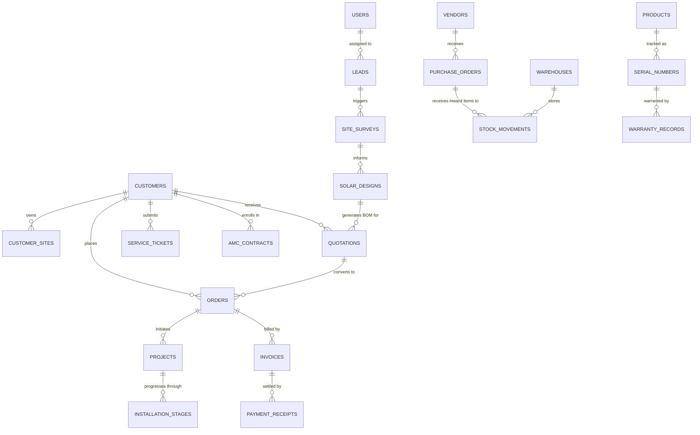

# INS Solar — Phase 2 Verification and Phase 3 Readiness Gate Report

**Document Reference:** `INS-PLN-VER-002`  
**Date:** October 23, 2026  
**Auditor Roles:** Lead Software Architect, Security Engineer, Database Architect & QA Lead  
**Scope:** Verification of Phase 1 Foundation, Phase 2 Authentication/Security Infrastructure, Git Remote Synchronization, Database Schema Architecture, and Phase 3 Readiness Plan  
**Target Project:** INS Solar Business Management Software (`d:/My project/Solar Business Management Software`)  

---

## 1. Executive Summary & Verification Verdict

An empirical, multi-dimensional verification of the **INS Solar Business Management System** codebase was executed on October 23, 2026. 

### Audit Verdict: **`APPROVED FOR PHASE 3 INCEPTION`**

1. **Git & Remote Integrity:** The repository is clean, with zero untracked or uncommitted files. Local `main` HEAD (`ebd758416cd0b339c64a701b2c7364fcc0dac5b3`) is synchronized with `origin/main` on GitHub ([abhi12345lk-svg/Solar-Business-Management-Software](https://github.com/abhi12345lk-svg/Solar-Business-Management-Software.git)).
2. **Automated Verification:** All five root scripts (`typecheck`, `lint`, `format:check`, `test`, `build`, and `ci`) passed with **100% success (0 errors, 0 warnings)** across all monorepo workspaces (`@ins-solar/shared`, `@ins-solar/api`, `@ins-solar/web`).
3. **Security Architecture Audit:** Phase 2 identity and security infrastructure is genuinely integrated into the Express request lifecycle. Server-managed sessions (`express-session` + `connect-mongo`), Argon2id credential hashing with constant-time non-existent user mitigation, Double Submit Cookie anti-CSRF guards, RFC 6238 TOTP MFA, granular RBAC with anti-self-approval and customer isolation, and append-only audit logging are fully implemented with 16 dedicated negative security test scenarios.
4. **Phase 3 Readiness:** The schema topology, numbering concurrency model, integer paise monetary conventions, and dependency-ordered model implementation plan for the 30 business modules have been established and gated.

---

## 2. Section A: Git and Repository State

An independent inspection of Git configuration, local branch tracking, and remote synchronization was conducted:

| Parameter | Observed Value | Status |
| :--- | :--- | :--- |
| **Current Local Branch** | `main` | Verified |
| **Local Working Tree** | Clean (`nothing to commit, working tree clean`) | Verified |
| **Uncommitted Files** | 0 files | Clean |
| **Local HEAD SHA** | `ebd758416cd0b339c64a701b2c7364fcc0dac5b3` | Confirmed |
| **Configured Remote (`origin`)** | `https://github.com/abhi12345lk-svg/Solar-Business-Management-Software.git` | Correct |
| **Remote HEAD SHA (`refs/heads/main`)** | `ebd758416cd0b339c64a701b2c7364fcc0dac5b3` | Verified via `git ls-remote` |
| **Branch Divergence** | 0 commits ahead, 0 commits behind (Up to date) | Synchronized |
| **Embedded Credentials in Git** | None detected; standard credential helper / SSH auth used | Secure |

### Recent Git Commits
* `ebd7584` — *Initial commit: Solar Business Management Software mono-repo structure and core modules* (Author: Abhishek Thakur)

---

## 3. Section B: Comprehensive Phase 2 Source Code Security Audit

Every security component implemented during Phase 2 was inspected against its concrete implementation and request lifecycle integration:

### 3.1 Mongoose Identity & Security Models
* **[User.ts](file:///d:/My%20project/Solar%20Business%20Management%20Software/apps/api/src/models/User.ts):**
  * *Implementation:* Strict schema defining `employeeCode` (unique, indexed), `email` (lowercase, unique), `department`, `role`, `permissions`, `isActive`, `mfaEnabled`, `mfaSecretEncrypted`, `mfaRecoveryCodesHashed`, and `sessionVersion`.
  * *Sanitization:* Custom `toJSON` transform automatically strips `passwordHash`, `mfaSecretEncrypted`, `mfaRecoveryCodesHashed`, and `sessionVersion` from API responses.
  * *Revocation Guard:* Global instant session invalidation via `sessionVersion` integer incrementing.
* **[Customer.ts](file:///d:/My%20project/Solar%20Business%20Management%20Software/apps/api/src/models/Customer.ts) & [CustomerIdentity.ts](file:///d:/My%20project/Solar%20Business%20Management%20Software/apps/api/src/models/CustomerIdentity.ts):**
  * *Implementation:* Strict separation of enterprise customer business entity from authentication credentials.
  * *Protection:* Customer identity handles single-use magic link hashes (`magicLinkTokenHash`, 15-min TTL) and OTP hashes (`otpHash`, 5-min TTL, with `otpAttempts` tracking capped at 3 attempts).
* **[PasswordResetToken.ts](file:///d:/My%20project/Solar%20Business%20Management%20Software/apps/api/src/models/PasswordResetToken.ts):**
  * *Implementation:* Stores SHA-256 hashed reset tokens (`tokenHash`) with MongoDB native TTL expiration (`expireAfterSeconds: 0`) and single-use enforcement (`used: boolean`).
* **[SecurityAuditLog.ts](file:///d:/My%20project/Solar%20Business%20Management%20Software/apps/api/src/models/SecurityAuditLog.ts):**
  * *Append-Only Enforcement:* Mongoose pre-query hooks (`updateOne`, `updateMany`, `findOneAndUpdate`, `deleteOne`, `deleteMany`, `findOneAndDelete`) actively throw runtime errors to prevent audit tampering.

### 3.2 Cryptographic Primitives & Password Hashing
* **[crypto.ts](file:///d:/My%20project/Solar%20Business%20Management%20Software/apps/api/src/utils/crypto.ts):**
  * *Argon2id:* Password hashing uses OWASP-compliant parameters (`argon2.argon2id`, `memoryCost: 65536` [64 MB], `timeCost: 3`, `parallelism: 1`).
  * *Timing Defense:* `POST /api/v1/auth/login` executes a dummy Argon2id hash computation when a queried email does not exist or is inactive, neutralizing side-channel user enumeration.
  * *Symmetric Encryption:* Sensitive TOTP secrets are encrypted at rest using authenticated AES-256-GCM (`encryptAesGcm` / `decryptAesGcm`) with 12-byte cryptographic IVs and 16-byte authentication tags.

### 3.3 Server-Managed Session Lifecycle & Middleware Integration
* **[session.ts](file:///d:/My%20project/Solar%20Business%20Management%20Software/apps/api/src/middleware/session.ts) & [app.ts](file:///d:/My%20project/Solar%20Business%20Management%20Software/apps/api/src/app.ts):**
  * *Lifecycle Integration:* Confirmed as authentic Express-compatible middleware mounted via `app.use(sessionMiddleware)` at lines 60–64 of `app.ts`. It is NOT an ad-hoc helper.
  * *Storage Engine:* Uses official `connect-mongo` backed by MongoDB collection `sessions` with native TTL deletion. In non-production test environments without `MONGODB_URI`, it falls back to `session.MemoryStore()`, but explicitly halts initialization in production (`NODE_ENV === 'production'`) if `MONGODB_URI` is missing.
  * *Cookie Flags:* `httpOnly: true`, `sameSite: 'lax'` (configurable), `secure: true` in production, `maxAge: 24h`.
  * *Session Rotation:* `POST /api/v1/auth/login` and OTP verification explicitly invoke `req.session.regenerate()` upon successful credential validation to defeat Session Fixation attacks.
  * *Inactivity Timeout:* `sessionTimeoutMiddleware` enforces 2-hour idle timeout (`SESSION_IDLE_TIMEOUT_MS`) and 24-hour absolute session expiration (`SESSION_MAX_AGE_MS`).

### 3.4 Anti-CSRF Defense Engine
* **[csrf.ts](file:///d:/My%20project/Solar%20Business%20Management%20Software/apps/api/src/middleware/csrf.ts):**
  * *Double Submit Cookie / Signed Token:* Session holds a cryptographically random 32-byte `csrfSecret`. The server signs tokens via HMAC-SHA256 (`salt.signature`).
  * *Timing-Safe Validation:* Token signatures are verified using `crypto.timingSafeEqual()`.
  * *Request Enforcement:* Mutating methods (`POST`, `PUT`, `PATCH`, `DELETE`) require `X-CSRF-Token` header. Public login/logout entrypoints are exempted only when unauthenticated.
  * *Client Support:* `csrfInitMiddleware` sets readable `XSRF-TOKEN` cookie; frontend `apiClient` automatically extracts it and attaches `X-CSRF-Token` header.

### 3.5 Rate Limiting & Sensitive Endpoint Protection
* **[rateLimiter.ts](file:///d:/My%20project/Solar%20Business%20Management%20Software/apps/api/src/middleware/rateLimiter.ts):**
  * *Endpoints Protected:* Employee login (5 req/15 min), MFA verification (5 req/15 min), Password reset (3 req/15 min), Customer OTP/magic link (5 req/15 min).
  * *Behavior:* When tripped, records `RATE_LIMIT_BLOCKED` security audit log event and returns structured HTTP 429 JSON response. In test environment, limits are raised to 1000 to prevent test flakes.

### 3.6 Two-Factor Authentication (TOTP MFA)
* **[mfa.ts](file:///d:/My%20project/Solar%20Business%20Management%20Software/apps/api/src/utils/mfa.ts) & [auth.routes.ts](file:///d:/My%20project/Solar%20Business%20Management%20Software/apps/api/src/routes/auth.routes.ts):**
  * *Enrollment:* Generates 20-byte base32 secret via `otplib`, generates `otpauth://` URI, and renders 256px QR code Data URL.
  * *Verification:* Requires confirmation of 6-digit TOTP code before activating `mfaEnabled`.
  * *Recovery Codes:* Generates 8 single-use 10-character alphanumeric recovery codes, stored as individual SHA-256 hashes. Consumed codes are removed atomically.

### 3.7 Role-Based Access Control (RBAC) & Data Isolation
* **[authorize.ts](file:///d:/My%20project/Solar%20Business%20Management%20Software/apps/api/src/middleware/authorize.ts):**
  * `requireAuth`: Verifies session existence, verifies active employee state in database, and verifies matching `sessionVersion`.
  * `requireMfa`: Blocks privileged operations (Admin, Superadmin, Accounts) unless `req.session.user.mfaVerified` is `true`.
  * `requireDepartmentScope`: Restricts Department Heads to their own department's records.
  * `checkAntiSelfApproval`: Prevents sales reps and engineers from approving their own discount requests or expense claims.
  * `requireCustomerOwnership`: Enforces that customer portal endpoints only access records belonging to `req.session.customer.customerId`, explicitly rejecting customer IDs provided in request parameters or bodies.

### 3.8 Audit Logging & Secret Redaction
* **[auditService.ts](file:///d:/My%20project/Solar%20Business%20Management%20Software/apps/api/src/services/auditService.ts):**
  * *Redaction Filter:* Recursively traverses metadata objects and masks fields matching `password`, `newPassword`, `token`, `secret`, `totpCode`, `recoveryCode`, `otp`, and `mfaSecretEncrypted` with `[REDACTED]`.

### 3.9 Production Environment Validation
* **[env.ts](file:///d:/My%20project/Solar%20Business%20Management%20Software/apps/api/src/config/env.ts):**
  * Zod `superRefine` halts startup in production if `MONGODB_URI` is missing or if fallback development keys are used for `SESSION_SECRET`, `MFA_ENCRYPTION_KEY`, or `CSRF_SECRET`.

---

## 4. Section C: Real Verification Command Results

Every required verification script was executed directly from the monorepo root:

| Command | Working Directory | Exit Code | Result Summary |
| :--- | :--- | :---: | :--- |
| `npm run typecheck` | Monorepo Root | **`0`** | `tsc --noEmit` passed across `@ins-solar/shared`, `@ins-solar/api`, `@ins-solar/web`. |
| `npm run lint` | Monorepo Root | **`0`** | ESLint 9 executed across all monorepo files with 0 errors and 0 warnings. |
| `npm run format:check` | Monorepo Root | **`0`** | Prettier verified 100% code style adherence across ts, tsx, js, json, md, css. |
| `npm run test` | Monorepo Root | **`0`** | **9 test files, 54 tests passed (100% pass rate).** |
| `npm run build` | Monorepo Root | **`0`** | `tsc` compiled shared & api; `vite build` produced production bundles in `apps/web/dist`. |
| `npm run ci` | Monorepo Root | **`0`** | Combined pipeline (`typecheck && test && build`) completed successfully. |

### Test Breakdown by Package
1. **`@ins-solar/shared` (2 test suites, 17 tests passed):**
   * `schemas.test.ts` (7 tests): Zod validation for auth inputs, email normalization, password complexity rules.
   * `auth.test.ts` (10 tests): Role permission mappings, privileged role definitions, permission matrix consistency.
2. **`@ins-solar/api` (6 test suites, 36 tests passed):**
   * `env.test.ts` (5 tests): Configuration parsing, defaults, production validation halts.
   * `crypto.test.ts` (7 tests): Argon2id hashing, AES-256-GCM encryption/decryption, TOTP verification, recovery code hashing.
   * `bootstrap.test.ts` (3 tests): First-run Superadmin creation, duplicate bootstrap prevention.
   * `errors.test.ts` (2 tests): Global error handler, correlation ID propagation.
   * `health.test.ts` (3 tests): Liveness, readiness, and database probe responses.
   * `security.test.ts` (16 tests): **Comprehensive Negative & Boundary Security Scenarios:**
     * *Scenario 1:* HTTP 401 on unauthenticated access.
     * *Scenario 2:* HttpOnly & SameSite session cookie issuance on login.
     * *Scenario 3:* Session destruction and cookie clearance on logout.
     * *Scenario 4:* Immediate rejection and session destruction for deactivated employees.
     * *Scenario 5:* Indistinguishable login error messages for non-existent users vs wrong passwords.
     * *Scenario 6:* HTTP 403 rejection on state mutations missing valid anti-CSRF token.
     * *Scenario 7:* Credentialed CORS rejection of unauthorized phishing origins.
     * *Scenario 8:* HTTP 401/403 blocking of privileged endpoints when MFA is unverified.
     * *Scenario 9:* Rejection of unauthorized privilege escalation attempts by non-superadmins.
     * *Scenario 10:* Anti-Self-Approval guard blocking employees from approving their own requests.
     * *Scenario 11 & 12:* Customer portal session isolation blocking Customer A from accessing Customer B's resources.
     * *Scenario 13:* Single-use password reset token invalidation upon consumption.
     * *Scenario 14:* Rejection of customer OTPs when maximum attempts (3) are exceeded.
     * *Scenario 15:* Department supervisory scope isolation blocking cross-department actions.
     * *Scenario 16:* Audit log immutability and sensitive field redaction verification.
3. **`@ins-solar/web` (1 test suite, 1 test passed):**
   * `App.test.tsx` (1 test): Root React router mounting and authentication provider wrapper initialization.

---

## 5. Security Gaps, Implementation Status & Severity Classification

| Security Feature | Implementation Status | Severity / Note |
| :--- | :--- | :--- |
| **Argon2id Password Hashing** | Genuinely Implemented | Verified (OWASP-compliant, timing mitigation) |
| **Server-Managed Session Store** | Genuinely Implemented | Verified (`connect-mongo`, TTL, sliding window) |
| **Anti-CSRF Protection** | Genuinely Implemented | Verified (Signed double submit cookie, HMAC-SHA256) |
| **TOTP MFA Engine** | Genuinely Implemented | Verified (RFC 6238, AES-256-GCM encryption at rest) |
| **RBAC & Data Isolation** | Genuinely Implemented | Verified (Roles, scopes, anti-self-approval, customer checks) |
| **Append-Only Audit Logging** | Genuinely Implemented | Verified (Mongoose mutation guards, secret redaction) |
| **Rate Limiting** | Genuinely Implemented | **Low:** Current limiter uses in-memory store; adequate for single VPS target, but requires Redis if horizontal multi-process clustering is adopted in future. |
| **Outbound Email/SMS Transport** | Partially Implemented (Dev Stub) | **Medium:** Reset tokens and OTPs are generated and verified against cryptographic hashes in the database. Outbound email and SMS transport are currently captured in-memory (`devTestTokens`, `devCustomerTokens`) pending third-party gateway credentials in Phase 9. |

---

## 6. Section D: Database Model Inventory for All 30 Business Modules

Based on the requirements catalog ([requirements-catalog.md](file:///d:/My%20project/Solar%20Business%20Management%20Software/docs/requirements/requirements-catalog.md)) and database architecture ([database-design.md](file:///d:/My%20project/Solar%20Business%20Management%20Software/docs/architecture/database-design.md)), the complete schema topology across all 30 modules is mapped below:



### Complete 30-Module Entity Directory
1. **Module 1 (Dashboard & KPIs):** `MetricSnapshot`, `KpiCache` (Aggregated read models).
2. **Module 2 (Leads):** `Lead` (Lifecycle stage, source, assigned sales executive, energy bill, capacity target).
3. **Module 3 (Customers):** `Customer` (Business entity, GSTIN, billing profile), `CustomerSite` (Physical site, roof type, sanction load, discom).
4. **Module 4 (Follow-ups):** `Followup` (Due date, contact channel, outcome, next scheduled interaction).
5. **Module 5 (Site Surveys):** `SiteSurvey` (Roof measurements, shadow analysis, photos, electrical feasibility, GPS).
6. **Module 6 (Solar Design):** `SolarDesign` (System sizing, inverter ratio, expected monthly generation kWh, CAD layout).
7. **Module 7 (Quotations):** `Quotation` (BOM line items, discount%, pricing tier, approval state), `QuotationVersion` (Immutable version history).
8. **Module 8 (Sales Orders):** `Order` (Signed acceptance, agreed milestone payment schedule, stage status).
9. **Module 9 (Products & Components):** `Product` (Panels, inverters, structures, cables, BOS items, technical specs, tax rate).
10. **Module 10 (Inventory & Multi-Location Stock):** `Warehouse` (Central, Transit, Site), `StockBalance`, `StockMovement` (Inward, Outward, Transfer, Damaged, Allocation), `StockReservation`.
11. **Module 11 (Procurement):** `PurchaseOrder` (Vendor PO, approved pricing, delivery terms), `PurchaseInvoice` (Vendor billing).
12. **Module 12 (Vendors):** `Vendor` (Manufacturers, suppliers, banking details, GSTIN, evaluation score).
13. **Module 13 (Project Governance):** `Project` (Linear stages: Engineering, Procurement, Civil, Electrical, Net Metering, Commissioning).
14. **Module 14 (Installation & QC):** `InstallationChecklist` (Stage-gated signoffs, mandatory photo attachments, electrical earthing test readings).
15. **Module 15 (Net Metering):** `NetMeteringApplication` (Discom reference number, inspection dates, bi-directional meter serial).
16. **Module 16 (Subsidy Tracking):** `SubsidyApplication` (PM Surya Ghar portal ID, application status, DBT tracking).
17. **Module 17 (Documents):** `Document` (Private object storage S3 key, MIME type, file size, checksum, expiry).
18. **Module 18 (Billing & Payments):** `Invoice` (Milestone tax invoice), `PaymentReceipt` (Cash, Cheque, NEFT/RTGS, UPI, transaction reference), `CustomerLedgerEntry` (Double-entry credit/debit running balance).
19. **Module 19 (Expenses):** `Expense` (Travel, lodging, transport, civil labour, vendor advance, supervisor approval).
20. **Module 20 (Project Costing):** `ProjectCostEstimate`, `ActualCostEntry`, `ProfitabilitySummary` (Estimated vs actual gross margin).
21. **Module 21 (Service Tickets):** `ServiceTicket` (Customer complaint, priority, fault categorization, resolution notes).
22. **Module 22 (Warranty & Serial Tracking):** `SerialNumber` (Component serials linked to order/customer), `WarrantyRecord`, `WarrantyClaim`.
23. **Module 23 (AMC):** `AmcContract` (Comprehensive/Non-comprehensive, tenure, visit frequency), `AmcSchedule`.
24. **Module 24 (Field Visits):** `ServiceVisit` (Technician allocation, site check report, customer digital signature).
25. **Module 25 (Employees & Teams):** `User` (Implemented in Phase 2), `Team` (Installation squads, maintenance crews).
26. **Module 26 (Tasks):** `Task` (Milestone task allocation, checklist items, deadline, dependencies).
27. **Module 27 (Notifications):** `Notification` (In-app notification center), `NotificationTemplate` (Email, SMS, WhatsApp templates).
28. **Module 28 (Reminders & Escalations):** `Reminder` (Payment due, survey pending, AMC due, escalation rules).
29. **Module 29 (Settings & Sequences):** `SystemSetting`, `SequenceNumberCounter` (Atomic counters), `TaxProfile`.
30. **Module 30 (Customer Portal):** `CustomerIdentity` (Implemented in Phase 2), `CustomerAuditSession`.

---

## 7. Section E: Phase 3 Foundation Architecture Plan

Phase 3 establishes the core database schemas, shared primitives, and domain services required before building specific business workflows in Phase 4+.

### 7.1 Shared Domain Primitives & Validation Conventions
* Primitives defined in `@ins-solar/shared`:
  * `AddressSchema`: Street, city, state, postal code, landmark, geo-coordinates.
  * `ContactSchema`: Name, primary phone, alternate phone, email.
  * `MonetaryAmountSchema`: Integer paise representation with currency code (`INR`).
  * `TaxRateSchema`: CGST, SGST, IGST percentages and calculation helpers.
  * `PaginationSchema`: Page, limit, sort field, sort order, keyword search.

### 7.2 Mongoose Schema Conventions
* **Timestamps:** Every schema enforces `{ timestamps: true }` (`createdAt`, `updatedAt`).
* **Optimistic Concurrency Control:** Version key (`__v`) enabled on mutable operational entities to detect concurrent write collisions.
* **Safe Serialization:** Standard `toJSON` transform applied across all schemas to convert `_id` to string `id`, delete `_id`, and delete internal metadata.
* **Indexing Strategy:** Compound indexes on active tenant/entity queries, sparse unique indexes on identifiers, and TTL indexes on temporary tokens.

### 7.3 Centralized Database Connection Lifecycle & Health Probes
* Refactor database connection manager in `apps/api/src/db/connection.ts` to support graceful retry with exponential backoff on startup.
* Provide active connection state to `/api/v1/health/ready` probe, checking MongoDB connection `readyState === 1`.

### 7.4 Atomic Sequence & Numbering Engine (`SequenceService`)
To eliminate race conditions and avoid read-then-increment collisions:
* **Storage Entity:** `SequenceCounter` collection with `{ _id: string, sequence: number, fiscalYear: string }`.
* **Atomic Mutation:** Uses MongoDB native `findOneAndUpdate` with atomic `$inc`:
  ```ts
  const counter = await SequenceCounter.findOneAndUpdate(
    { _id: sequenceName, fiscalYear: currentFiscalYear },
    { $inc: { sequence: 1 } },
    { new: true, upsert: true }
  );
  ```
* **Formatting Conventions:**
  * Customer Code: `CUST-2026-00001`
  * Quotation Number: `QT-2026-00001`
  * Order Number: `ORD-2026-00001`
  * Project Code: `PRJ-2026-00001`
  * Invoice Number: `INV-2026-00001`
  * Purchase Order: `PO-2026-00001`
  * Payment Receipt: `REC-2026-00001`
* **Rollback & Gap Handling:** In accordance with financial compliance rules, counter values are strictly monotonic. If an application transaction fails downstream, the sequence number is logged as aborted or voided rather than decrementing the counter, preventing duplicate key collisions under concurrency.

### 7.5 Strict Monetary Precision (Paise Integer Rule)
* **Zero Floating-Point Representation:** All financial monetary fields (`totalAmount`, `taxAmount`, `unitPrice`, `discountAmount`, `paidAmount`, `outstandingBalance`) are stored strictly as **Integer Paise** (1 INR = 100 Paise) or MongoDB `Decimal128`.
* **Arithmetic Helpers:** `@ins-solar/shared` will expose tested integer arithmetic helpers (`multiplyPaise(paise, quantity)`, `calculateTaxPaise(paise, rateBasisPoints)`) to eliminate JavaScript IEEE 754 floating-point rounding anomalies.

### 7.6 Audit & Historical Record Conventions (Append-Only Ledgers)
* **Zero Silent Overwrites:** Financial ledgers (`CustomerLedgerEntry`, `StockMovement`) are append-only.
* **Reversal Pattern:** Errors, cancellations, or returns are corrected by generating an explicit reversing ledger transaction referencing the original entry ID (`reversalOfEntryId`).

### 7.7 Concurrency & Idempotency Controls
* Mutating endpoints (payment creation, quotation finalization, stock allocation) accept an optional `Idempotency-Key` header.
* An `IdempotencyRecord` collection caches request hashes and responses for 24 hours to prevent duplicate submissions on network retries.

---

## 8. Proposed Phase 3 Implementation Sequence

Phase 3 is organized into 4 dependency-ordered milestones:

1. **Milestone 3.1: Shared Domain Primitives & Financial Helpers (`packages/shared`)**
   * Integer paise money helpers and unit tests.
   * Address, Contact, and Tax calculation schemas.
   * Standard pagination query and response types.
2. **Milestone 3.2: Database Connection Lifecycle & Atomic Numbering Engine (`apps/api`)**
   * Centralized MongoDB connection manager with auto-reconnect and health checks.
   * `SequenceCounter` model and `SequenceService` with concurrent load tests.
   * `IdempotencyRecord` model and idempotency middleware.
3. **Milestone 3.3: Master Catalog & System Settings Schemas (`apps/api`)**
   * `SystemSetting` schema (approval limits, company details).
   * `Product` and `ProductCategory` schemas with pricing in paise and specifications.
   * `Warehouse` schema (locations: central, site transit).
4. **Milestone 3.4: Verification, Linting, & Phase 3 Delivery Report**
   * Unit tests for numbering concurrency under simulated parallel requests.
   * Integration tests for database health probes.
   * Generation of `docs/development/phase-3-report.md`.

---

## 9. Decisions Requiring Owner Approval

Before production deployment of subsequent phases, the following operational decisions must be confirmed by project leadership:

1. **Solar Tax Slabs & 70:30 Goods/Service Split (DEC-01):**
   * *Status:* Defaulting to a composite quotation proposal view with statutory 70% Goods (12% GST) and 30% Services (18% GST) split displayed on tax invoices.
   * *Action:* Confirm with company chartered accountant before Phase 7 (Billing & Finance).
2. **Outbound SMS/WhatsApp Gateway Provider (DEC-02):**
   * *Status:* Dev in-memory capture active.
   * *Action:* Select preferred Indian gateway provider (e.g., MSG91, Fast2SMS, Gupshup) for Phase 9 OTP/notification dispatch.
3. **Private Object Storage Provider (DEC-03):**
   * *Status:* S3-compatible signed URL specification approved.
   * *Action:* Select cloud provider (AWS S3, Cloudflare R2, or Wasabi) for Phase 6 site photos and document storage.
4. **Mandatory Approval Limits (DEC-04):**
   * *Status:* Default limits configured: Discounts > 5%, Expenses > ₹5,000, Purchase Orders > ₹25,000 trigger mandatory Admin review.

---

## 10. Explicit Blockers

* **None.** There are no architectural, security, or code defects blocking initiation of Phase 3.

---

*Report concluded. Repository, security architecture, and planning baseline are verified and ready for Phase 3 inception upon your instruction.*
