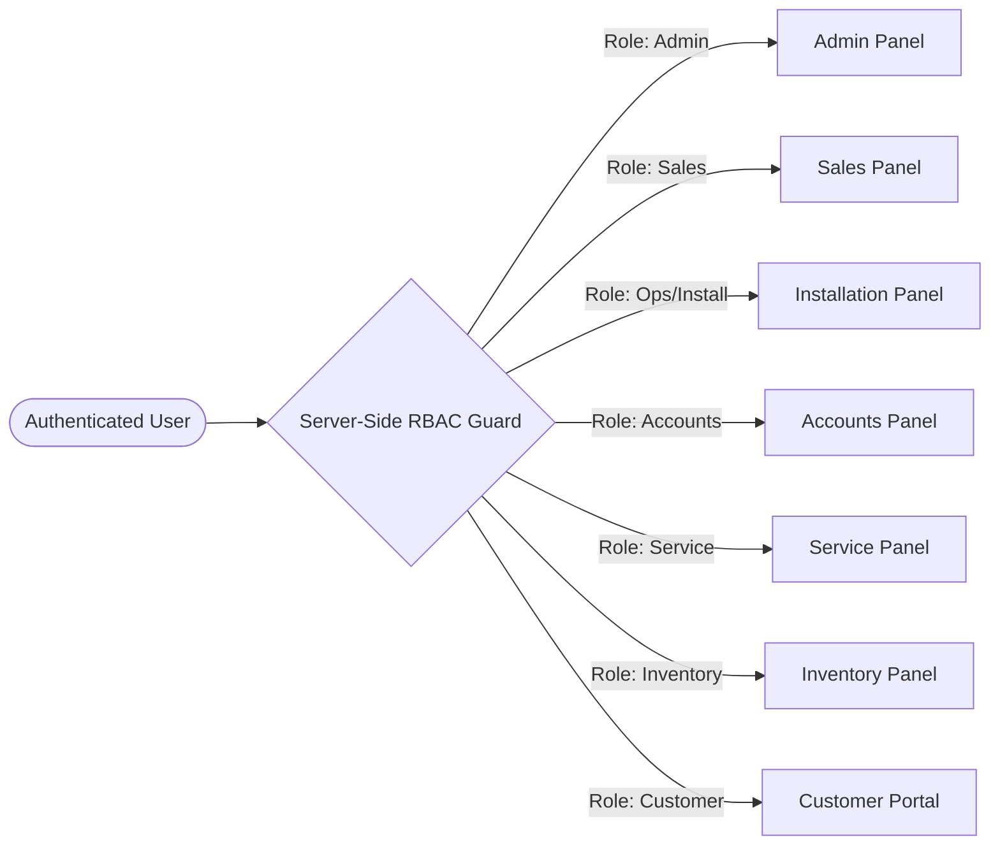
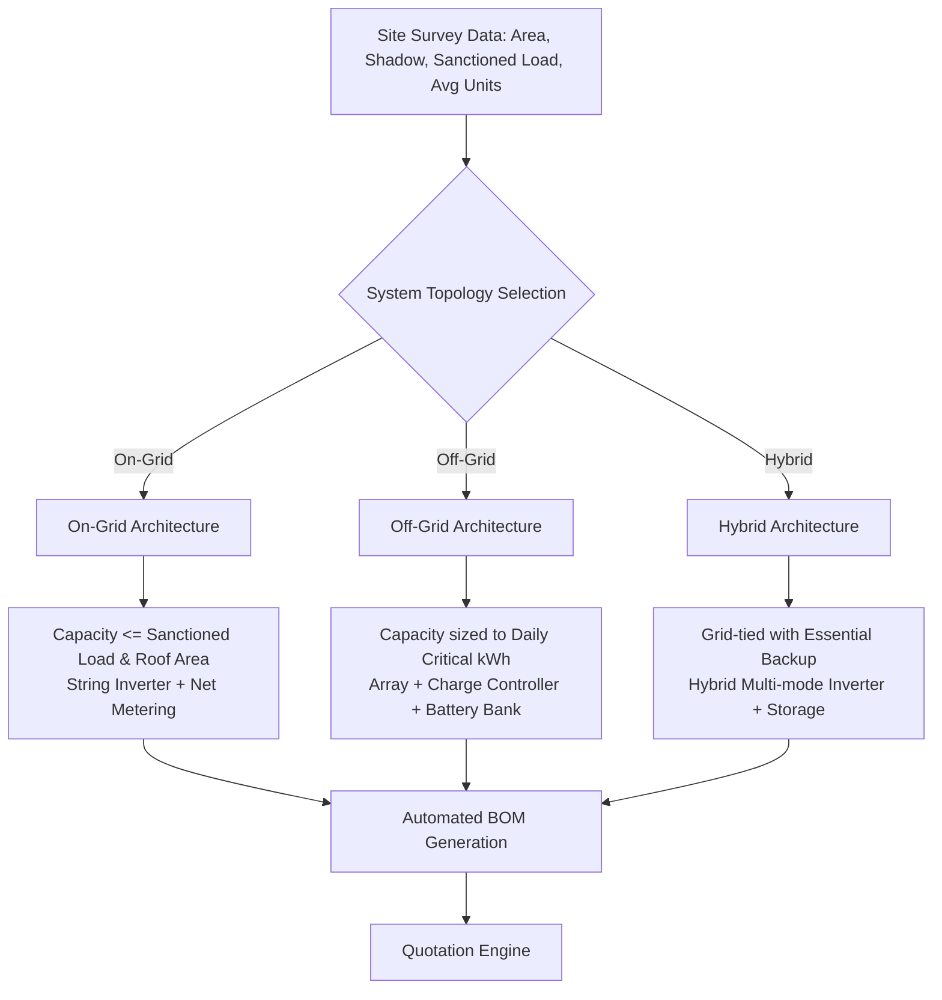

# INS Solar Business Management Software — Requirements Catalog

**Document Reference:** `INS-REQ-CAT-001`  
**Version:** `1.0.0`  
**Status:** Approved for Implementation Planning  
**Target Environment:** Single-Company Enterprise Business Management System (INS Solar)  
**Target Users:** 11–30 Employees across 6 Operating Departments + External Customers via Secure Portal  

---

## 1. Executive Summary & System Objective

The **INS Solar Business Management Software** is a bespoke, enterprise-grade, single-company operational ERP and Customer Relationship Management (CRM) platform engineered exclusively for **INS Solar**. The organization executes end-to-end solar engineering, procurement, construction (EPC), and post-installation maintenance operations for residential, commercial, and industrial customers across on-grid, off-grid, and hybrid solar configurations.

The primary objective of this system is to consolidate disjointed spreadsheets, paper surveys, fragmented messaging threads, and manual financial ledgers into a unified, secure, audit-trailed digital operating system. The system enforces strict role-based access control (RBAC), atomic stock movement tracking across multi-location inventories, stage-gated project and installation governance, rigorous financial tracking (advances, partial payments, GST/non-GST splits, and project profitability), and compliant customer communications through a dedicated customer portal and notification engine.

> [!IMPORTANT]
> This system is **NOT** a multi-tenant SaaS application. It is a dedicated, single-tenant, private enterprise platform designed to maximize operational velocity, preserve financial data integrity, eliminate inventory leakage, and provide complete operational traceability for INS Solar.

---

## 2. Operating Model, Users & Departmental Structure

The software is calibrated for an initial operating scale of **11–30 internal employees** distributed across six core functional departments, alongside external customer access:

```mermaid
graph TD
    subgraph INS Solar Internal Team
        Admin["Executive & Administration (Management, System Admins)"]
        Sales["Sales & Marketing (Lead Executives, Technical Sales)"]
        Engineering["Survey & Design (Field Surveyors, Solar Engineers)"]
        Ops["Installation & Operations (Project Managers, Installation Crews)"]
        Accounts["Finance & Accounts (Accounts Officers, Billing)"]
        Service["Service & Maintenance (AMC Managers, Service Technicians)"]
        Stores["Inventory & Stores (Storekeepers, Procurement)"]
    end
    
    subgraph External Stakeholders
        Customer["Customer (System Owners, Facility Managers)"]
        Vendors["Vendors & Subcontractors (Hardware Manufacturers, Suppliers)"]
    end

    Admin --> Sales & Engineering & Ops & Accounts & Service & Stores
    Customer <--> |Secure Customer Portal| INS Solar Internal Team
```

### 2.1 User Categories & Operational Volumes

| Department / Role | Typical User Count | Primary Responsibility | Primary System Interface |
| :--- | :--- | :--- | :--- |
| **Administration / Directors** | 2 – 4 | Strategic oversight, financial approvals, policy config, audit | Admin Panel |
| **Sales & Business Development** | 3 – 8 | Lead intake, customer consultations, quotations, follow-ups | Sales Panel |
| **Site Surveyors & Engineers** | 2 – 4 | On-site feasibility, shadow analysis, BOM sizing, engineering | Sales / Mobile Survey View |
| **Project & Installation Team** | 4 – 8 | Stage-gate installations, quality checklists, commissioning | Installation Panel |
| **Accounts & Commercial** | 2 – 3 | Invoicing, payment reconciliation, vendor payments, margins | Accounts Panel |
| **Inventory & Logistics** | 1 – 2 | Stock tracking, warehouse movements, material issuances | Inventory Panel |
| **Service & Maintenance** | 2 – 4 | Break-fix complaints, scheduled AMC visits, warranty claims | Service Panel |
| **External Customers** | Unbounded | View quotations, track projects, download invoices, tickets | Customer Portal |

---

## 3. Comprehensive 30-Module Functional Inventory

Every functional module listed below represents a mandatory, end-to-end business capability. Each module defines explicit data attributes, business validations, user interactions, and integration touchpoints.

---

### Module 1: Dashboard

The central command and analytics center tailored dynamically by role. For management and operations, it delivers real-time visibility into business pipeline health, operational bottlenecks, cash flow, and project execution velocity.

*   **1.1 Total Leads:** Aggregate count of all leads ever captured within the system, with comparative period-over-period indicators (weekly, monthly, annual).
*   **1.2 New Leads:** Real-time count of leads in `New` status awaiting initial qualification or sales executive assignment.
*   **1.3 Follow-ups:** Count of follow-ups scheduled for the current day, accompanied by overdue follow-up alerts and aging badges.
*   **1.4 Quotations:** Dynamic summary of active quotations categorized by state: `Draft`, `Pending Approval`, `Sent to Customer`, `Accepted`, `Rejected`, and `Expired`.
*   **1.5 Confirmed Orders:** Count and aggregate monetary value of orders confirmed within the selected reporting timeframe.
*   **1.6 Installation Pending:** Count of confirmed customer projects pending site installation, categorized by readiness (e.g., awaiting material dispatch, awaiting DISCOM approval, or awaiting structural team).
*   **1.7 Completed Projects:** Tally of fully commissioned projects with signed customer handover and testing certificates.
*   **1.8 Payments:** Real-time metrics of total payments received (inflows) categorized by time bucket, project type, and payment mode (UPI, NEFT, Cheque, Cash).
*   **1.9 Outstanding:** Current total accounts receivable across all active and completed projects, segmented by aging brackets (0–15 days, 16–30 days, 31–60 days, >60 days).
*   **1.10 Monthly Sales:** Visual time-series graph displaying monthly booked sales versus collection realization, with target progress meters.
*   **1.11 Interactive Filters:** Global dashboard filtering by Date Range, Branch/Location, Solar System Type (On-Grid, Off-Grid, Hybrid), and Sales Executive.

---

### Module 2: Lead Management

Standardized top-of-funnel intake mechanism ensuring no inquiry is lost, duplicated, or neglected.

*   **2.1 Lead ID:** System-generated unique identifier following a sequential, human-readable format (`LD-YYYY-XXXXX`).
*   **2.2 Date:** Timestamp of lead creation with automated recording of creator/origin.
*   **2.3 Customer Name:** Primary contact person or corporate entity name.
*   **2.4 Mobile:** E.164-compliant phone number with validation and automated duplicate-detection check across active and archived leads.
*   **2.5 Location:** Installation location details including Street, City, District, State, and PIN Code.
*   **2.6 Lead Source:** Source attribution (e.g., Website, Referral, Cold Outreach, Trade Expo, Social Media, Architect/Builder Channel).
*   **2.7 Solar Requirement:** Customer intention: Residential Rooftop, Commercial & Industrial (C&I), Agricultural Pumping, Ground Mount, or Battery Storage Retrofit.
*   **2.8 Estimated Capacity:** Desired or anticipated capacity in kilo-Watts peak ($kW_p$).
*   **2.9 Assigned Employee:** Explicit assignment to an internal sales executive with assignment notification and audit history.
*   **2.10 Status:** Finite state machine transition: `New` $\rightarrow$ `Contacted` $\rightarrow$ `Survey Scheduled` $\rightarrow$ `Quoted` $\rightarrow$ `Negotiation` $\rightarrow$ `Converted` $\rightarrow$ `Lost` / `Dropped`. Rejection reasons mandatory upon entering `Lost`.

---

### Module 3: Customer Management

Comprehensive Master Record for individuals and commercial entities doing business with INS Solar.

*   **3.1 Customer ID:** System-generated immutable identifier (`CUST-YYYY-XXXXX`).
*   **3.2 Name:** Full legal individual name or registered corporate/industrial entity name.
*   **3.3 Mobile:** Primary mobile number with optional secondary contact for site supervisors.
*   **3.4 Email:** Verified electronic mail address for transactional document delivery.
*   **3.5 Address:** Permanent billing address with complete postal hierarchy.
*   **3.6 GST/PAN:** Tax identifiers with format validation (15-character Indian GSTIN and 10-character PAN) to facilitate compliant GST or Non-GST billing.
*   **3.7 Installation Site:** Linked site profile capturing physical site characteristics, GPS geo-coordinates, access restrictions, and local DISCOM division.
*   **3.8 Project History:** Interactive consolidated timeline of all past, present, and pipeline projects associated with the customer.
*   **3.9 Payment History:** Complete ledger view of every invoice raised, receipt generated, credit adjustment, and current running balance.
*   **3.10 Customer Portal Identity:** Secure credential linkage enabling customer portal access via phone/email magic link or password authentication.

---

### Module 4: Follow-up Management

Operational tracking of ongoing customer negotiations and sales cadence.

*   **4.1 Lead/Customer:** Direct relational linkage to either a pre-conversion Lead record or an active Customer record.
*   **4.2 Follow-up Date:** Date and time of the logged interaction.
*   **4.3 Discussion:** Rich narrative notes detailing topics covered, customer objections, technical clarifications, and budget discussions.
*   **4.4 Next Follow-up:** Scheduled date and time for the subsequent action, automatically provisioning calendar entries and notification alerts.
*   **4.5 Assigned Employee:** Responsible sales representative accountable for executing the follow-up.
*   **4.6 Status:** Status indicator: `Scheduled`, `Completed`, `Rescheduled`, or `Cancelled`.
*   **4.7 Remarks:** Qualitative outcome remarks summarizing customer sentiment (`Hot`, `Warm`, `Cold`).

---

### Module 5: Site Survey

Engineering feasibility evaluation conducted physically on-site or via precision desktop tools prior to system design.

*   **5.1 Survey ID:** Unique tracking identifier (`SRV-YYYY-XXXXX`).
*   **5.2 Customer & Site Address:** Linked customer record and physical location under inspection.
*   **5.3 Roof Type:** Classification of roof substrate: Reinforced Cement Concrete (RCC Flat), Metal Profile Sheet (Trapezoidal / Standing Seam), Clay Tile, Asbestos, or Elevated Ground Mount.
*   **5.4 Roof Area:** Usable rooftop surface area in square meters ($m^2$) or square feet ($ft^2$).
*   **5.5 Electricity Bill:** Historical consumption audit capturing average monthly units ($kWh$) and tariff structure.
*   **5.6 Sanctioned Load:** Approved grid connection capacity ($kW$ or $kVA$) from the local electrical utility (DISCOM).
*   **5.7 Shadow Analysis:** Detailed azimuth, tilt, obstacle clearance, and seasonal shadow report (identifying parapet walls, water tanks, trees, adjacent buildings).
*   **5.8 Proposed Capacity:** Recommended maximum generation capacity ($kW_p$) calculated from available shadow-free area and sanctioned load limits.
*   **5.9 Photos:** Multi-angle photo repository (roof area, electrical distribution board / main switchboard, earthing pit locations, cable routing pathways).
*   **5.10 Surveyor:** Internal technical surveyor or solar engineer conducting the audit.
*   **5.11 Remarks:** Structural integrity observations, water-proofing concerns, and site access constraints.

---

### Module 6: Solar System Design

Engineering configuration engine that translates survey parameters into a Bill of Materials (BOM) and generation model.

*   **6.1 System Capacity:** Total rated DC capacity in kilo-Watts peak ($kW_p$).
*   **6.2 System Architecture:** Strict topology classification:
    *   *On-Grid:* Grid-tied inverter with bi-directional net metering; zero battery backup.
    *   *Off-Grid:* Solar array with charge controllers, battery energy storage, and isolated inverter output.
    *   *Hybrid:* Multi-mode inverter with intelligent grid synchronization, export limiters, and battery energy storage.
*   **6.3 Panel Quantity & Wattage:** Calculation of module count based on chosen module rating (e.g., 20 modules $\times$ 550Wp Mono PERC = 11.0 kWp).
*   **6.4 Inverter:** Specification of inverter capacity ($kW$), phase configuration (Single-Phase 230V / Three-Phase 415V), MPPT tracker count, and brand/model.
*   **6.5 Structure:** Structural engineering specification: Standard Aluminum Rail, Hot-Dip Galvanized Iron (GI), High-Rise Elevated Truss, or Ballasted Non-Penetrative.
*   **6.6 Battery:** Battery chemistry (LiFePO4, Lead-Acid Tubular), voltage, and storage capacity ($kWh$ / $Ah$) (mandatory for Off-Grid and Hybrid configurations).
*   **6.7 Cable:** DC solar cable gauges ($4mm^2$, $6mm^2$ UV-resistant cross-linked polyolefin) and AC copper/aluminum armored cable sizing.
*   **6.8 Accessories:** Balance of System (BOS) components: AC Distribution Box (ACDB) with MCBs/SPDs, DC Distribution Box (DCDB) with fuses/SPDs, Earthing Electrodes, Chemical Compounds, Lightning Arresters, and conduits.
*   **6.9 Estimated Generation:** Annualized generation output forecast ($kWh$/year) based on regional Global Horizontal Irradiance (GHI) and specific yield factors.

---

### Module 7: Quotation Management

Commercial pricing and formal proposal generation engine enforcing margin protection and corporate approval hierarchies.

*   **7.1 Quotation Number:** Sequential, revision-aware numbering format (`QT-YYYY-XXXXX-R0`, `R1`, etc.).
*   **7.2 Customer:** Relational link to customer and linked site survey.
*   **7.3 System Capacity & Design:** Relational link to engineered system configuration.
*   **7.4 Products & Bill of Materials:** Explicit line items enumerating modules, inverters, structures, BOS, and installation services.
*   **7.5 Quantity & Unit Rate:** Transparent line-item pricing detailing standard list price and discounted base.
*   **7.6 Discount & Margin Control:** Discount percentage or flat reduction. Discounts exceeding pre-configured company thresholds (e.g., >5%) trigger mandatory Admin/Management approval prior to issuance.
*   **7.7 GST & Taxation:** Configurable multi-component tax computation engine supporting intra-state CGST+SGST, inter-state IGST, or Non-GST schemes based on date-effective tax profiles (with zero hardcoded statutory ratios or assumed tax formulas). Invoices take a permanent immutable snapshot of applied tax rules upon issuance.
*   **7.8 Total:** Computed gross project proposal value including base price, tax lines, freight, and optional turn-key net metering liaison charges.
*   **7.9 Validity:** Defined expiration date (defaulting to 15 or 30 days) to mitigate volatile module commodity price fluctuations.
*   **7.10 Terms & Conditions:** Structured legal clauses covering warranty obligations, customer scope (civil foundations, water supply), payment milestones, and DISCOM timeline disclaimers.
*   **7.11 Status:** Lifecycle state: `Draft`, `Pending Approval`, `Approved`, `Sent`, `Accepted`, `Revised`, `Declined`, `Expired`.

---

### Module 8: Quotation Sharing

Multi-channel delivery, presentation, and acceptance system.

*   **8.1 Generate PDF:** Server-side pixel-perfect, branded PDF document compiler embedding company insignia, technical specifications, financial breakdown, and terms.
*   **8.2 Print:** Clean, print-optimized stylesheet output for physical branch meetings.
*   **8.3 Download:** Secure instant download of signed PDF copies for internal sales executives and authenticated customers.
*   **8.4 Email / WhatsApp Sharing:** Direct transactional dispatch via SMTP/SendGrid with PDF attachment, alongside configurable WhatsApp template notifications containing secure customer acceptance URLs.
*   **8.5 Quotation History:** Immutable revision log tracking previous iterations, price variances, and audit trail of who made alterations and when.
*   **8.6 Approval Status:** Real-time visibility into internal executive approval state and customer digital acceptance/rejection timestamps.

---

### Module 9: Order Management

The contractual transition point converting an accepted quotation into an active operational project and formal order.

*   **9.1 Order ID:** Immutable sales order identifier (`ORD-YYYY-XXXXX`).
*   **9.2 Customer:** Associated customer master record.
*   **9.3 Quotation Link:** Immutable association with the exact accepted revision of the quotation, permanently locking agreed prices and technical BOM.
*   **9.4 Order Date:** Date of contract signing or advance receipt confirmation.
*   **9.5 System Capacity:** Contracted plant capacity ($kW_p$).
*   **9.6 Order Value:** Contracted total sale value.
*   **9.7 Advance Received:** Verified upfront financial advance credited to company accounts.
*   **9.8 Balance:** Current outstanding contract balance dynamically calculated against posted receipts.
*   **9.9 Payment Status:** Financial state: `Advance Pending`, `Partially Paid`, `Fully Paid`, `Overdue`.
*   **9.10 Installation Status:** Operational state: `Not Started`, `In Progress`, `Completed`, `On Hold`.
*   **9.11 Automatic Project Initialization:** System requirement: Upon order confirmation, the system must atomically create a linked Project Management record and optionally place a stock reservation on the required BOM inventory.

---

### Module 10: Product / Item Master

Centralized catalog of all hardware, electrical equipment, and consumable parts handled by INS Solar.

*   **10.1 Item Categories:**
    *   *Solar Panels:* Monocrystalline, Bifacial, TopCon, Polycrystalline.
    *   *Inverters:* On-Grid String, Hybrid Multi-MPPT, Micro-inverters, Off-Grid Inverters.
    *   *Batteries:* Lithium Iron Phosphate (LiFePO4) racks/wall-mounts, Tubular Lead-Acid.
    *   *Mounting Structures:* HDG Aluminum rails, mid/end clamps, anchor fasteners, L-feet, strut channels.
    *   *Cables:* Solar DC cross-linked cables (red/black), AC 3-core/4-core armored cables.
    *   *Switchgear & BOS:* ACDBs, DCDBs, Solar MCBs, Surge Protection Devices (Type II), Fuses, Isolators.
    *   *Connectors & Fasteners:* MC4 connectors, Y-branches, cable ties, lugs, brass glands.
    *   *Earthing:* Chemical earthing electrodes, copper-bonded rods, earthing compound bags, GI strips.
*   **10.2 Unit of Measurement (UOM):** Strict unit definition (Nos, Sets, Meters, Kilograms, Packages, Pairs).
*   **10.3 Purchase Rate:** Default acquisition cost for inventory valuation and profit estimation.
*   **10.4 Selling Rate:** Baseline retail/billing price.
*   **10.5 HSN / SAC Codes:** Indian Harmonized System of Nomenclature codes for accurate GST invoicing.
*   **10.6 Specifications:** Structured technical JSON metadata (wattage, voltage range, efficiency, dimensions, weight, warranty duration).

---

### Module 11: Inventory Management

Multi-location, real-time stock control engine preventing stockouts, phantom stock, and material loss.

*   **11.1 Item Reference:** Direct relationship to Product Master.
*   **11.2 Multi-Location Stock Tracking:** Independent balance tracking across three critical business tiers:
    1.  *Main Warehouse:* Central company depot stock.
    2.  *Installation Site:* In-transit or staged material delivered physically to a customer's roof.
    3.  *Employee / Team Issued:* Tools, test meters, and consumable stocks issued directly to field technicians.
*   **11.3 Opening Stock:** Audited baseline quantity recorded at system inception or fiscal reconciliation.
*   **11.4 Stock In:** Increments resulting from verified Purchase Goods Receipt Notes (GRN) or inter-location transfers.
*   **11.5 Stock Out:** Verified decrements resulting from project installations or authorized internal consumption.
*   **11.6 Stock Reservations:** Automatic virtual lock on stock items upon Order confirmation to prevent double-selling prior to physical dispatch.
*   **11.7 Available vs Physical Stock:** Calculated availability: $\text{Available} = \text{Physical on Hand} - \text{Reserved}$.
*   **11.8 Minimum Stock & Low Stock Alerts:** Configurable reorder thresholds triggering automated UI warnings and procurement notifications.
*   **11.9 Material Issue Records & Shortage Handling:** Strict material dispatch workflow requiring storekeeper authorization and technician receipt sign-off. If a shortage occurs, material issuance is hard-blocked until stock replenishment or manager override.
*   **11.10 Serial Number Tracking:** Mandatory capture of serialized hardware (solar panel barcodes, inverter serial numbers, battery BMS serials) tied to customer warranty cards.

---

### Module 12: Purchase Management

Procurement lifecycle management for acquiring solar hardware and subcontractor services from verified vendors.

*   **12.1 Purchase ID:** Unique procurement identifier (`PO-YYYY-XXXXX`).
*   **12.2 Vendor:** Relational link to approved Vendor Master.
*   **12.3 Purchase Date:** Date of purchase order issuance.
*   **12.4 Itemized Hardware:** Detailed line items specifying quantity, agreed unit cost, and specifications.
*   **12.5 Rate & GST:** Purchase price breakdown including applicable input tax credit (ITC) eligible GST amounts.
*   **12.6 Total:** Total purchase obligation.
*   **12.7 Payment Status:** Accounts payable status: `Unpaid`, `Partially Paid`, `Paid`.
*   **12.8 Purchase Invoice & GRN:** Document upload for vendor tax invoices and Goods Receipt Note (GRN) generation verifying actual physical quantities received into inventory.

---

### Module 13: Vendor Management

Directory and historical ledger for suppliers, hardware distributors, and specialized subcontractors.

*   **13.1 Vendor Name:** Registered business entity name.
*   **13.2 Contact Details:** Primary representative, corporate phone, email, and billing address.
*   **13.3 GST/PAN:** Statutory tax identification details.
*   **13.4 Products Supplied:** Categorized catalog of components supplied (e.g., Tier-1 solar panels, specific inverter brands).
*   **13.5 Purchase History:** Consolidated log of all historical Purchase Orders raised.
*   **13.6 Outstanding Balance:** Real-time net payable balance owed to the vendor.
*   **13.7 Payment History:** Record of outgoing disbursements, bank transfer references, and payment vouchers.

---

### Module 14: Project Management

The central operational heartbeat coordinating the execution of sold solar installations from site handoff to final commissioning.

*   **14.1 Project ID:** Unique operational project identifier (`PRJ-YYYY-XXXXX`).
*   **14.2 Customer & Order Link:** Direct relational binding to Customer and originating Order.
*   **14.3 Capacity & System Type:** Technical parameters ($kW_p$, On-Grid/Off-Grid/Hybrid).
*   **14.4 Order Value:** Contracted revenue for project financial tracking.
*   **14.5 Project Manager:** Assigned senior engineer or project head accountable for timeline and quality.
*   **14.6 Start Date & Expected Completion:** Project scheduling baseline with milestone tracking.
*   **14.7 Current Stage:** Linear stage-gate progression:
    1.  `Engineering & Structure Design`
    2.  `DISCOM Net Metering Application`
    3.  `Material Procurement & Dispatch`
    4.  `Civil Foundation & Structure Mounting`
    5.  `Module Laying & DC Cabling`
    6.  `Inverter & ACDB Installation`
    7.  `Earthing & Lightning Protection`
    8.  `Testing & Pre-Commissioning`
    9.  `DISCOM Inspection & Bi-Directional Meter Installation`
    10. `Plant Commissioning & Customer Handover`
*   **14.8 Overall Status:** High-level project state: `Planning`, `In Progress`, `On Hold`, `Completed`, `Cancelled`.

---

### Module 15: Installation Management

Field execution tracking module utilized by project managers, site engineers, and installation crews.

*   **15.1 Project Link:** Relational link to the active Project.
*   **15.2 Installation Date:** Scheduled work dates and shift assignments.
*   **15.3 Installation Team:** Assigned installation technicians, electricians, and certified scaffolders.
*   **15.4 Physical Milestone Verification:** Step-by-step progress logging:
    *   *Panels Installed:* Actual count and layout configuration.
    *   *Inverter Installed:* Wall/structure mounting, IP-rating compliance, and DC/AC termination.
    *   *Structure Complete:* Torque-checked fasteners, civil grouting, rust-proof cold galvanizing paint applied.
    *   *Wiring Complete:* DC string conduits secured, UV protection checked, AC cable glands dressed.
    *   *Earthing Complete:* Dedicated pits for Inverter, Solar Array, and LA with measured resistance values ($<5\,\Omega$).
    *   *Testing Complete:* Open circuit voltage ($V_{oc}$), short circuit current ($I_{sc}$), and insulation resistance testing.
*   **15.5 Completion Status:** Formal field sign-off triggering inspection readiness.

---

### Module 16: Installation Checklist & Quality Assurance

Mandatory digital quality gate preventing premature project closure without photographic and technical evidence.

*   **16.1 Checklist Categories:**
    *   *Site Preparation:* Roof clean, clear access, hazards mitigated.
    *   *Structure:* Foundation curing verified, tilt angle calibrated, structural rigidity approved.
    *   *Panel Installation:* Zero micro-cracks, module clamp positions compliant with manufacturer specifications.
    *   *Inverter & Electricals:* Breaker ratings verified, DC polarity verified, AC phase rotation confirmed.
    *   *Safety & Protection:* Lightning arrestor coverage verified, danger/caution signage displayed, grounding bonds tight.
*   **16.2 Photo Verification:** Mandatory upload of timestamped, geofenced site photos for every single checklist category.
*   **16.3 Testing Logs:** Recorded megger test readings, earth resistance readings, and string-level $V_{oc}$ logs.
*   **16.4 Formal Approval:** Digital signature sign-off by the Project Manager and Quality Lead.

---

### Module 17: Net Metering / Subsidy Tracking

Tracking of state utility (DISCOM) approvals, bi-directional net meter installation, and central/state subsidy disbursements (e.g., PM Surya Ghar Muft Bijli Yojana or state portal schemes).

*   **17.1 Application Number:** Official utility or government portal application registration ID.
*   **17.2 Customer & Project Link:** Relational context.
*   **17.3 DISCOM Identification:** Name of local electricity distribution company, division, and subdivision office.
*   **17.4 Application Date:** Timestamp of formal online application submission.
*   **17.5 Document Checklist:** Verification tracking of required submissions:
    *   National Consumer Number / Service Connection Number
    *   Latest Paid Electricity Bill
    *   Property Tax Receipt / Ownership Proof
    *   Aadhaar & PAN Copy of Consumer
    *   Solar System Single Line Diagram (SLD) & Component Test Certificates
*   **17.6 Technical Feasibility Inspection:** Date of physical site inspection by DISCOM junior engineer, feasibility status, and demand note payment status.
*   **17.7 Meter Installation:** Work order issuance, bi-directional net meter testing, meter installation date, and initial meter reading.
*   **17.8 Subsidy Status:** Sequential tracking: `Eligible`, `Applied`, `Claim Uploaded`, `Inspected by Nodal Agency`, `Disbursed to Customer Account`, `Rejected`.
*   **17.9 Remarks & Alerts:** Reminders for DISCOM follow-ups and subsidy documentation deadlines. *(Note: Strictly an internal tracking engine; no automated direct government portal API integration is assumed without authorized credentials).*

---

### Module 18: Payment Management

Financial transactions ledger capturing customer collections, payment reconciliation, and receipts.

*   **18.1 Payment ID:** Unique financial receipt identifier (`REC-YYYY-XXXXX`).
*   **18.2 Customer & Project Link:** Associated customer and project.
*   **18.3 Invoice Reference:** Linkage to Proforma or Tax Invoice raised.
*   **18.4 Amount:** Exact financial value in base currency (INR).
*   **18.5 Payment Date:** Date funds were realized or received.
*   **18.6 Payment Mode:** Strict categorization: Bank NEFT/RTGS, UPI/IMPS, Cheque, Online Gateway, or Cash.
*   **18.7 Transaction Reference:** Bank UTR number, cheque number, or gateway transaction ID.
*   **18.8 Received By:** Internal employee or accounts officer who collected/logged the transaction.
*   **18.9 Balance:** Real-time remaining balance on the linked Project/Order.
*   **18.10 Status & Idempotency:** State: `Pending Clearance`, `Cleared`, `Bounced`, `Refunded`. Robust protection against duplicate payment logging via unique transaction reference constraints and idempotency keys.
*   **18.11 Automated Payment Receipts:** Server-generated downloadable, branded payment vouchers issued immediately upon clearance.

---

### Module 19: Expense Management

Tracking of project-level operational expenses, field team expenditures, and administrative overheads.

*   **19.1 Expense Date:** Date the cost was incurred.
*   **19.2 Category:** Strict operational expense breakdown:
    *   *Site Survey Travel & Fuel*
    *   *Freight & Logistics (Warehouse to Site)*
    *   *Crane / Crane Loading & Unloading*
    *   *Civil Works (Cement, Sand, Bricks)*
    *   *Subcontractor Installation Labor*
    *   *DISCOM Liaison & Inspection Fees*
    *   *Safety Gear & Site Consumables*
    *   *Miscellaneous Administrative Overhead*
*   **19.3 Project Attribution:** Explicit linkage to a specific Project ID (enabling true project costing) or flagged as General Company Overhead.
*   **19.4 Employee / Vendor Link:** Person claiming reimbursement or vendor being paid.
*   **19.5 Description & Amount:** Detailed narrative and verified monetary value.
*   **19.6 Receipt Attachment:** Upload of physical vendor cash memo, fuel slip, or bill.
*   **19.7 Approval Workflow:** Multi-tier authorization: Expenses over defined limits (e.g., >₹5,000) require Accounts Manager or Admin approval before reimbursement.

---

### Module 20: Project Costing & Profitability

Executive financial analytics engine calculating real-time gross margin and cost variances for every completed or in-progress installation.

*   **20.1 Hardware Costs:** Actual landed cost of panels, inverters, structures, batteries, and BOS drawn from inventory.
*   **20.2 Labor Costs:** Subcontractor installation fees and internal team daily labor allocations.
*   **20.3 Transportation & Freight:** Staged logistics and delivery expenditures.
*   **20.4 Commissioning & Liaison Expenses:** Net metering application fees and testing expenses.
*   **20.5 Other Incidental Expenses:** Sum of all approved project-attributed expenses logged in Module 19.
*   **20.6 Total Project Cost:** Dynamic aggregate: $\text{Total Cost} = \text{Hardware} + \text{Labor} + \text{Freight} + \text{Liaison} + \text{Incidentals}$.
*   **20.7 Sale Value:** Final contracted gross invoice value (excluding net tax pass-throughs).
*   **20.8 Gross Profit & Margin:** Real-time computation:
    $$\text{Gross Profit} = \text{Sale Value} - \text{Total Cost}$$
    $$\text{Margin \%} = \left(\frac{\text{Gross Profit}}{\text{Sale Value}}\right) \times 100$$
*   **20.9 Cost Variance Analysis:** Side-by-side comparison of *Estimated BOM Cost* (from Quotation) versus *Actual Landed Cost* (from Project Execution), highlighting margin erosion.

---

### Module 21: Service / Complaint Management

Post-commissioning customer ticketing and break-fix warranty resolution system.

*   **21.1 Complaint ID:** Unique service ticket identifier (`TKT-YYYY-XXXXX`).
*   **21.2 Customer & System Link:** Relational binding to Customer and installed solar plant.
*   **21.3 Complaint Date:** Ticket intake timestamp.
*   **21.4 Issue Category:** Precise defect classification:
    *   *Inverter Grid Error / Inverter Offline*
    *   *Zero Generation / Low Generation*
    *   *Physical Damage (Module glass breakage, cable cut)*
    *   *Structure Looseness / Vibration*
    *   *Water Leakage from Roof Fasteners*
    *   *Net Meter / Bi-directional Display Fault*
*   **21.5 Assigned Technician:** Field service engineer dispatched to resolve the defect.
*   **21.6 Scheduled Visit Date:** Target appointment date communicated to the customer.
*   **21.7 Root Cause & Resolution:** Detailed technical documentation of diagnostic findings and corrective action taken.
*   **21.8 Replacement Parts Used:** Track inventory consumption for repairs, indicating whether covered under Warranty (free replacement) or Billable to customer.
*   **21.9 Status:** Ticket progression: `Open`, `Assigned`, `Site Visit Scheduled`, `Pending Parts`, `Resolved`, `Closed`. Mandatory customer sign-off prior to closure.

---

### Module 22: Annual Maintenance Contract (AMC) Management

Recurring revenue and scheduled preventive maintenance governance for commercial and residential installations.

*   **22.1 AMC ID:** Unique contract identifier (`AMC-YYYY-XXXXX`).
*   **22.2 Customer & System Capacity:** Linked customer profile and plant rating.
*   **22.3 Contract Validity:** Start Date and Expiration Date (e.g., 1-year, 3-year, 5-year AMC terms).
*   **22.4 AMC Amount & Billing:** Agreed annual fee, billing frequency (Annual Advance, Semi-Annual, Quarterly), and payment status.
*   **22.5 Service Frequency:** Agreed annual visit cadence (e.g., Quarterly - 4 visits/year; Bi-Monthly - 6 visits/year).
*   **22.6 Service Schedule Generator:** Automated batch generation of planned Service Visit records across the contract duration.
*   **22.7 Renewal Tracking:** Automated alerts 30 days and 15 days prior to AMC expiration to prompt sales/renewal outreach.
*   **22.8 Contract Status:** State: `Active`, `Expiring Soon`, `Expired`, `Renewed`, `Terminated`.

---

### Module 23: Service Visit Management

Execution engine for scheduled AMC maintenance and preventive inspection visits.

*   **23.1 Customer & System Link:** Associated asset.
*   **23.2 Visit Date:** Date visit was conducted.
*   **23.3 Technician:** Lead service technician conducting inspection.
*   **23.4 Generation Audit:** Record current cumulative $kWh$ meter reading and instantaneous power generation ($kW$) vs solar irradiance conditions.
*   **23.5 Panel Condition:** Visual inspection of module surfaces: soiling level, bird dropping hotspots, EVA discoloration, delamination, frame damage.
*   **23.6 Inverter Status:** Inverter heatsink temperature check, fault code history review, fan operation, DC input voltage and AC output voltage measurements.
*   **23.7 Cleaning Verification:** Confirmation of module washing, water quality, and cleaning methodology.
*   **23.8 Structure & Earthing:** Torque inspection of clamps, checking earth pit watering and ground bond integrity.
*   **23.9 Issues Found & Field Report:** Digital service report generated on-site, including technician recommendations and customer digital signature.

---

### Module 24: Employee & Team Management

Human resource directory, departmental hierarchy, and operational team allocation.

*   **24.1 Employee Details:** Full Name, System Employee Code (`EMP-XXXX`), Mobile, Email, Residential Address, Emergency Contact.
*   **24.2 Designation & Department:** Corporate hierarchy (e.g., Senior Solar Consultant in Sales; Lead Electrician in Operations; Financial Analyst in Accounts).
*   **24.3 Assigned Workloads:** Real-time visibility into active assigned leads, open site surveys, active projects, and open service tickets.
*   **24.4 Team Grouping:** Composition of specialized installation crews (e.g., "Crew Alpha - Structure Specialists", "Crew Beta - Electrical & Commissioning").
*   **24.5 Attendance & Availability:** Field availability tracking (Active, On Site, On Leave) to prevent assigning tasks to unavailable personnel.
*   **24.6 Performance Metrics:** Key performance indicators (Leads converted, surveys completed within SLA, installations commissioned on schedule, customer satisfaction ratings).

---

### Module 25: Task Management

Cross-departmental collaboration, ad-hoc work management, and internal accountability tracking.

*   **25.1 Task Title & Description:** Clear operational deliverable (e.g., "Procure 400m 6sqmm Polycab DC cable for Sharma Project", "Submit Net Metering SLD to DISCOM Executive Engineer").
*   **25.2 Relational Context:** Linkable to a Lead, Customer, Project, or Purchase Order.
*   **25.3 Assigned Employee:** Person accountable for execution.
*   **25.4 Priority Matrix:** Priority tier: `Low`, `Medium`, `High`, `Urgent`.
*   **25.5 Start & Due Date:** Timeline constraints with automated countdowns.
*   **25.6 Status:** Kanban-style state transitions: `To Do`, `In Progress`, `Under Review`, `Completed`.
*   **25.7 Remarks & Activity Thread:** Internal commentary, file attachments, and completion notes.

---

### Module 26: Document Management

Centralized, secure repository for all operational files, regulatory filings, and customer assets.

*   **26.1 Document Categories:**
    *   *Customer KYC:* Aadhaar, PAN Card, Voter ID.
    *   *Utility Documentation:* Electricity Bills, Tariff Sanction Letters, Meter Test Certificates.
    *   *Property Documents:* Title Deed extracts, Tax Paid Receipts, Roof Lease Agreements.
    *   *Commercial Proposals:* Signed Quotations, System Engineering Drawings (CAD/SLD).
    *   *Legal Contracts:* EPC Contracts, Work Orders, Turnkey Agreements.
    *   *Installation Quality:* Pre/Post Site Photos, Checklist PDF Sign-offs, Megger Test Reports.
    *   *Warranty Cards:* Module 25-Year Performance Warranty, Inverter 5/10-Year Warranty, Workmanship Guarantee.
*   **26.2 Security & Storage Architecture:** Private Object Storage (S3-compatible / MinIO / Cloud Storage) with zero direct public access. Documents served exclusively via short-lived, cryptographically signed URLs (TTL $\le$ 15 minutes) validated against server session permissions.
*   **26.3 Metadata & Versioning:** Document upload timestamp, uploader identity, MIME type, file size, checksum, and revision tagging.

---

### Module 27: Reports & Analytics

Enterprise reporting suite providing exportable operational and financial business intelligence.

*   **27.1 Lead Report:** Conversion funnel analysis, drop-off stage analysis, lead source ROI, and sales rep performance.
*   **27.2 Sales Report:** Booked revenue, average deal size ($kW$ and INR), system-type breakdown (On-grid vs Off-grid vs Hybrid).
*   **27.3 Quotation Report:** Win/loss ratio, discount distribution, quotation turnaround time.
*   **27.4 Installation Report:** Average project delivery cycle time (days from order to commissioning), stage-by-stage delay analysis.
*   **27.5 Inventory Report:** Stock valuation, fast-moving vs slow-moving stock, consumption trends, replenishment projections.
*   **27.6 Payment Report:** Cash collection ledger, payment mode distribution, aging schedule of outstanding receivables.
*   **27.7 Expense Report:** Project cost breakdowns, departmental expense distribution, reimbursement audit.
*   **27.8 Profit Report:** Project-by-project gross margin analysis, company aggregate EBITDA estimate, variance against budget.
*   **27.9 AMC Report:** Active contract value, preventive visit compliance rate, renewal retention rate.
*   **27.10 Export Formats:** Server-side streaming export to CSV, Microsoft Excel (.xlsx), and printable PDF.

---

### Module 28: User, Role & Permission Management

Security kernel enforcing corporate governance, principle of least privilege, and session lifecycle management.

*   **28.1 System Roles:**
    *   `Admin / Superadmin`: Unrestricted operational and financial authority.
    *   `Sales Executive / Sales Head`: Pipeline, quotations, surveys, customer interactions.
    *   `Surveyor / Design Engineer`: Technical site surveys, shadow reports, BOM creation.
    *   `Project Manager / Installation Tech`: Project schedules, site checklists, installations.
    *   `Accounts Officer / CFO`: Invoicing, payments, vendor ledgers, expense approvals, margins.
    *   `Inventory Manager / Storekeeper`: Stock movements, GRNs, issuances, stock alerts.
    *   `Service Technician / AMC Lead`: Maintenance tickets, AMC schedules, visit logs.
    *   `Customer (Portal User)`: Access strictly limited to own project, quotations, and bills.
*   **28.2 Granular Permissions:** Resource-action matrix (e.g., `quotation:create`, `quotation:approve_discount`, `inventory:adjust_stock`, `payment:void`).
*   **28.3 Department Head Hierarchy:** Department heads can view and authorize actions across their entire team's caseload.
*   **28.4 Session Revocation & Employee Deactivation:** Instant kill-switch disabling deactivated employee accounts and revoking active server-side sessions immediately across all devices.
*   **28.5 Multi-Factor Authentication (MFA):** Mandatory TOTP-based 2FA for all privileged users (Admin, Accounts, Storekeeper) with one-time emergency recovery codes.

---

### Module 29: Notifications & Reminders Engine

Asynchronous alerting and messaging bus keeping all internal team members and customers aligned.

*   **29.1 In-App Notification Center:** Real-time bell notification dropdown displaying actionable events with deep links.
*   **29.2 Email Engine:** Transactional HTML emails powered by structured templates (e.g., Quotation Sent, Payment Received, Project Milestone Achieved).
*   **29.3 WhatsApp Notification Engine:** Configurable webhook/API provider integration dispatching approved message templates for mobile updates (site survey scheduled, quotation shared, installation date confirmed).
*   **29.4 Automated Reminders:**
    *   *Follow-up Reminder:* 2 hours prior to scheduled sales call.
    *   *Payment Due Reminder:* 3 days prior to milestone due date and weekly on overdue balances.
    *   *Installation Milestone Reminder:* Daily summary to Project Managers on stalled stages.
    *   *AMC Expiry Reminder:* 30 days and 7 days prior to maintenance contract expiration.
    *   *Service Due Reminder:* 3 days prior to scheduled quarterly cleaning visit.
    *   *Low Stock Alert:* Instant high-priority dispatch to Inventory Manager upon stock crossing minimum safety threshold.

---

### Module 30: Settings & Master Data Management

Global configuration console managing system parameters, pricing baselines, numbering rules, and corporate legal entities.

*   **30.1 Solar Brand Masters:** Approved brands for Solar Modules (e.g., Waaree, Adani, Tata Power, Vikram), Inverters (e.g., Growatt, Sungrow, Solis, Deye), and Batteries.
*   **30.2 System Capacity Brackets:** Standard catalog offerings (3kW, 5kW, 8kW, 10kW, 15kW, 20kW, 50kW, 100kW+).
*   **30.3 Pricing & Rate Cards:** Base turnkey rates per watt peak ($₹/W_p$) by capacity slab and system configuration.
*   **30.4 GST & Tax Rules Master:** Centralized date-effective tax profiles, HSN/SAC codes, and multi-component ratio models (CGST, SGST, IGST, cess) with zero hardcoded statutory splits or formulas.
*   **30.5 Lead Source & Service Type Masters:** Configurable dropdown values.
*   **30.6 Company Profile & Legal Details:** Company Legal Name, Registered Address, Corporate Identification Number (CIN), GSTIN, PAN, Bank Account Details (for invoice footers), Support Hotline, and Official Letterhead branding.
*   **30.7 Sequential Numbering Schemes:** Configurable prefix, suffix, and padding rules for all system documents (`QT-`, `INV-`, `REC-`, `PO-`, `PRJ-`, `TKT-`).
*   **30.8 Policy Limits:** Configurable approval limits (maximum sales discount without admin approval, expense auto-approval thresholds, quotation validity defaults).

---

## 4. Role-Based Panels & Customer Portal Matrix

The system organizes its user experience into **six dedicated internal functional panels** plus an external **Customer Portal**. Access to these panels is strictly governed by server-side authorization:



### 4.1 Panel Feature Composition

| Panel Name | Target Department / Roles | Accessible Functional Modules & Capabilities |
| :--- | :--- | :--- |
| **Admin Panel** | Directors, General Managers, Superadmins | **Dashboard** (Executive View), **Customers**, **Leads**, **Quotations** (All + Approvals), **Orders**, **Projects**, **Inventory**, **Payments**, **Expenses**, **Costing & Profit**, **Reports & Analytics**, **User & Role Management**, **Settings & Masters** |
| **Sales Panel** | Sales Executives, Sales Managers, Surveyors | **Dashboard** (Personal/Team Sales View), **Leads** (Assigned/Unassigned), **Follow-ups**, **Customers**, **Site Survey**, **Solar System Design**, **Quotations** (Create/Revise/Share), **Orders** (Initiation) |
| **Installation Panel** | Project Managers, Field Engineers, Electricians | **Projects** (Assigned Active), **Installation Management**, **Installation Checklists & Photos**, **Team Assignments**, **Testing Sign-offs**, **Milestone Handover** |
| **Accounts Panel** | Accounts Officers, CFO, Billing Clerks | **Payments** (Receipts, Outstanding, Aging), **Expenses** (Audit, Approvals, Reimbursements), **Purchase Orders**, **Vendor Ledgers**, **Project Costing & Gross Margin Analysis**, **Financial Reports** |
| **Service Panel** | AMC Coordinators, Service Technicians | **Complaints / Service Tickets**, **Service Visits**, **Annual Maintenance Contracts (AMC)**, **Service History Log**, **Spare Parts Consumed** |
| **Inventory Panel** | Storekeepers, Procurement Managers | **Product / Item Master**, **Multi-Location Stock Levels**, **Stock In / Stock Out**, **Stock Reservations**, **Material Issue Slips**, **Stock Shortages**, **Purchase Orders & GRN**, **Vendor Management**, **Low Stock Alerts** |
| **Customer Portal** | External Property Owners, Commercial Clients | **My Solar Project** (Live Milestone Tracker), **My Quotations** (Review, Download PDF, Digital Accept/Reject), **My Documents** (Upload KYC/Bill, Download Agreements & Warranty Cards), **Payment History & Receipts**, **Submit Service Complaint** |

---

## 5. Confirmed Business Decisions & Technical Directives

The following 30 architectural and operational decisions have been established as immutable project directives:

1.  **Single-Company Enterprise System:** Engineered exclusively for INS Solar. The architecture will not compromise simplicity or performance with multi-tenant schema partitioning or cross-tenant routing logic.
2.  **Order-Driven Project Creation:** Projects are never created as speculative entities. A Project record is automatically instantiated only when an Order is formally confirmed and an advance or agreement is recorded.
3.  **GST and Non-GST Billing Support:** The system must seamlessly support standard GST invoicing (with CGST, SGST, IGST, and HSN codes) as well as non-GST or composite billing for exempt/agricultural customers.
4.  **Tri-Topology Solar Engineering:** Full first-class calculation, BOM, and workflow support for **On-Grid**, **Off-Grid**, and **Hybrid** solar power configurations.
5.  **Multi-Tier Location-Aware Inventory:** Physical inventory balances must be tracked across three distinct location tiers: (a) Central Warehouse, (b) Installation Site, and (c) Employee/Team Issued.
6.  **Hard Stock-Out Blocking:** Material issuance is strictly prevented if required available inventory is insufficient. No negative stock balances are permitted under any circumstance.
7.  **Two-Phase Stock Lifecycle (Reservation $\rightarrow$ Movement):** Confirming an Order places a virtual *reservation* on available stock. Actual inventory decrement occurs only upon explicit *Material Issue* dispatch.
8.  **Hierarchical Approval Gates:** Sensitive operational and financial actions (discounts exceeding thresholds, purchase orders, expenses above limits, stock write-offs, order cancellations, and refunds) require mandatory, auditable manager approval.
9.  **Granular RBAC with Department Heads:** Support individual logins, distinct departmental leadership privileges, custom fine-grained permissions, and immediate session termination.
10. **English-Language Interface:** The primary system language for all internal panels, customer portal interfaces, and transactional documents is English.
11. **Pragmatic Low-Cost Infrastructure:** Architecture prioritized for economical, reliable managed hosting (e.g., standard Linux VPS, managed Node runtime, MongoDB Atlas M0/M10, S3-compatible storage) avoiding microservices and Kubernetes overhead.
12. **Dedicated Customer Portal:** External clients receive secure, authenticated access to review quotations, inspect milestone progress, upload KYC files, and track payments.
13. **Customer Self-Service Capabilities:** Authenticated customers can digitally accept or reject proposals, upload electricity bills/ID proofs, and submit break-fix complaints.
14. **Assisted Quotation Preparation:** Proposals are prepared manually by sales engineers with automated real-time calculation of BOM quantities, unit rates, tax lines, and gross totals.
15. **Flexible Cash Flow Management:** Native support for milestone advances, partial installments, running outstanding balances, and authorized adjustments.
16. **Stage-Gated Installation Governance:** Construction progress tracks linear phases, requiring mandatory digital checklists, timestamped photos, electrical test readings, and supervisor approval before stage advancement.
17. **Full Hardware Serial & Warranty Tracking:** Individual component serial numbers (panels, inverters, batteries) are permanently associated with customer records, tracking manufacturer warranty periods, installation warranties, claims, and replacements.
18. **Pragmatic Utility / Subsidy Tracking:** Net metering and subsidy workflows track milestones, documents, and reminders internally. No direct government web-scraping or unauthenticated API integration is assumed.
19. **Omnichannel Alerts:** Real-time in-app notification center, transactional HTML emails, and configurable third-party WhatsApp template dispatch.
20. **Pragmatic Accounts Scope:** Finance capabilities focus on operational cash flows (collections, project expenses, purchase orders, vendor balances, and project gross margins). Full double-entry balance-sheet accounting is deferred.
21. **Greenfield Data Inception:** The system commences with clean master data; legacy spreadsheet data migration is out of scope for initial deployment.
22. **Private Secure Object Storage:** Sensitive customer records, site surveys, and generated invoices are stored in private cloud object storage and accessed via short-lived signed URLs.
23. **Scalability Profile:** Sized for 11–30 concurrent internal staff and several hundred active customer portal sessions.
24. **Immutable Audit Trails:** Financial entries and stock movements are permanently immutable. Corrections require explicit voiding vouchers, debit/credit adjustments, or reversing stock entries.
25. **Transaction Idempotency:** Financial submissions (payments, order bookings) utilize unique transaction reference numbers and idempotency safeguards to prevent accidental double-clicks or network retries from creating duplicates.
26. **Monetary Precision & Centralized Tax Engine:** Financial math uses strict integer cents/paise or fixed-point decimal arithmetic with centralized tax helper functions to prevent floating-point rounding errors.
27. **Atomic Inventory Concurrency:** Stock balance decrements and reservations must execute via atomic database operations (`$inc` with conditional guards or database transactions) to guarantee no overselling in concurrent sessions.
28. **Orthogonal State Separation:** Project operational status, payment status, installation status, and subsidy status operate as independent state machines rather than coupled attributes.
29. **Quotation Snapshot Immutability:** When a quotation revision is generated and accepted, its line items, rates, taxes, and legal text are permanently snapshotted and locked against future Product Master rate changes.
30. **Empirical Quality & Security Assurance:** Reliability is validated through automated unit, integration, and end-to-end tests, structured logging, regular automated database backups, and documented recovery protocols.

---

## 6. Solar Domain Engineering & Regulatory Specifications

### 6.1 System Topologies & Sizing Rules



*   **On-Grid Constraint:** Sized primarily to offset annual energy consumption ($kWh$) subject to DISCOM regulations capping plant capacity at a percentage of consumer Sanctioned Load (typically 80% to 100%).
*   **Off-Grid Constraint:** Sized based on peak surge demand ($kVA$) and daily load energy ($kWh$), factoring in battery autonomy days (typically 1 to 2 days) and Depth of Discharge (DoD) limits (80% for LiFePO4, 50% for Lead-Acid).
*   **Hybrid Operation:** Configured for peak shaving and emergency power backup during grid outages with programmable battery discharge priority.

### 6.2 Indian Solar Regulatory & DISCOM Net Metering Alignment

*   **Bi-Directional Net Metering:** Tracking of solar export vs import units, application filing with local DISCOMs (e.g., BESCOM, MSEDCL, UPPCL, TANGEDCO, etc.), technical feasibility clearance, and bi-directional meter installation.
*   **Subsidy Verification (PM Surya Ghar):** Standardized customer documentation checklist matching National Portal for Rooftop Solar specifications (Aadhaar, electricity bill in applicant name, bank passbook cancelled cheque, stamped undertaking).
*   **Safety Compliance:** Strict adherence to CEA (Measures relating to Safety and Electric Supply) Regulations: dedicated AC/DC disconnect isolators, dual earth pits for lightning arresters, and earth leakage protection.

---

## 7. Mandatory Implementation-Quality Rules

The following engineering rules serve as non-negotiable acceptance standards across all subsequent phases:

1.  **Zero Missing Features:** Every module and sub-feature documented in this catalog must be implemented.
2.  **Zero Mock Data in Production:** All business transactions must persist to the database with full referential integrity.
3.  **Zero Non-Functional UI Placeholders:** Every button, modal, form, and link must trigger real, working backend workflows or be omitted from view.
4.  **End-to-End Persistence:** No client-side `localStorage` or `sessionStorage` for business records.
5.  **Strict Server-Side Authorization:** Every single API endpoint must independently verify identity, role, and record-level authorization.
6.  **Comprehensive Runtime Validation:** All inbound requests must be validated using Zod schemas with meaningful, localized error messages.
7.  **Protected File Access:** Direct public access to uploaded files is forbidden; all asset requests require session verification and signed URLs.
8.  **Concurrency Control:** All financial and inventory updates must use atomic increments and conditional write guards.
9.  **Standardized API Contracts:** Uniform API response envelopes for both successful data payloads and error structures.
10. **Pagination & Search:** All listing views must implement server-side pagination, multi-field search, and sorting.
11. **Stateful UI Indicators:** All asynchronous UI components must render explicit loading skeletons, empty state illustrations, form validation messages, and error banners.
12. **Test-Driven Verification:** No phase is considered complete without accompanying automated tests (unit, integration, or E2E) validating both happy paths and boundary failure modes.
